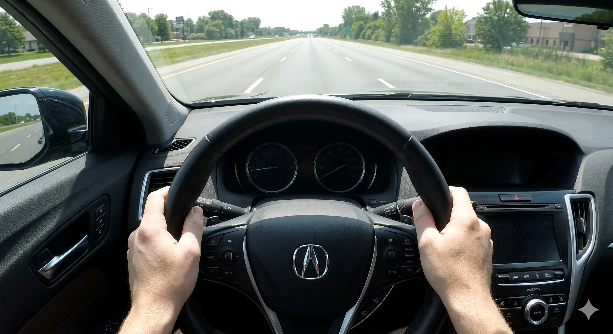

Lors de la livraison d'une voiture neuve, tout conducteur s'attend à une trajectoire rigoureusement rectiligne. Pourtant, certains propriétaires remarquent rapidement qu'en ligne droite, le volant semble « incliné de quelques degrés vers un côté ». S'agit-il d'un défaut de fabrication ou d'un déréglage de la géométrie ?

Ce phénomène est en réalité très fréquent. Avant de suspecter une anomalie d'usine, examinons les quatre causes physiques et techniques les plus répandues.

## 1. La Conception des Chaussées : Le Devers d'Évacuation (Road Crown)
La quasi-totalité des routes n'est pas parfaitement plane. Pour éviter la stagnation d'eau lors d'intempéries, les chaussées adoptent un profil bombé transversal, le centre de la voie étant plus surélevé que les bords extérieurs.

Dans les pays où la circulation se fait sur le côté droit, la gravité entraîne continuellement la masse du véhicule vers le bas-côté droit. Pour conserver une trajectoire rectiligne, le conducteur exerce une micro-compensation instinctive vers la gauche. Cette correction permanente donne l'illusion visuelle que le volant est calé de travers.

## 2. Le Phénomène de « Torque Steer » sur les Tractions
La majorité des berlines et SUV modernes adoptent une disposition mécanique à moteur avant transversal. En raison de l'implantation décalée de la boîte de vitesses, les cardans (arbres de transmission) présentent des longueurs inégales entre le côté gauche et le côté droit.

Lors des fortes sollicitations de l'accélérateur, la torsion des arbres et les angles des biellettes génèrent une transmission de puissance asymétrique sur les roues motrices avant. Ce phénomène, appelé **Torque Steer** (effet de couple de direction), tire fugacement la direction vers un côté. Il s'agit d'une caractéristique cinématique inhérente à l'architecture mécanique, et non d'une défaillance.

## 3. Le Calibrage du « Point Zéro » de la Direction Assistée Électrique (EPS)
Les véhicules modernes sont dotés d'une direction assistée électrique (EPS). Le calculateur central utilise un capteur d'angle de braquage pour identifier la position centrale exacte (0°). Si l'apprentissage usine de ce point neutre présente un écart infime de fraction de degré, ou si la réinitialisation électronique n'a pas été exécutée après un réglage du parallélisme, le moteur électrique peut appliquer une micro-assistance involontaire, procurant une sensation de volant décalé.

## 4. Les Plages de Tolérance Géométrique d'Usine
Sur les chaînes de montage, le réglage du parallélisme, du carrossage et de la chasse n'est pas un point mathématique unique, mais une **plage de tolérances autorisées**. Si un véhicule sort d'usine calé sur la limite haute ou basse de cette plage, et que les silentblocs de suspension se tassent légèrement au cours des premiers milliers de kilomètres, un léger tirage directionnel peut se manifester.

## Comment Vérifier et Résoudre le Problème ?
Si vous ressentez une anomalie au volant, réalisez ce test méthodique :
1. Choisissez une **voie fermée, plane et dépourvue de devers d'écoulement** (grand parking dégagé ou section d'asphalte parfaitement horizontale).
2. Stabilisez votre allure à vitesse modérée et relâchez le volant avec prudence.
3. Si le véhicule conserve sa trajectoire rectiligne mais que la branche du volant est inclinée, il s'agit d'un décalage d'alignement ou de capteur EPS.
4. Si la voiture plonge immédiatement vers un fossé, contrôlez en premier lieu **la pression à froid des quatre pneumatiques**.

Si la dérive persiste, rendez-vous en concession. Un technicien qualifié vérifiera la géométrie sur banc laser 3D et exécutera une **réinitialisation du point zéro de l'EPS** via la valise de diagnostic pour retrouver un centrage parfait.
