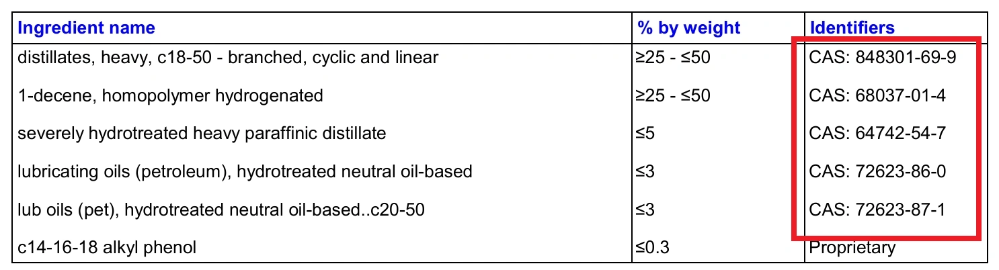

Lors du choix d'une huile moteur, de nombreux automobilistes et passionnés s'interrogent : l'appellation commerciale « 100% Synthèse » masque-t-elle une véritable base PAO (Groupe IV), des Esters (Groupe V) ou une huile minérale hydrocraquée VHVI (Groupe III) ? Le moyen le plus fiable et impartial pour percer les secrets de formulation d'un lubrifiant consiste à analyser sa **Fiche de Données de Sécurité (FDS / SDS)**.

<figure>
  
  <figcaption align="center">Illustration : FDS Mobil 1 0W-40</figcaption>
</figure>

Dans une FDS, chaque composé chimique est identifié par un identifiant universel : le **Numéro CAS (Chemical Abstracts Service)**, véritable numéro d'immatriculation de la matière. Ce guide vous fournit un tableau récapitulatif complet des numéros CAS des principales huiles de base (Groupes I à V) et des additifs de pointe (ZDDP, modificateurs de friction MoDTC, détergents, dispersants).

  <label for="casSearchInput" style="font-weight: bold; margin-right: 10px;">Recherche Instantanée :</label>
  <input type="text" id="casSearchInput" placeholder="Entrez un numéro CAS (ex. 68037-01-4)" style="padding: 8px; width: 250px; border: 1px solid #ccc; border-radius: 4px;">
  <button onclick="searchCAS()" style="padding: 8px 15px; background-color: #04384c; color: white; border: none; border-radius: 4px; cursor: pointer;">Rechercher</button>
  

| Catégorie de Base / Additif | Numéro CAS | Description Chimique |
| :--- | :--- | :--- |
| **Groupe IV (Synthèse PAO)** | 68037-01-4 | 1-Décène, homopolymère hydrogéné |
| | 68649-12-7 | Tétramère de 1-décène mélangé avec trimère de 1-décène, hydrogéné |
| | 68649-11-6 | 1-Décène, dimère hydrogéné |
| | 163149-29-9 *(et 8002-05-9)* | 1-Décène, homopolymère hydrogéné ; copolymères d'oléfines C8, C12 |
| | 151006-63-2 | 1-Dodécène, homopolymère hydrogéné |
| | 151006-62-1 | 1-Dodécène, trimère hydrogéné |
| | 151006-60-9 | 1-Dodécène polymérisé avec 1-décène, hydrogéné |
| | 163149-28-8 | 1-Décène polymérisé avec 1-octène et 1-dodécène, hydrogéné |
| **Groupe III (GTL Gas-to-Liquid)**| 848301-69-9 | Distillats de synthèse Fischer-Tropsch, lourds, C18-50 ramifiés et linéaires |
| | 1262661-88-0| Distillats de synthèse Fischer-Tropsch, lourds, C18-50 ramifiés |
| **Groupe III (Hydrocraquage VHVI)** | 64741-89-5 | Huiles de base paraffiniques hautement hydrotraitées |
| | 64742-54-7 | Huiles de base paraffiniques lourdes hautement hydrotraitées |
| | 64742-55-8 | Huiles de base paraffiniques légères hautement hydrotraitées |
| | 64742-70-7 | Huiles paraffiniques déparaffinées catalytiquement |
| | 72623-87-1 | Hydrocarbures paraffiniques sévèrement hydrotraités (C20-50) |
| | 72623-85-9 | Huiles lubrifiantes neutres hydrotraitées haute viscosité |
| | 72623-86-0 | Huiles de base neutres hydrotraitées |
| | 178603-64-0 | Gasoils sous vide hydrocraqués et hydroisomérisés C15-30, haut indice VI |
| | 178603-65-1 | Gasoils sous vide hydrocraqués et hydroisomérisés C20-40, haut indice VI |
| | 178603-66-2 | Gasoils sous vide hydrocraqués et hydroisomérisés C25-55, haut indice VI |
| **Groupe I / II (Bases Minérales)** | 64741-50-0 | Distillats paraffiniques légers |
| | 64741-50-5 | Distillats pétroliers légers de raffinage |
| | 64741-52-2 | Distillats naphténiques légers |
| | 64742-65-0 | Distillats paraffiniques lourds déparaffinés au solvant |
| | 64742-58-1 | Huiles lubrifiantes hydrotraitées régénérées |
| | 64742-56-9 | Distillats paraffiniques légers déparaffinés au solvant |
| | 64742-62-7 | Huiles résiduelles déparaffinées au solvant |
| **Groupe V (Esters / Divers)** | 27178-16-1 | Adipate de di-isodécyle |
| | 16958-92-2 | Huiles de base synthétiques de type ester |
| | 28472-97-1 | Azélate de di-isodécyle (base di-ester) |
| | 9003-13-8 | Polyalkylène glycol (PAG) |
| **Additifs Anti-usure (ZDTP / ZDDP)** | 68649-42-3 | Dialkyldithiophosphate de zinc ZDTP |
| | 84605-29-8 | Sels de zinc de l'acide phosphorodithioïque, esters bis(1,3-diméthylbutyle et iso-Pr) |
| **Modificateurs de Friction (MoDTC / MoDTP)**| 68958-92-7 | Dithiophosphate de molybdène |
| | 68958-92-9 | Di(2-éthylhexyl)phosphorodithioate de molybdène |
| **Antioxydants**| 36878-20-3 | Bis(nonylphényl)amine |
| | 128-39-2 | 2,6-di-tert-butylphénol |
| **Détergents**| 61789-86-4 | Sulfonate de calcium pétrolier |
| | 68783-96-0 | Sulfonates de calcium surbasés |
| | 115733-09-0 | Phénate sulfure d'alkyle à chaîne longue et calcium |
| **Dispersants** | Sans CAS | Succinimide de polyoléfine polyamine, polyol |
| | 296-404-1 *(N° CE)*| Esters d'acide phosphorique |
| | 84605-20-9 | Polyisobutylène succinimide (PIBSI) |
| **Améliorants de Viscosité (VM)** | 25038-36-2 | Copolymère d'oléfines (OCP) |
| | 127883-08-3 | Polyoléfine aromatique éthylène/propylène |
| **Abaisseurs de Point d'Écoulement (PPD)** | Sans CAS | Polyméthacrylate d'alkyle (PMA) |
| **Antimousse**| 63148-62-9 | Polydiméthylsiloxane (huile de silicone) |

## Références Techniques
* [Étude de la composition des huiles - Bases PAO, GTL, Hydrocraquage VHVI, Esters - Forum Oil-Club.ru](https://www.oil-club.ru/forum/topic/2120-izuchaem-sostav-masla-pao-group-iv-gtl-gidrokreking-vhvi-group-iii-mineralnoe-maslo-group-i-ili-ii-estery-itd/page/31/)
