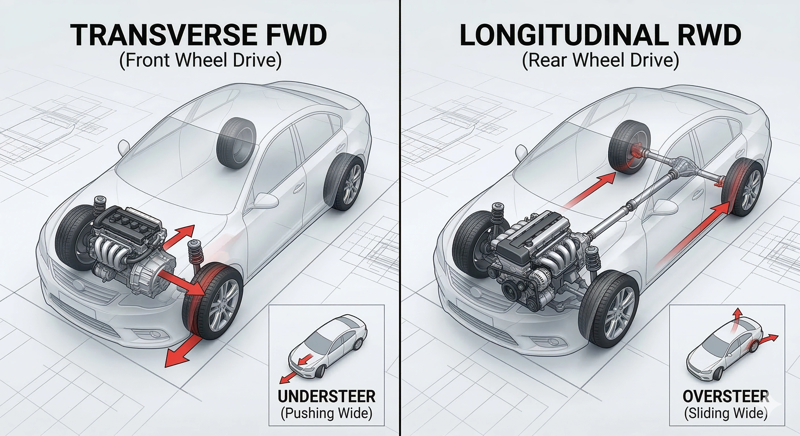

À la suite de notre précédente analyse sur la dérive du volant, de nombreux lecteurs s'interrogent sur les différences dynamiques fondamentales entre une architecture « Traction Avant » et une « Propulsion Arrière ». Voyons comment ces deux approches structurent radicalement votre expérience au volant.

## 1. La Traction Avant Transversale (FWD) : L'Optimisation de l'Espace
Comme son nom l'indique, le moteur est positionné transversalement à l'avant et transmet son couple directement aux roues antérieures. C'est la configuration universelle des citadines, berlines compactes et de la plupart des SUV familiaux.

**Caractéristiques et Dynamique Routière :**
* **Habitabilité Maximale :** L'absence d'arbre de transmission traversant le châssis vers l'essieu arrière permet d'offrir un plancher arrière plat et un volume de coffre généreux.
* **Motricité Sereine au Quotidien :** Le poids du moteur et de la boîte repose directement au-dessus des roues motrices, garantissant une bonne motricité au démarrage sur bitume mouillé ou enneigé.
* **La Limite du « Sous-Virage » :** Les pneus avant cumulent deux fonctions antagonistes : la transmission de la puissance et le guidage directionnel. En entrée de virage trop appuyée, le train avant sature et glisse vers l'extérieur de la courbe : c'est le **sous-virage**.
* **L'Effet de Couple (Torque Steer) :** Sur les tractions puissantes, les demi-arbres de longueurs inégales peuvent engendrer des tiraillements au volant lors des fortes relances.

## 2. La Propulsion Arrière Longitudinale (RWD) : L'Éloge du Toucher de Route
Dans cette configuration noble, le moteur est implanté longitudinalement dans l'axe de la voiture, et la force motrice est acheminée à l'essieu arrière via un arbre de transmission central. C'est l'architecture reine des berlines de prestige et des sportives de race.

**Caractéristiques et Dynamique Routière :**
* **Répartition des Masses Idéale :** L'alignement longitudinal permet de reculer le bloc-moteur derrière l'essieu avant. Associé au différentiel arrière, le châssis approche la perfection d'un équilibre des masses **50:50**, réduisant l'inertie en entrée de courbe.
* **Séparation Rigoureuse des Rôles :** Le train avant assure exclusivement le guidage, tandis que le train arrière propulse. Chaque train de pneus exploitant son plein potentiel d'adhérence, la direction gagne en précision et en retour d'information.
* **Le Plaisir du « Surviorage » :** À la limite d'adhérence ou sur remise de gaz précoce, l'essieu arrière peut pivoter et amorcer une dérive contrôlée : le **survirage**. C'est cette sensation de poussée dynamique qui fait le bonheur des amateurs de pilotage.
* **Contrainte d'Agencement :** Le passage de l'arbre de transmission impose un tunnel central volumineux qui grignote l'espace aux jambes des passagers arrière.

## Conclusion : Quel Choix Selon Vos Besoins ?

* **Optez pour la Traction (FWD)** si vous privilégiez la sobriété en carburant, l'espace habitable pour la famille et un comportement prévisible et rassurant pour les trajets quotidiens.
* **Optez pour la Propulsion (RWD)** si vous recherchez le plaisir de conduite authentique, la précision chirurgicale de la direction et une stabilité impériale à haute vitesse.

Quel que soit votre mode de transmission, comprendre les limites physiques de votre châssis reste le gage absolu d'une conduite sereine et maîtrisée !
