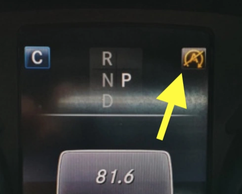

## Les Signes de Défaillance de la Batterie d'Origine

- **Le système Stop-Start Eco disparaît :** L'indicateur le plus limpide est l'icône « A » sur le combiné d'instruments qui demeure jaune ou refuse de couper le moteur aux feux rouges. Le calculateur BMS du véhicule détecte que le niveau de charge ou l'état de santé (SoH) de la batterie AGM est tombé sous le seuil d'activation.
- **Alertes lors de la révision périodique :** Le technicien mesure la capacité restante. Si le testeur annonce une tension résiduelle basse ou un gonflement des flancs de la batterie, son remplacement devient urgent.
- **Démarrages laborieux :** Si l'impulsion du démarreur perd de son mordant et semble hésitante, n'attendez pas la panne totale : le remplacement immédiat vous évitera d'appeler une dépanneuse.

## Tableau Comparatif des Fabricants

| Marque | Origine & Caractéristiques des Cellules | Démarrage d'Urgence | Garantie | Niveau de Prix |
|:---|:---|:---:|:---:|:---|
| **Great Power (GreenRun)** | Cellules OEM de premier rang ([Certification d'incombustibilité auto](https://batteryfinds.com/wp-content/uploads/2021/09/Great-Power-100Ah-Lithium-Iron-PhosphateLiFePO4-LFP-Battery-Cell-Product-Specification.pdf)) | Non | 2 Ans | Compétitif |
| **Houny** | Ancien fabricant OEM Nokia / [Fabrication interne remarquable](https://youtu.be/qL8HSL3h-MU) | Non | 3 Ans | Modéré |
| **Tieli** | Marque émergente / Origine des cellules non précisée | Non | 2 Ans | Modéré |

## Pourquoi Choisir la Green Run 2 (Cellules Great Power)

- **Rejet des ateliers artisanaux sans traçabilité :** J'exclus délibérément les assembleurs sans usine certifiée qui fondent leur réputation sur du marketing sans données d'ingénierie.
- **Sécurité intransigeante :** Great Power utilise des cellules prismatiques dotées de véritables certifications d'incombustibilité automobile. Pour un organe placé sous le capot moteur, la sécurité ne se négocie pas.
- **Rapport investissement/performance :** Elle apporte le compromis idéal pour fiabiliser la W205 sans engager les budgets démesurés des modèles de compétition.

### Avantages Majeurs du LiFePO4 face au Plomb AGM :
1.  **Gain de Masse :** Près de **20 kg gagnés** sur le train avant, ce qui aiguise immédiatement l'agilité directionnelle dans les enchaînements de virages.
2.  **Stabilité de Tension :** Une tension de décharge linéaire et plus élevée procure une étincelle plus vive à l'allumage et des passages de rapports plus fluides.
3.  **Longévité Supérieure :** Capable de tenir 5 à 10 ans sans faiblir, alors qu'une batterie AGM surchauffée dans un compartiment moteur étroit cède souvent au bout de 2 à 3 ans.

### **Recommandation pour la Pose**
Utilisez impérativement un **boîtier de maintien de tension sur prise OBD-II** pendant la dépose/pose. L'architecture électronique de la Mercedes W205 est très sensible aux coupures de courant franches. Une alimentation continue vous évitera la perte des mémoires de vitres, de toit ouvrant et l'effacement des paramètres de confort.
