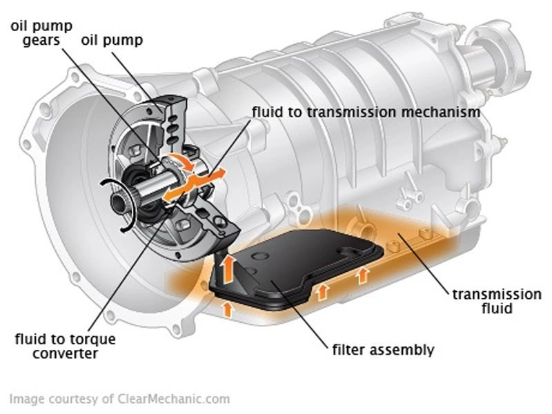
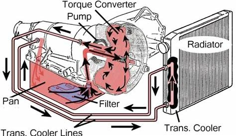

<iframe width="560" height="315" src="https://www.youtube.com/embed/zcwG97VMOVk?si=svbJ4WHcnP2I0Zgr&amp;start=410" title="YouTube video player" frameborder="0" allow="accelerometer; autoplay; clipboard-write; encrypted-media; gyroscope; picture-in-picture; web-share" referrerpolicy="strict-origin-when-cross-origin" allowfullscreen></iframe>

L'animation ci-dessus illustre clairement le parcours de circulation du fluide de transmission (ATF) :
- La **Pompe à Huile** aspire le fluide logé dans le **Carter d'huile (Sump)**. Le fluide traverse d'abord le **Filtre / Crépine**, puis se divise en deux circuits d'écoulement principaux :
  - Un premier circuit alimente le **Convertisseur de Couple**.
  - Un second circuit alimente les **Mécanismes d'Engrenages et le Corps de Soupape (Bloc Hydraulique)**.
- Le fluide lubrifie et commande les organes internes avant de **retomber par gravité dans le carter d'huile**.

### Schémas Hydrauliques du Circuit de Transmission
 

Cette architecture hydraulique est strictement comparable à la **lubrification d'un moteur thermique** :
- **Dès que la pompe aspire l'huile, la première étape obligatoire est le passage à travers le filtre.**
- Cela garantit que seul un fluide propre et exempt de résidus abrasifs atteint les composants de haute précision (tiroirs hydrauliques, solénoïdes et paliers).

## L'Importance Vitale du Filtre de Boîte

Beaucoup d'automobilistes s'inquiètent en découvrant des dépôts de boue ou de fines particules au fond du carter lors d'une vidange. Tant que le **filtre** remplit son rôle, ces impuretés demeurent piégées au fond du carter ou dans le média filtrant, sans contaminer le corps de soupape hypersensible.

### Les Différentes Conceptions de Filtration :

1.  **Crépines Métalliques Traditionnelles :** Elles utilisent une maille métallique fine. Efficaces contre les gros débris et fragments d'usure, elles laissent cependant passer les boues d'embrayage microscopiques.
2.  **Systèmes à Double Filtre (Haute Performance / Véhicules Récents) :** Ils associent une crépine métallique dans le carter à un **Élément Filtrant en Papier** secondaire externe ou dédié. Cette configuration offre une protection optimale aux électrovannes proportionnelles.
3.  **Filtres Internes Non Remplaçables :** Certains fabricants installent le filtre au centre du carter de transmission scellé. Son remplacement exige une dépose et un démontage intégral de la boîte.

### **La Controverse des Filtres « Sans Entretien à Vie »**

Lorsqu'une boîte de vitesses est conçue avec un filtre inaccessible en entretien régulier, la saturation progressive du média filtrant condamne le système à une dégradation certaine. Cette orientation technique est vivement dénoncée par les spécialistes comme une forme d'**Obsolescence Programmée**—un compromis privilégiant une baisse artificielle des coûts d'entretien affichés au détriment de la longévité mécanique réelle du véhicule.

### En Conclusion :
Lors de l'entretien d'une boîte automatique, **vidanger l'huile ne représente que la moitié du travail.** Si la conception de votre véhicule le permet, **remplacez systématiquement le filtre ou la crépine.** Préserver la propreté des « reins » de votre boîte de vitesses est l'unique garantie de faire durer le corps de soupape et le convertisseur sur des centaines de milliers de kilomètres.
