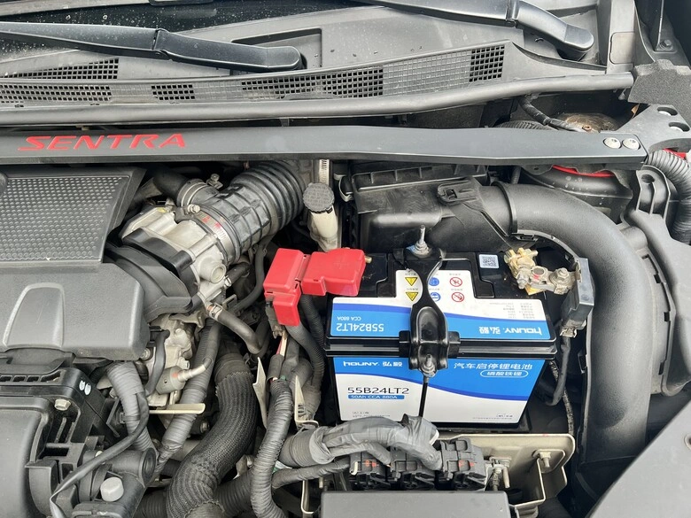
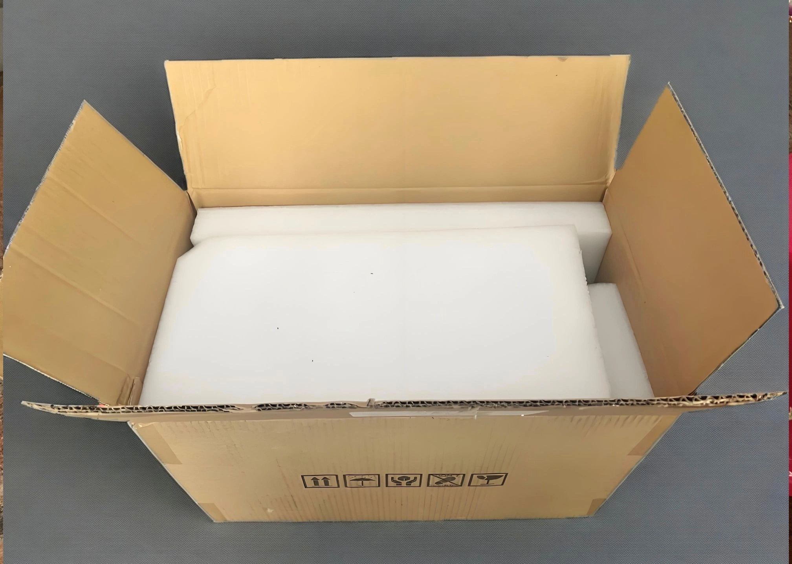
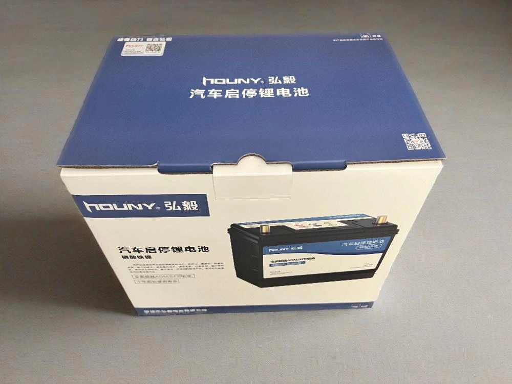
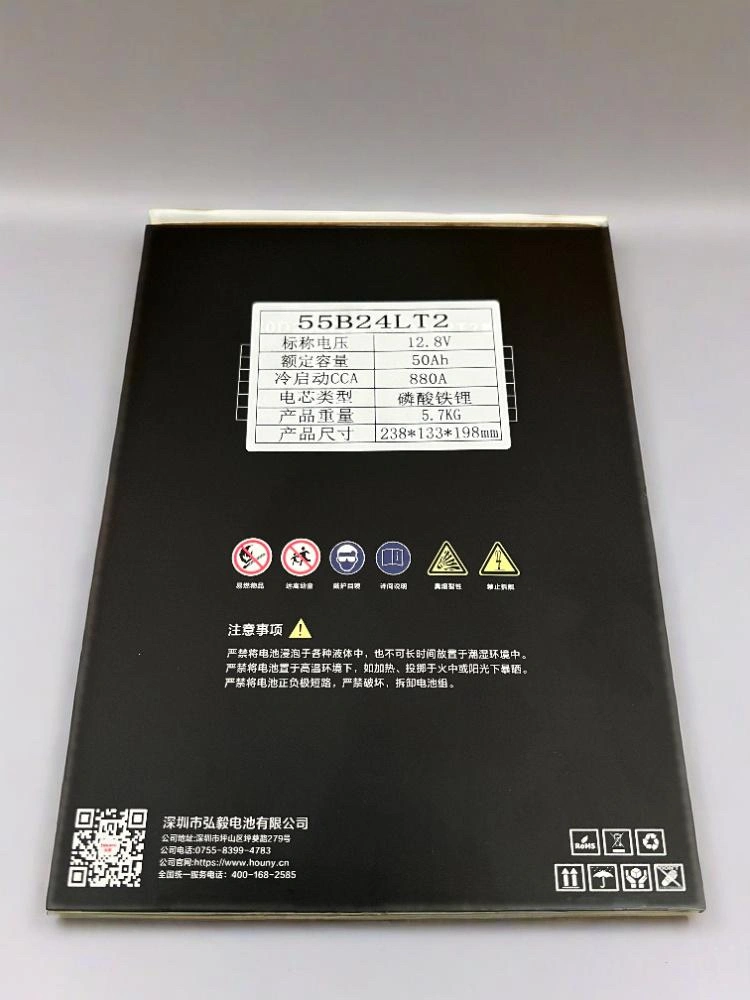
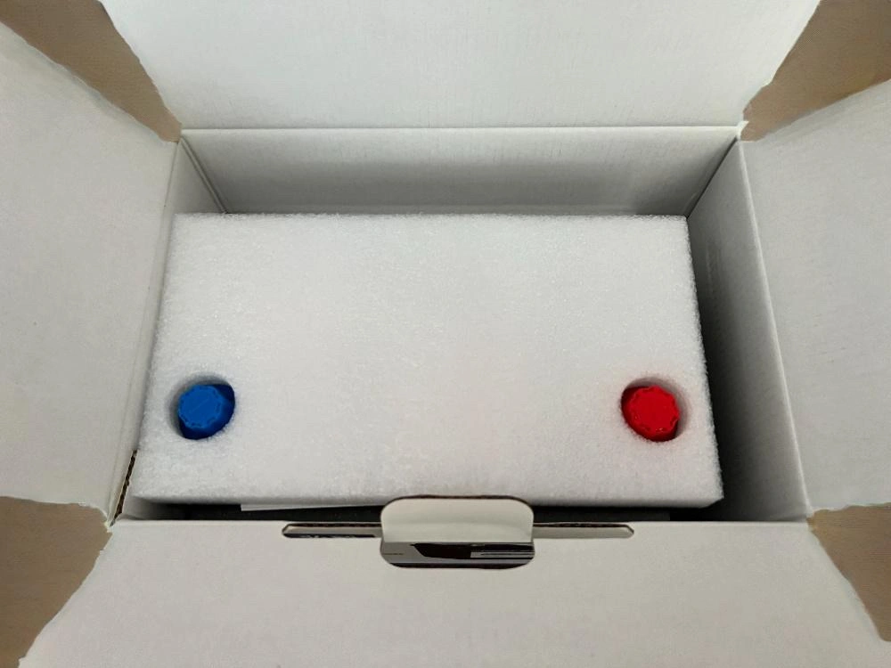
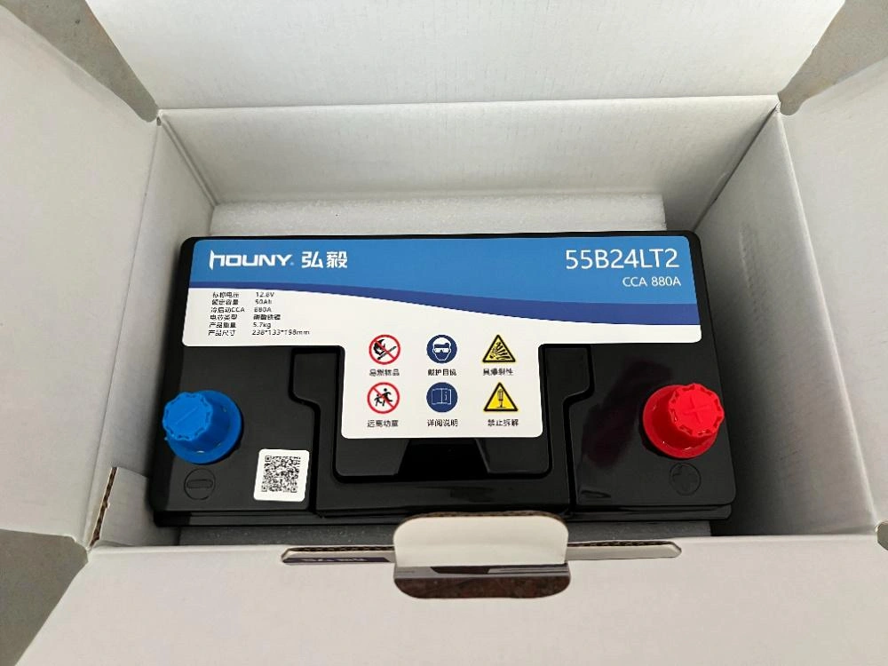
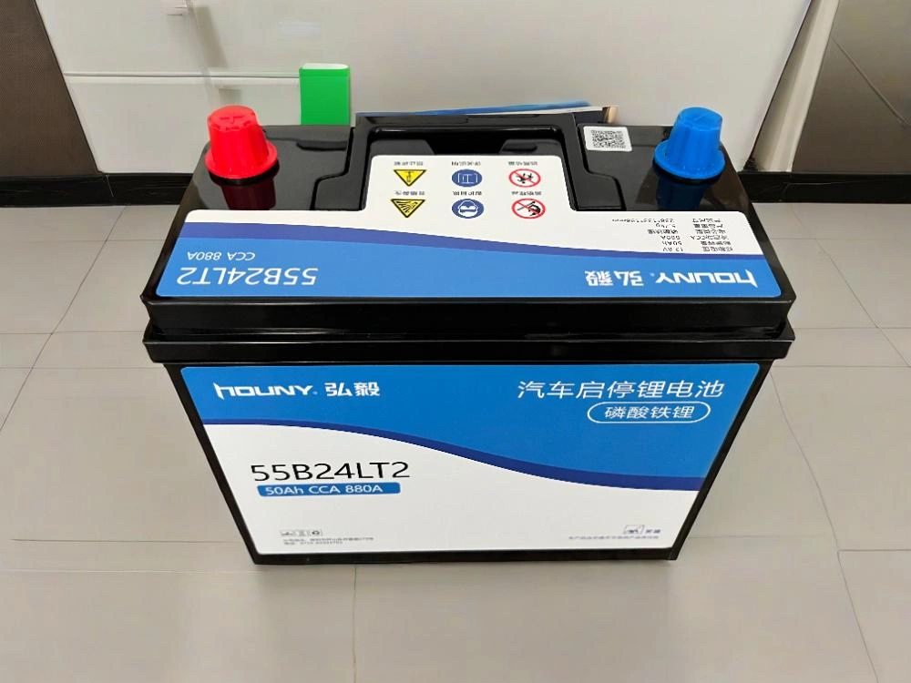
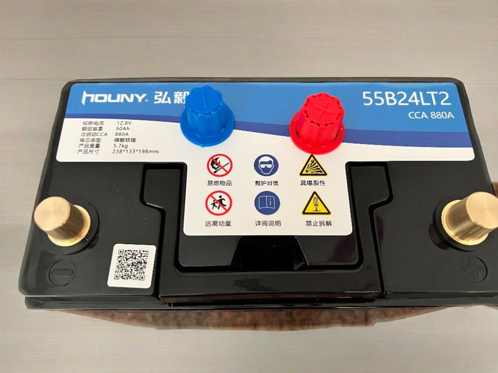
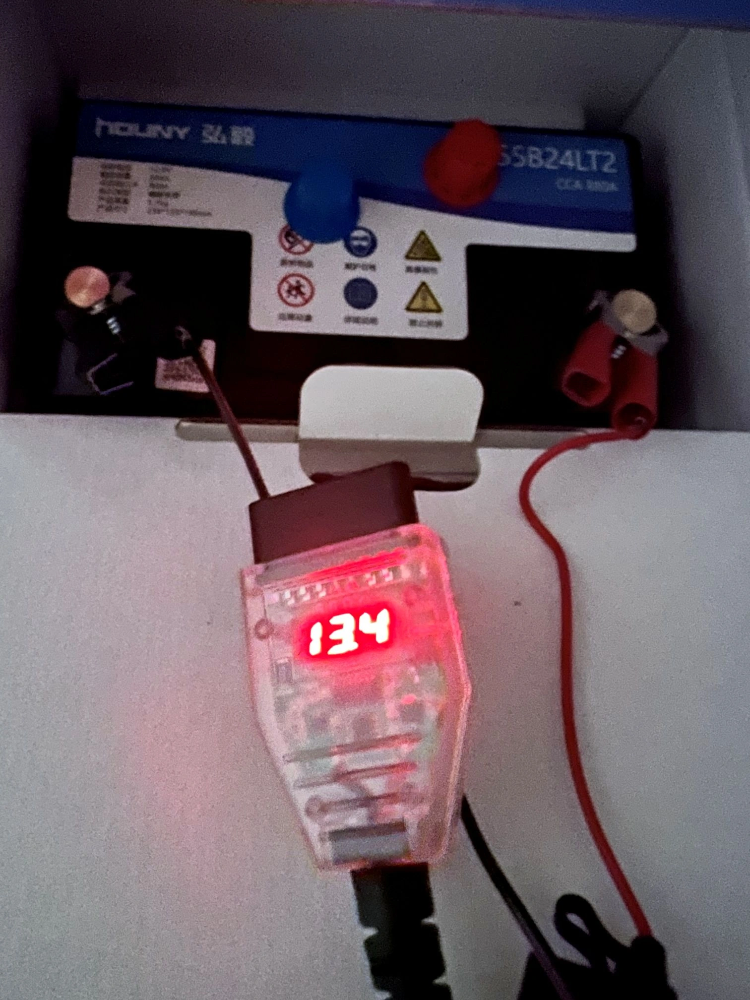
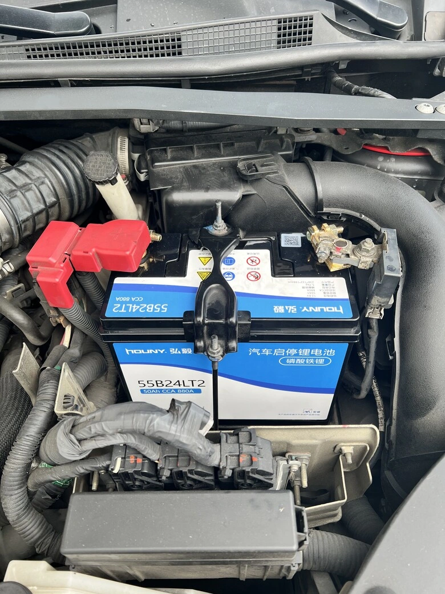

**Modèle du Véhicule** : NISSAN SENTRA B17  
**Marque de la Batterie** : [Batterie Houny (Houyi)](https://www.houny.cn/)  
**Référence Modèle** : 55B24LT2, 50Ah  

## Contexte du Choix

Ces dernières années, notre famille est progressivement passée aux [batteries lithium-fer GreenRun](/fr/2025/greenrun.html). Qu'il s'agisse de l'agrément de conduite ou de la longévité, la satisfaction a été totale. La batterie au plomb Panasonic CAOS Blue installée sur cette SENTRA commençant à montrer des signes de fatigue après plus de trois ans de service, nous avons saisi l'opportunité pour basculer vers une technologie LiFePO4.

Cependant, le choix de batteries LiFePO4 au format standard japonais reste restreint sur le marché local, reposant souvent sur des assembleurs individuels aux garanties incertaines. Bien que le marché chinois propose de nombreuses marques 12V, certaines affichent des capacités mensongères ou une qualité douteuse. Après de rigoureuses comparaisons, nous avons jeté notre dévolu sur **Houny**, pour plusieurs raisons déterminantes :

- Ancien **sous-traitant OEM pour les batteries de téléphones mobiles Nokia**, bénéficiant d'un bagage technologique éprouvé.  
- Fabrication sous contrat (OEM) de modules de stockage stationnaire pour des marques européennes et américaines réputées.  
- Très bonne réputation auprès de la communauté technique comme [marque authentique et rigoureuse](/images/houny-lifepo4-battery-netizen-review.webp).  
- Vidéos de démontage public, notamment [sur ce reel Facebook](https://www.facebook.com/reel/670416912191093), mettant en valeur une fabrication interne soignée ; sa sécurité a également été validée par des tests destructifs sévères ([voir cette vidéo](https://www.facebook.com/reel/1804670450453719)).  
- Présence désormais d'un [distributeur à Taïwan](https://imgur.com/a/mkuKuAg) et garantie d'usine de trois ans.

Grâce à une profondeur de décharge (DoD) admissible nettement plus élevée, les batteries LiFePO4 délivrent une capacité utile équivalente à 1,6 fois celle du plomb : un accumulateur LiFePO4 de 50Ah égale donc sans peine une batterie au plomb de 80Ah, garantissant une réserve de puissance très confortable.

## Détails du Déballage

### Protection de l'Emballage
  
*L'intérieur du carton d'expédition est garni d'une mousse haute densité assurant une excellente protection antichoc.*

  
*Le carton intérieur bénéficie d'une impression soignée et d'une rigidité exemplaire.*

  
*Étiquette détaillée des spécifications sur le côté du coffret.*

  
*À l'ouverture du carton intérieur, une épaisse protection de mousse recouvre l'ensemble.*

  
*Aperçu de la batterie après retrait de la première couche de mousse.*

### Corps du Pack Batterie
  
*Aspect général et boîtier robuste de la batterie.*

  
*Les plots de bornes positive et négative adoptent le standard européen épais.*

## Opération de Montage

### Outillage Nécessaire
1. Clé ou douille en L de 10 mm [/images/L-socket.webp](/images/L-socket.webp)  
2. [Boîtier de sauvegarde mémoire OBD](/fr/2025/memory-saving-battery.html) (pour conserver l'alimentation sans perte de données de l'ECU)  
3. Booster ou batterie 12V d'appoint avec câbles

### Remarque : L'Imprévu du Diamètre des Bornes
En commandant ce modèle, nous avons découvert un détail non anticipé : **la différence de diamètre des plots polaires** :  
- La majorité des véhicules en Chine continentale utilisent de **grosses bornes coniques européennes (19,5 mm / 17,9 mm)**.  
- Les japonaises (comme la SENTRA) requièrent de **petites bornes coniques JIS (14,7 mm / 13 mm)**.

Bien que le fabricant propose une déclinaison à petites bornes, il nous a fallu commander un jeu d'adaptateurs réducteurs usinés en cuivre pur (grosses vers petites bornes), ce qui a repoussé l'installation d'une semaine.

### Procédure d'Installation
Le remplacement a finalement été réalisé sans coupure grâce au boîtier mémoire branché sur le port OBD.

  
*Vérification de la tension via la prise OBD avant pose : la batterie neuve affiche 13,4 V à réception.*

## Montage Finalisé et Retour d'Expérience

  
*Installation achevée dans le compartiment moteur.*

Impressions initiales :
- **Qualité de Finition** : Emballage particulièrement rigoureux et boîtier de batterie impeccablement assemblé.  
- **Comportement Électrique** : Après montage, le BMS stabilise très rapidement la tension de veille.  
- **Démarrage Moteur** : La réactivité au coup de clé est instantanée, beaucoup plus dynamique qu'avec l'ancienne batterie au plomb.  
- **Durabilité** : Il conviendra d'observer si la longévité rivalise à terme avec les produits taïwanais de chez [GreenRun](/fr/2025/greenrun.html).

Après six mois d'utilisation :  
Les occupants du véhicule confirment que les légères hésitations occasionnelles observées sur la boîte de vitesses avant le changement de batterie ne se sont plus jamais manifestées depuis le passage à la batterie LiFePO4.
