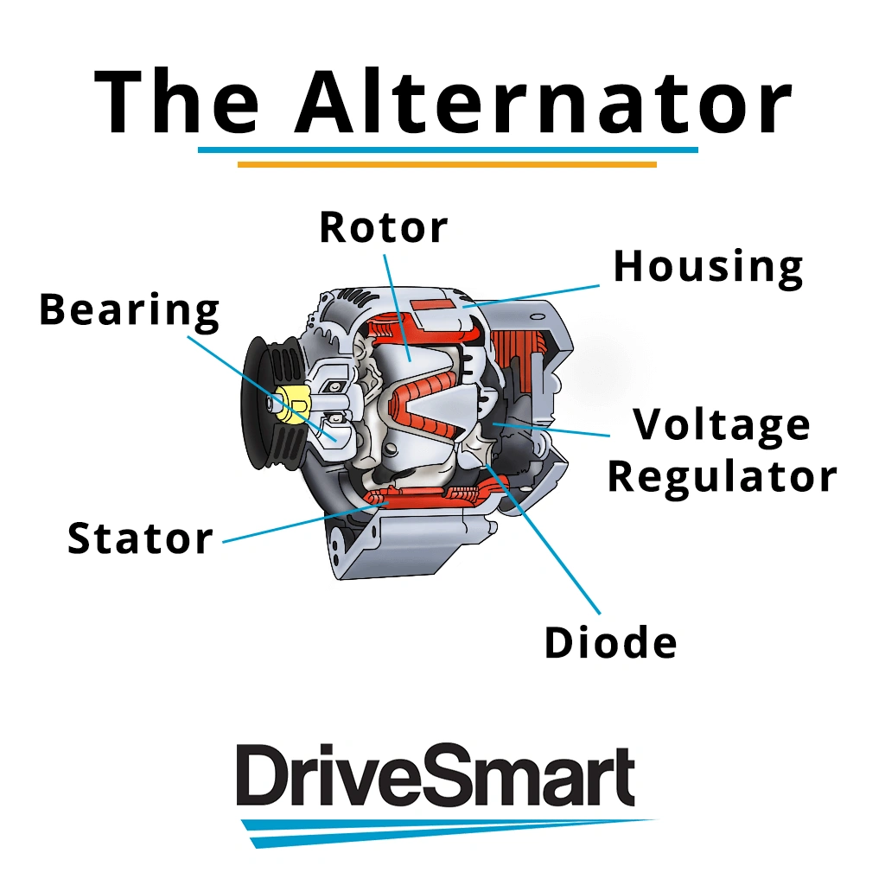
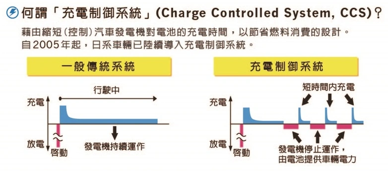

### Facteurs Déterminant la Longévité de l'Alternateur

Les principaux éléments d'usure qui conditionnent la durée de vie utile d'un alternateur sont :

- **Balais de Charbon (Charbons)** : Soumis à une friction continue contre les bagues collectrices lors de la rotation.  
- **Roulements à Billes** : Sujets à l'usure mécanique et aux contraintes thermiques avec les kilomètres.  
- **Pont Redresseur (Diodes)** : Convertit le courant alternatif triphasé en courant continu ; sa défaillance survient généralement par échauffement.

## Système de Contrôle de Charge Intelligent et C-rate

Le rotor d'un alternateur automobile est concrètement un **électro-aimant rotatif**. En faisant varier l'intensité injectée dans le rotor, le régulateur module la production électrique. Lorsqu'une forte recharge est demandée :

- Le champ magnétique s'intensifie → La résistance mécanique du rotor augmente → L'effort sur le vilebrequin s'accroît → **La consommation de carburant augmente.**

Afin de réduire la consommation et les émissions de CO₂, les constructeurs automobiles modernes ont généralisé le **Contrôle de Charge Piloté (Charging Control System - CCS)** :  
L'alternateur ne génère un débit élevé que lorsque la batterie est en demande. Dès que la batterie atteint sa tension cible, le régulateur coupe ou minimise le courant dans le rotor, permettant à l'alternateur de **tourner en quasi-roue libre sans résistance magnétique**.

### Comment le C-rate Détermine l'Efficacité de la Charge

Le C-rate désigne la vitesse à laquelle un accumulateur peut « engloutir » ou restituer du courant proportionnellement à sa capacité :

- **Batterie à C-rate Élevé (ex. LiFePO4)** : Si l'alternateur envoie 10A, la batterie peut en absorber 8A instantanément.  
- **Batterie à Faible C-rate (ex. Plomb-acide)** : Si l'alternateur envoie 10A, la batterie plomb ne peut en accepter que 2A en raison de sa forte résistance interne.

Parce qu'une batterie à haut C-rate absorbe l'énergie à une vitesse très supérieure, le cycle de recharge s'achève beaucoup plus vite. L'alternateur repasse rapidement en mode « roue libre », épargnant au moteur thermique un effort parasite prolongé. Cela se traduit par une **économie sensible de carburant** et une **diminution de l'usure par étincelage des balais de charbon**.

## Pourquoi le Titanate de Lithium (LTO) n'est pas Toujours la Panacée

Bien que le **Titanate de Lithium (LTO)** offre un C-rate encore plus spectaculaire et une résistance exceptionnelle aux cycles extrêmes, il présente des limites concrètes comme batterie de démarrage 12V :

1.  **Inadéquation de la Plage de Tension** : Avec une tension nominale de 2,3V à 2,4V par élément, un montage 5S culmine à ~14,0V (souvent trop bas pour la charge d'égalisation automobile) et un 6S requiert ~16,2V (incompatible avec le circuit 14,4V du véhicule).
2.  **Densité Énergétique Inférieure** : Pour une capacité identique, une batterie LTO est nettement plus lourde et volumineuse qu'un pack LiFePO4.
3.  **Coût Élevé** : Le rapport coût/bénéfice pour une utilisation de démarrage classique est bien moins avantageux qu'un système LiFePO4 éprouvé couplé à un BMS performant.
