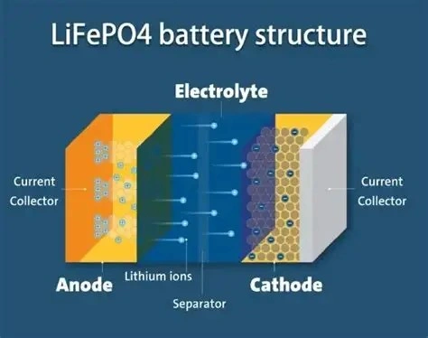

## Temps de Réponse en Décharge de la Batterie

| Type de Batterie | Résistance Interne | Temps de Réponse (0 à 200A) | Caractéristiques de Réaction |
| :--- | :---: | :---: | :--- |
| **LiFePO4 (Lithium Fer Phosphate)** | Très faible | **< 10 ms** | Réponse matérielle quasi instantanée |
| **Plomb-Acide (AGM / EFB / Inondée)** | Élevée | **100 à 500 ms** | Cinétique chimique lente |

De nombreux conducteurs constatent une voiture plus réactive à l'accélération après avoir adopté une batterie au lithium. Il ne s'agit aucunement d'un effet placebo. Du point de vue de la cinétique électrochimique, la vitesse à laquelle la batterie libère ses ampères influe directement sur le **temps de saturation des bobines d'allumage** et la stabilité des calculateurs sous forte charge.

## Pourquoi le LiFePO4 est-il Infiniment Plus Rapide ?

### 1. Haute Réversibilité Électrochimique et Intercalation
Les réactions au sein d'une cellule LiFePO4 fonctionnent par **intercalation et désintercalation** des ions lithium dans la structure cristalline olivine, sans altération destructive de la maille. L'énergie se libère sans résistance cinétique majeure, assurant un débit d'électrons instantané.

### 2. Électrolyte et Résistance Interne Minimale
Les batteries lithium utilisent des **solvants organiques fluorés à haute conductivité ionique** couplés à des collecteurs de courant cuivre/aluminium à très faible impédance. Cela permet d'extraire des centaines d'ampères sans effondrement brutal de la tension en circuit fermé.

### 3. Surface Active Nanostructurée
Le matériau actif de cathode LiFePO4 est manufacturé sous forme de nanoparticules d'une finesse extrême. Cette nanostructuration démultiplie la surface de contact solide-liquide, offrant une multitude de points de réaction simultanés pour les ions.

## Les Verrous Physiques de la Chimie Plomb-Acide

À l'inverse, l'accumulateur au plomb dépend d'un mécanisme de conversion de phase lent et contraignant :
- **Précipitation de Sulfate de Plomb :** Lors du débit de courant, des cristaux de sulfate de plomb (PbSO4) se forment sur les plaques. Ce composé étant hautement isolant électriquement, il fait chuter la conductivité au cœur même de la réaction.
- **Surface Spécifique Limitée :** Les grains de dioxyde de plomb sont grossiers par rapport aux nanopoudres de lithium, limitant le nombre d'ions pouvant réagir à la milliseconde.
- **Résistance de l'Électrolyte Aqueux :** Bien que conducteur, l'acide sulfurique dilué présente une impédance globale et une polarisation de concentration qui expliquent le délai de réaction de 100 à 500 ms.

### Conclusion
Sur les véhicules modernes équipés d'injections directes sophistiquées et de systèmes d'allumage multi-étincelles, une batterie ultrarapide assure aux bougies des décharges d'allumage plus franches, intenses et homogènes. Le résultat se traduit par une **combustion plus complète**, une **réponse à l'accélérateur plus nette** et un rendement moteur accru.
