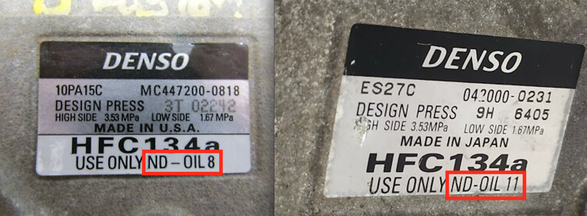

<figure>
  
  <figcaption>Compresseurs Denso : utiliser EXCLUSIVEMENT la série ND (inclut ND-OIL 8 et ND-OIL 11)</figcaption>
</figure>

## Comprendre l'Huile ND8 (ND-OIL 8)

Pour les conducteurs de véhicules japonais comme **Toyota**, **Lexus** ou **Honda**, le compresseur de climatisation est quasi systématiquement conçu par l'équipementier nippon **Denso**. Ces compresseurs haute précision sont usinés pour fonctionner avec un fluide spécifique : l'huile **ND8**. Bien que la ND8 appartienne à la famille générique des lubrifiants **PAG (Polyalkylène Glycol)**, il s'agit d'une formulation sur-mesure ultra-raffinée aux performances très supérieures aux huiles PAG universelles de seconde monte.

## Avantages Clés de la ND8 Face aux Huiles PAG Génériques

### 1. Faible Hygroscopicité et Protection Anti-Corrosion
Les huiles PAG traditionnelles se caractérisent par une forte affinité avec l'eau : elles absorbent avidement l'humidité de l'air ambiant dès que le circuit est ouvert.
* **Le Piège Chimique :** Au contact du fluide frigorigène R134a, les molécules d'eau forment de **l'acide fluorhydrique**.
* **La Solution ND8 :** Grâce à une modification structurelle de ses chaînes polymères, la ND8 résiste efficacement à l'absorption d'humidité. Elle protège ainsi les parois en aluminium du condenseur et les pièces polies du compresseur contre l'attaque acide.

### 2. Miscibilité Parfaite avec le Fluide HFC-134a
Dans un circuit frigorifique, l'huile est entraînée par le gaz à travers tout le circuit et doit impérativement regagner le carter du compresseur. La viscosité et la tension superficielle de la ND8 sont précisément calibrées pour garantir un retour d'huile optimal sans stagner dans l'évaporateur, évitant ainsi le manque d'huile à haut régime.

### 3. Excellente Stabilité à l'Oxydation
Sous les contraintes de température et de pression extrêmes régnant en tête de compresseur, les huiles bon marché s'oxydent, polymérisent et créent des **dépôts boueux ou vernis**. Ces gommes bouchent le détendeur thermostatique. La formule anti-oxydante de la ND8 assure la propreté du circuit durant des centaines de milliers de kilomètres.

## Les Dangers des Huiles « Universelles » Tout-Venant

Certains ateliers de maintenance emploient une huile PAG générique « universelle » (PAG 46 ou PAG 100). Cependant, les compresseurs Denso possèdent des tolérances mécaniques micrométriques :
* **Bruits et Vibrations :** Ronronnement anormal dès l'enclenchement de l'embrayage électromagnétique.
* **Chute de l'Efficacité Frigorifique :** Mauvais échange thermique si un film d'huile trop épais nappe l'évaporateur.
* **Grippage Complet du Compresseur :** La panne la plus onéreuse et contraignante du système d'air conditionné.

## En Conclusion

Lors d'une recharge de gaz ou du remplacement d'un condenseur ou compresseur, exigez formellement de votre réparateur l'utilisation d'huile **Denso ND8 d'origine** (ou ND11 pour les compresseurs électriques de véhicules hybrides). C'est le sang de votre circuit frigorifique, et la meilleure garantie contre une facture de réparation de plusieurs milliers d'euros.
