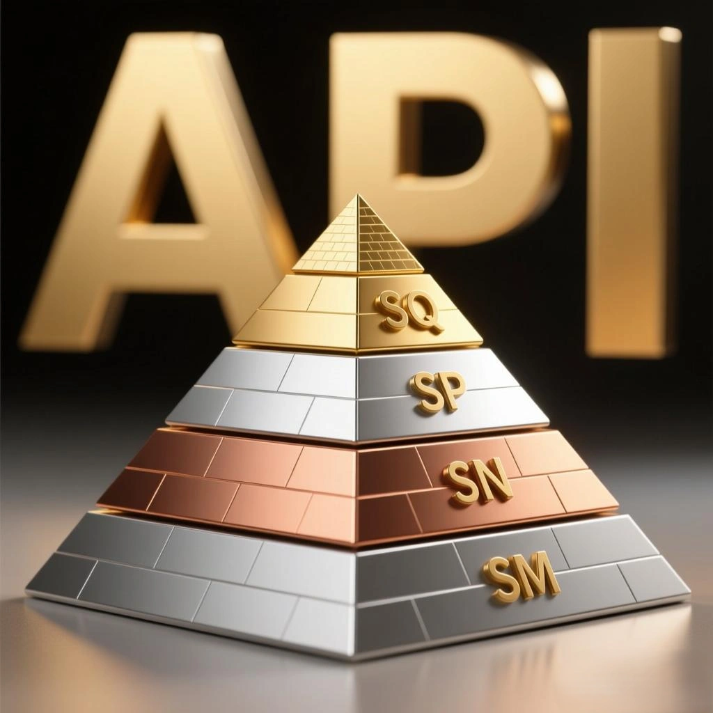

- **Aucune spécification d'huile moteur n'a jamais rabaissé ses exigences : chaque nouvelle norme constitue un bond en avant technique majeur.**
- **Prétendre que « le neuf est moins bon que l'ancien » n'est qu'une pure manœuvre pseudo-scientifique pour écouler des invendus périmés.**

## Tableau Comparatif des Spécifications Techniques

| Catégorie d'Essai (Sequence) | API SM (2004) | API SN (2010) | API SP (2020) | API SQ (2024) |
| :--- | :--- | :--- | :--- | :--- |
| **Dépôts sur Piston (IIIH)** | Non applicable (IIIG) | Pas d'exigence formelle | ≥ 3,5 pts | **≥ 4,0 pts** |
| **Augmentation de Viscosité (IIIH)** | ≤ 275% | ≤ 200% | ≤ 150% | **≤ 125%** |
| **Volatilité de l'Huile (IIIH)** | Non applicable (IIIG) | Pas d'exigence formelle | ≤ 80 mL | **≤ 60 mL** |
| **Boues à Basse Température (VH)** | Piston ≥ 4,0 (VG) | Piston ≥ 5,0 | Piston ≥ 7,6 | **Piston ≥ 8,0** |
| **Usure Distribution (IVB)** | Non applicable (IVA) | Moyenne < 90µm | Perte volume < 2,7% | **Perte volume < 2,3%** |
| **Protection Anti-LSPI (IX)** | Non applicable | Non applicable | Moyenne 0 pré-allumage | **Seuil encore durci** |
| **Usure Chaîne de Distribution (X)** | Non applicable | Non applicable | Allongement ≤ 0,085% | **Allongement ≤ 0,070%** |
| **Compatibilité Carburants** | Standard | Standard | Standard | **Prise en charge E85** |
| **Optimisation Hybride** | Non | Non | Basique | **Prise en charge totale** |

## Analyse Approfondie du Standard API SQ (ILSAC GF-7)

### 1. Pouvoir Détergent et Propreté Inégalée (Sequence IIIH)
Dans l'épreuve reine Sequence IIIH, la note minimale de dépôt sur les gorges de piston passe de 3,5 à **4,0 points**. Les huiles doivent démontrer une capacité de détergence renforcée pour empêcher le gommage des segments et préserver les taux de compression moteur sur de longs intervalles.

### 2. Résistance Maximale à l'Épaississement par Oxydation
L'épaississement toléré de la viscosité sous contrainte thermique est désormais bridé à **125%** maximum. Cela empêche l'huile de se transformer en cambouis dans les carters chauds des mécaniques downsizées et turbocompressées.

### 3. Protection Renforcée de la Chaîne de Distribution
Sur les moteurs à injection directe (GDI), les suies de combustion favorisent l'élongation de la chaîne de distribution. L'API SQ abaisse l'allongement admissible de 0,085% à seulement **0,070%**, évitant les décalages de distribution destructeurs.

### 4. Préservation des Systèmes Antipollution Modernes
L'API SQ garantit une compatibilité chimique totale avec les **Filtres à Particules Essence (GPF/OPF)** et Diesel (DPF), limitant les teneurs en cendres sulfatées, phosphore et soufre (SAPS) pour ne pas empoisonner les catalyseurs.

## Conclusion

De l'API SM à l'API SQ, chaque saut générationnel traduit un niveau de protection moteur, d'économie de carburant et de neutralité environnementale sans équivalent. Lors de vos vidanges, exigez sans hésiter la spécification la plus récente préconisée par votre constructeur. L'**API SQ (GF-7)** n'est pas un slogan publicitaire : c'est un ensemble d'épreuves de banc d'essai drastiques conçues pour sécuriser les moteurs modernes Turbo, Hybrides et à Injection Directe.
