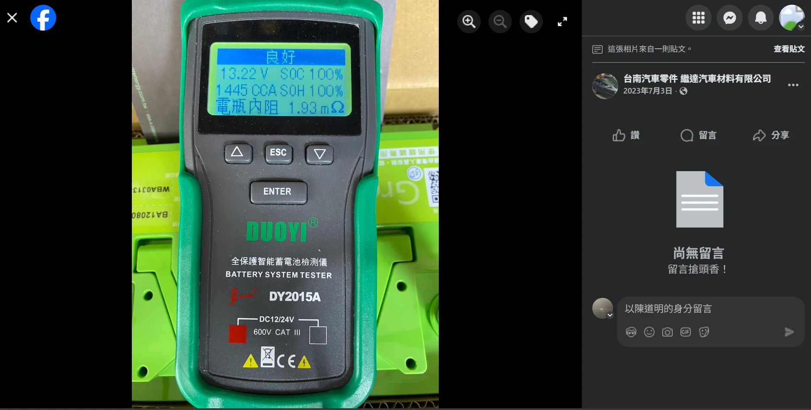
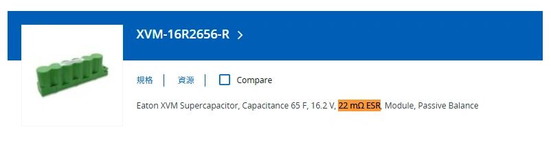

Si vous disposez d'un budget pour optimiser le comportement électrique de votre véhicule, un dilemme se pose souvent :

👉 Devez-vous investir dans un **« Supercondensateur »** additionnel ?  
👉 Ou devez-vous basculer directement vers une **« Batterie LiFePO4 (Lithium Fer Phosphate) »** ?

**Allons droit au but : installer un supercondensateur en parallèle n'est pas seulement un détour coûteux, c'est en pratique une véritable « régression technique ».**

## Principes Fondamentaux : Lois des Circuits en Parallèle et Division du Courant

Avant d'analyser le problème, rappelons deux lois physiques incontournables :

### 1. Formule de Résistance Équivalente en Parallèle
La formule d'impédance totale pour deux générateurs ou résistances en parallèle est : ([Calculateur d'Impédance](/fr/2026/ir-caculator.html))

  RImpédance Totale = 
  
    RBatterie × RCondensateur
    RBatterie + RCondensateur
  

Cette équation impose une réalité : **si l'impédance de l'un des composants est déjà extrêmement basse par rapport à l'autre, le gain sur la résistance totale résultante est négligeable.**

### 2. Principe de Répartition du Courant
Le courant électrique agit comme l'eau : il s'écoule prioritairement par la branche présentant la **résistance interne la plus faible**. Lorsqu'une charge lourde (démarreur, bobines sous pleine charge, sono puissante) réclame un appel d'ampères instantané, c'est l'élément à la résistance la plus basse qui encaisse et fournit la puissance.

## Raison 1 : La Batterie LiFePO4 est Déjà un Monstre de Puissance

Les supercondensateurs ont été popularisés pour pallier les défauts des vieilles batteries au plomb, pénalisées par une [forte résistance interne et une cinétique lente](/fr/2025/lithium-vs-lead-analysis.html)—à l'image d'une mémoire cache placée devant un disque dur mécanique lent.

Or, une batterie LiFePO4 présente nativement :
- [Une résistance interne ultra-basse (2 à 3 mΩ)](/images/greenrun_ir.webp)
- Un taux de décharge instantané phénoménal (50C à 80C)
- [Un temps de réponse ultrarapide (< 10ms)](/fr/2025/lithium-vs-lead-analysis.html)

👉 La capacité d'expulsion de courant d'un pack LiFePO4 **surclasse depuis longtemps le rôle « d'appoint » que pourrait apporter un supercondensateur.**

## Raison 2 : En Pratique, le Supercondensateur Répond Plus Lentement

En théorie physique pure, un condensateur idéal libère son énergie à la vitesse de l'éclair. Mais dans la réalité automobile, un module de supercondensateur commercial exige la mise en série de plusieurs cellules associées à des circuits imprimés d'équilibrage. Cette cascade élève la résistance série équivalente (ESR) du module à **20 ou 30 mΩ**—soit davantage qu'une batterie au plomb en forme ! Lors d'un appel de courant brutal, cette résistance interne élevée provoque une chute de tension immédiate et dissipe l'énergie en pure perte thermique. Sa réactivité pratique est donc inférieure à celle d'une bonne batterie LiFePO4 à 2 mΩ.

## Raison 3 : Le Montage en Parallèle LiFePO4 + Condensateur a un Effet Nul

Appliquons les chiffres réels à la formule du circuit en parallèle :

- Résistance interne DC d'une batterie LiFePO4 : **environ 2 à 3 mΩ**  
  
- Résistance interne d'un module supercondensateur commercial : **environ 20 à 30 mΩ**  
  

En calculant la mise en parallèle d'une batterie LiFePO4 GreenRun avec un supercondensateur réputé (Eaton), la résistance globale n'est abaissée que de **0,15 mΩ seulement**—une paille qui se trouve effacée par la simple résistance de contact des câbles d'interconnexion !  
Selon la loi de division du courant, le courant est délivré à 95% par la batterie LiFePO4. Le condensateur ne sert rigoureusement à rien.

> Remarquez bien les tests publiés par les fabricants de condensateurs : ils comparent systématiquement **« Batterie Plomb + Condensateur vs Plomb Seul »**.  
> Ils ne publient jamais de comparatif **« LiFePO4 + Condensateur vs LiFePO4 Seul »**, car cela prouverait immédiatement qu'ajouter leur boîtier ne change **absolument rien aux performances.**

## Raison 4 : Forte Auto-Décharge des Condensateurs

En plus d'une capacité ridicule et d'une sensibilité maladive à la chaleur, les supercondensateurs souffrent d'une auto-décharge permanente :
- Auto-décharge d'un supercondensateur : **de quelques mA à plusieurs centaines de mA**
- Auto-décharge d'une batterie LiFePO4 : **seulement quelques dizaines de µA** (1 mA = 1000 µA)

Après quelques jours d'immobilisation du véhicule, la tension du condensateur s'effondre. Dès le contact mis, il devient une charge supplémentaire qui « pompe » du courant sur la batterie principale pour se recharger.

## Raison 5 : Risques Liés aux Faisceaux Additionnels

- **Risque d'Installation** : Rajouter des câblages sous le capot expose à des frottements contre les tôles, des faux contacts ou des courts-circuits directs, sans compter le risque de projection du boîtier en cas d'accident.
- **Risque Produit** : Plusieurs défaillances de supercondensateurs ont provoqué des surchauffes sévères et des départs d'incendie.

À l'inverse, la batterie LiFePO4 remplace la batterie d'origine dans son bac constructeur en « plug-and-play » sans modifier le faisceau du véhicule.

## Raison 6 : Le LiFePO4 est Devenu Très Accessible

Par le passé, les cellules LiFePO4 étaient très onéreuses, laissant une place de marché aux condensateurs. Aujourd'hui, les prix ont chuté de manière spectaculaire :
- Batterie automobile LiFePO4 100Ah de marque : environ 350 €
- Batterie moto LiFePO4 5.5Ah : environ 75 €

👉 Puisque les batteries LiFePO4 sont devenues abordables et durables, **pourquoi dépenser des centaines d'euros dans un supercondensateur de 0,3Ah qui craint la chaleur et vampirise du courant ?**

## Raison 7 : Une Capacité Trop Lourde pour le Filtrage Haute Fréquence

Dans le domaine du filtrage antiparasite, **la rapidité d'absorption fréquentielle prime sur la capacité brute**.
- Le supercondensateur réagit avec lenteur face aux harmoniques haute fréquence générées par l'alternateur ou les injecteurs piézoélectriques, à cause de son inductance série parasite (ESL) élevée.
- Pour lisser les micro-ondulations résiduelles, des condensateurs céramiques ou électrolytiques miniatures de quelques microfarads sont infiniment plus véloces et adaptés. Le supercondensateur se révèle inopérant sur les parasites rapides.

## Conclusion : Dépensez Votre Argent avec Discernement

L'époque des supercondensateurs dans le tuning et l'optimisation automobile est révolue :

* **Si vous possédez déjà une batterie LiFePO4** : Le supercondensateur est **totalement inutile** car la batterie est beaucoup plus rapide et puissante que lui.
* **Si vous possédez une batterie au plomb** : Le supercondensateur est **non rentable**, car le coût combiné approche le prix d'une batterie LiFePO4 neuve qui surclassera l'ensemble de la chaîne.

👉 Conservez le budget prévu pour un boîtier condensateur et investissez-le directement dans une **véritable batterie de démarrage LiFePO4 de qualité**. C'est la démarche la plus rationnelle, sécurisante et performante.
