[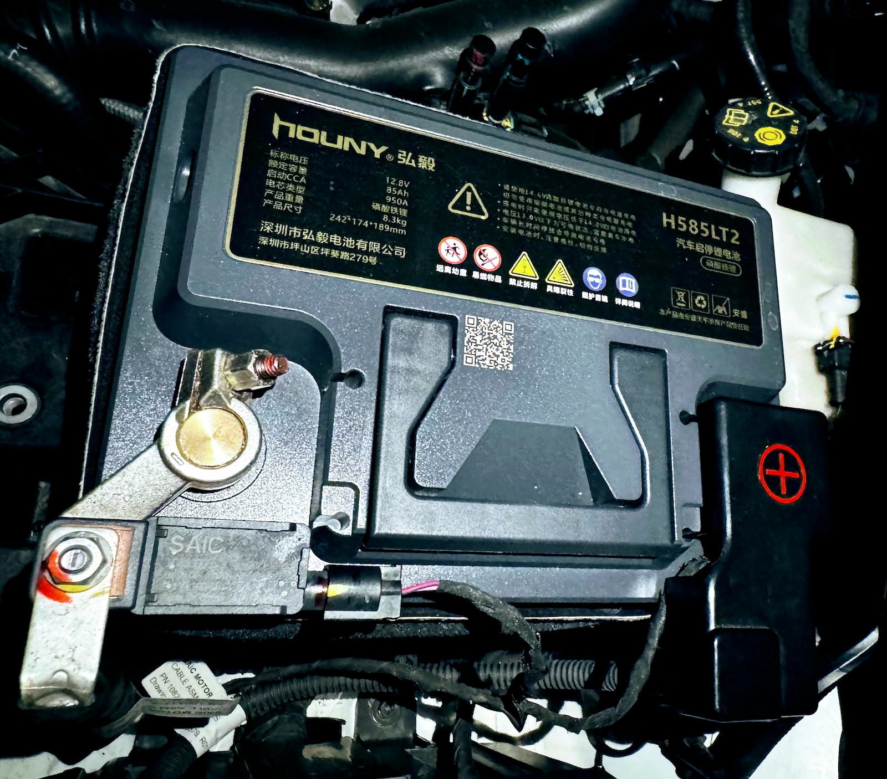](/images/LN2_HY_Install2.webp)

| Élément | Caractéristiques |
| :--- | :--- |
| **Véhicule Concerné** | MG HS 1.5T Version Essence |
| **Marque Retenue** | [Batterie Houny (Houyi)](https://www.houny.cn/) |
| **Référence Modèle** | H585LT2 85Ah (Format LN2) |

## Contexte et Sélection

Il y a quelques années, nous avons équipé notre véhicule familial d'une [batterie LiFePO4 GreenRun](/fr/2025/greenrun.html), avec une satisfaction totale en termes d'agrément de conduite et de longévité. Récemment, un ami propriétaire d'un MG HS 1.5T a constaté que sa batterie au plomb d'origine commençait à faiblir, avec une résistance interne en hausse continue. Après concertation, il a décidé de sauter le pas vers le Lithium Fer Phosphate (LiFePO4).

La batterie d'origine du MG HS est une Sail 6-QW-63MG répondant au standard de dimension **LN2**. Bien que le bac à batterie puisse physiquement accueillir la taille supérieure LN3, ce choix aurait imposé de renoncer à la housse isolante thermique d'origine. Nous avons donc conservé le gabarit LN2 d'origine.

À Taïwan comme ailleurs, le format LN2 souffre d'un choix restreint en LiFePO4 de marque certifiée, le marché étant saturé d'assemblages anonymes ou sans traçabilité. Après examen minutieux, notre choix s'est porté sur **Houny**, un constructeur spécialisé dans les batteries de démarrage lithium assurant la production OEM/ODM pour des donneurs d'ordre occidentaux.

[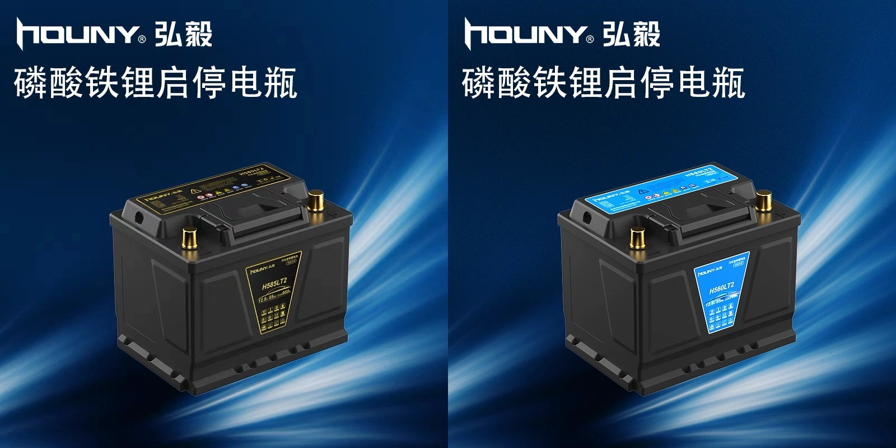](/images/LN2_HY_Type.webp)

Après la refonte de leur gamme 2025 (séries Gold, Blue et Green), nous avons opté pour le modèle Gold 85Ah. Il existe une version 100Ah dans le même boîtier LN2, mais pour un véhicule entièrement d'origine utilisé principalement le week-end, l'équivalence utile d'une **LiFePO4 de 85Ah correspond à une batterie au plomb de 130Ah**, offrant une marge de sécurité royale.

## Déballage et Examen Visuel

[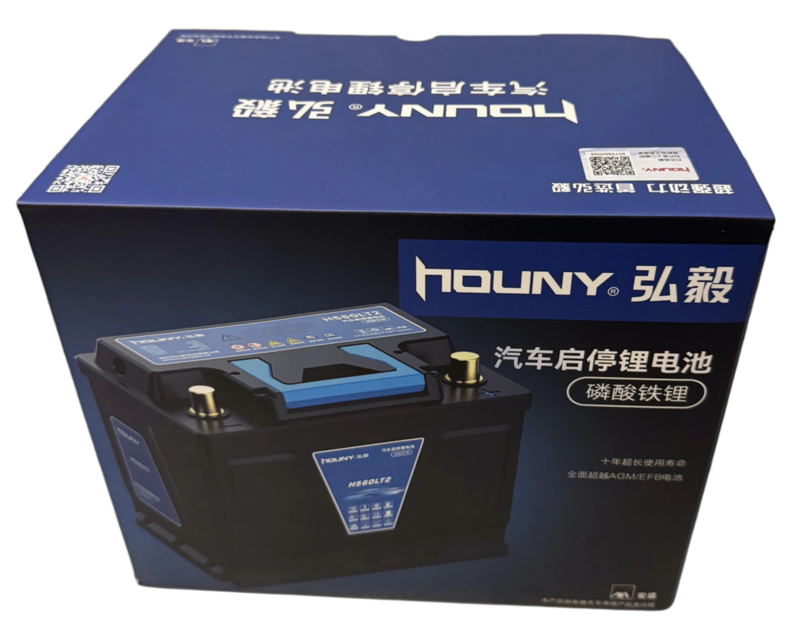](/images/LN2_HY_BOX.webp)  
*Carton d'expédition robuste*

[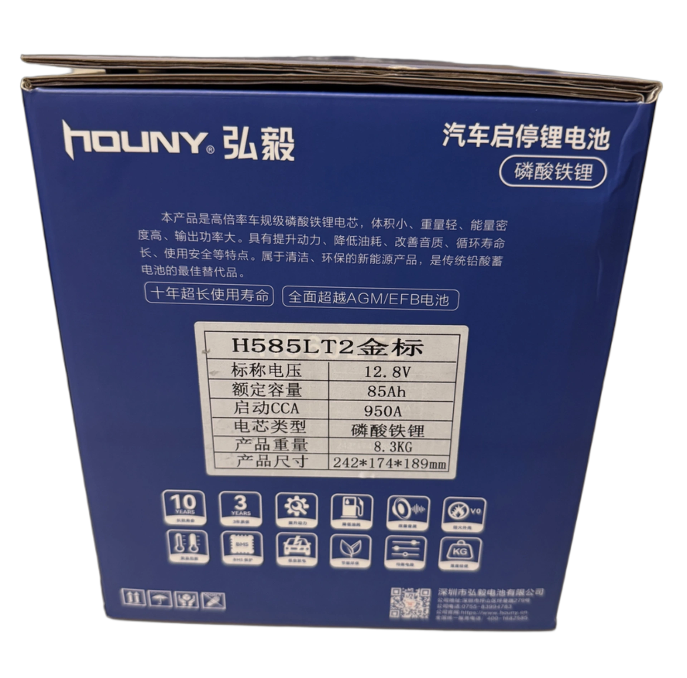](/images/LN2_HY_BOX2.webp)  
*Étiquette détaillée des spécifications sur le flanc du carton*

[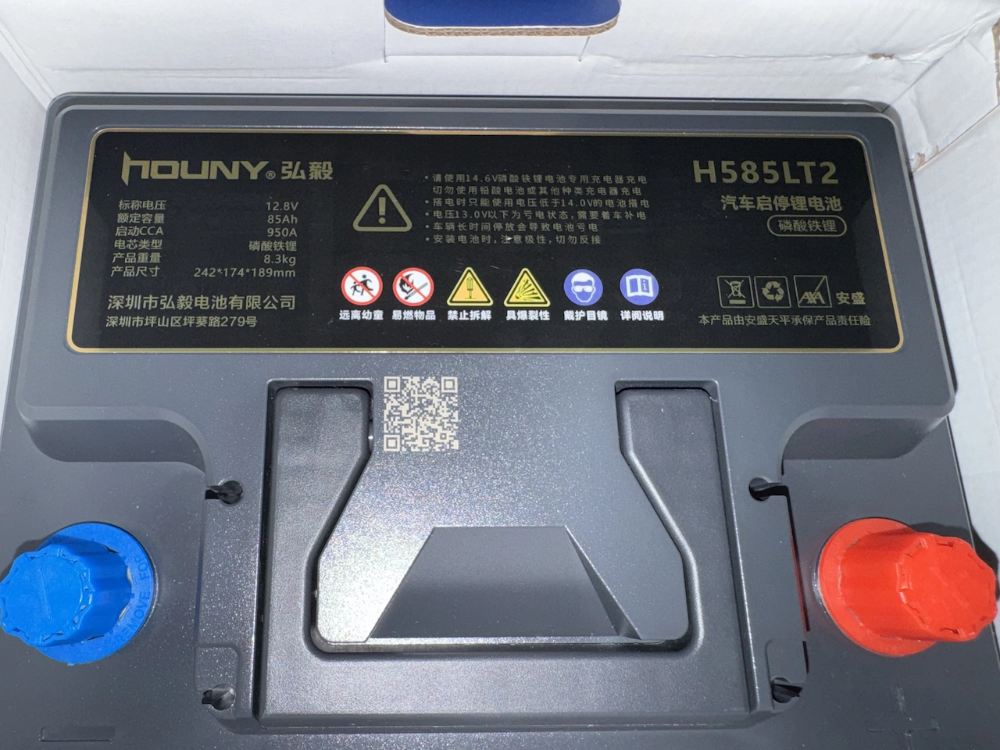](/images/LN2_HY_Top.webp)  
*Vue supérieure avec consignes de sécurité et sceau constructeur*

[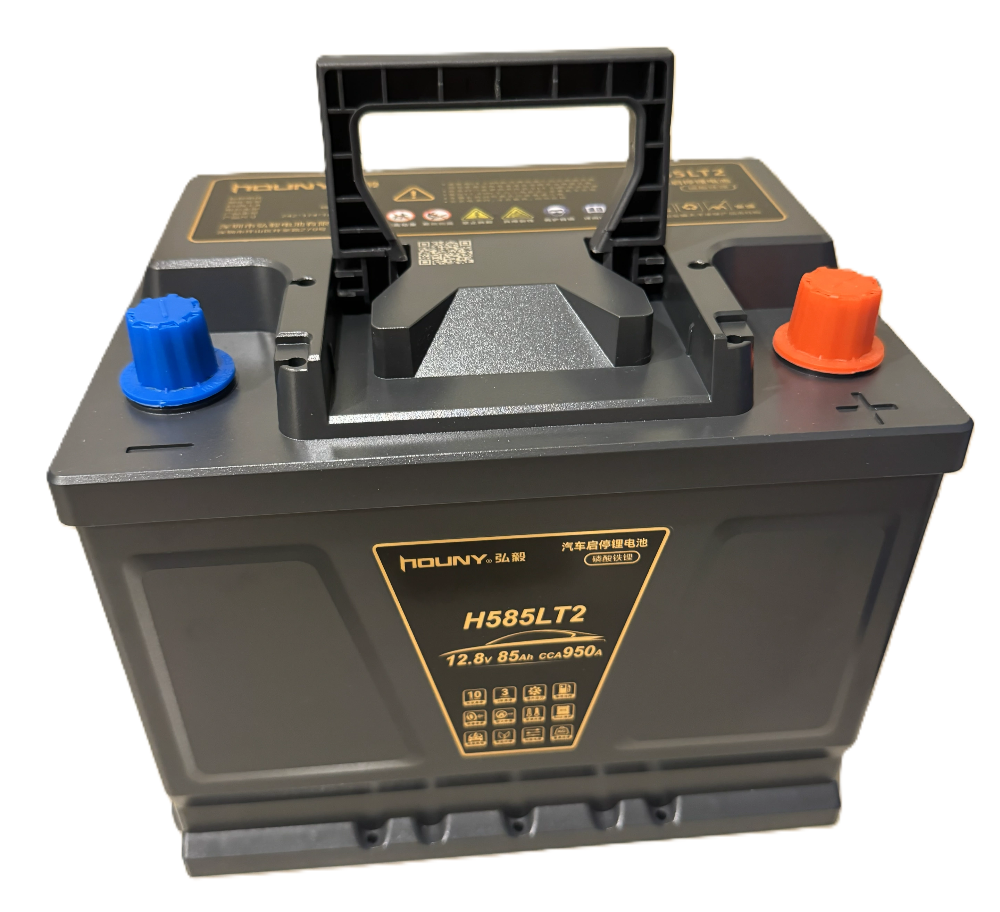](/images/LN2_HY_Front.webp)  
*Face avant avec caractéristiques électriques détaillées*

[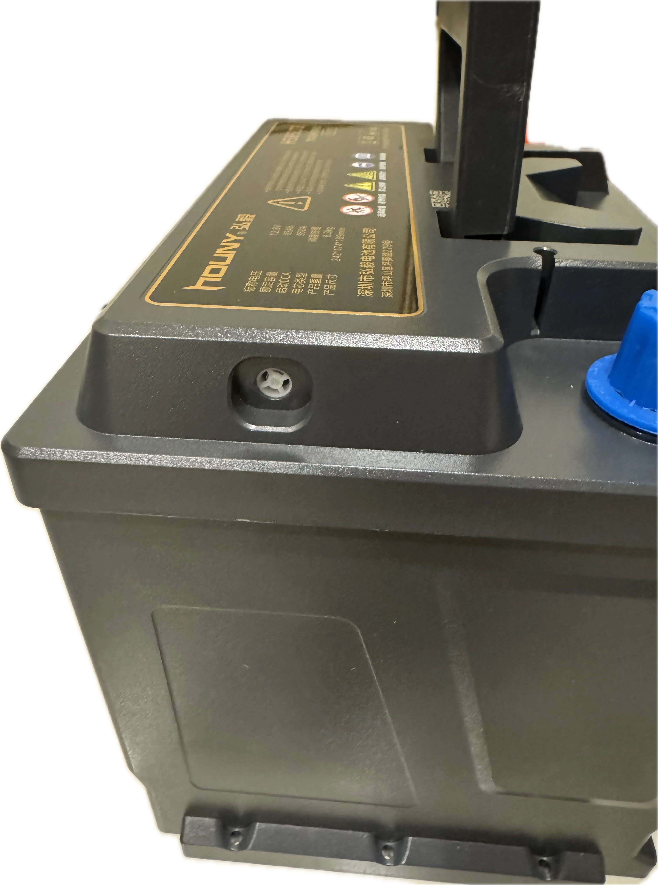](/images/LN2_HY_Side1.webp)  
*Détail de l'évent de sécurité directionnel*

[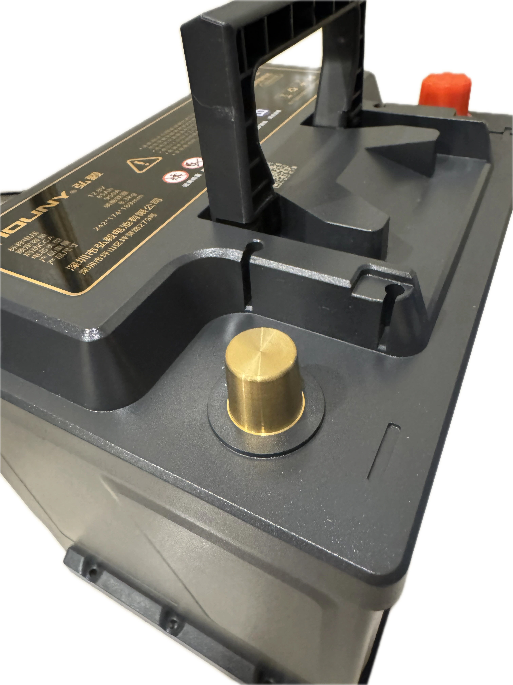](/images/LN2_HY_Side2.webp)  
*Bornes coniques usinées en cuivre massif à haute conductivité*

[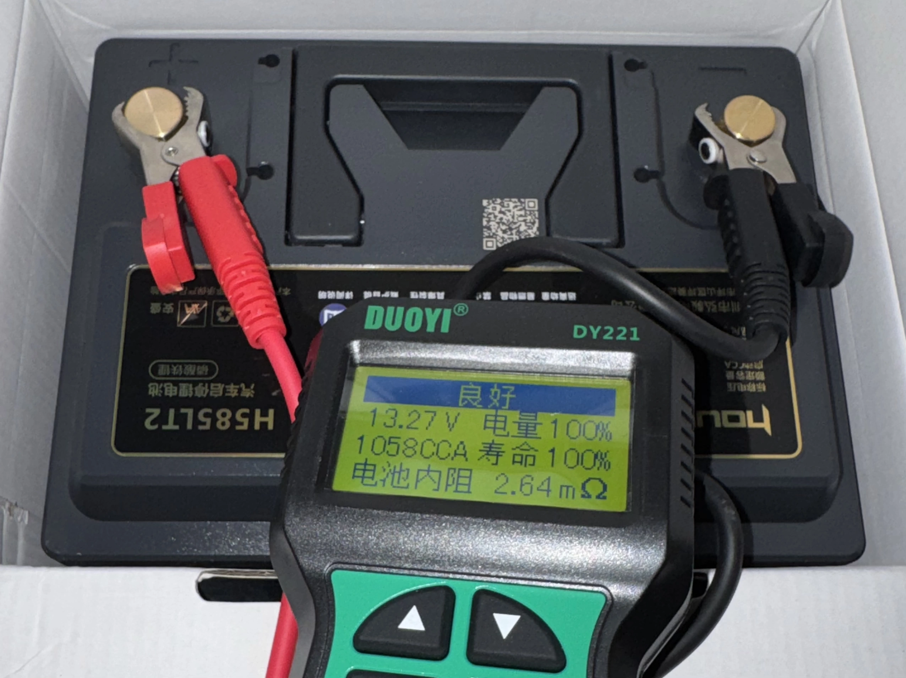](/images/LN2_HY_IR.webp)  
*Contrôle à réception : tension de repos stable et impédance ultra-basse*

Les clichés internes issus d'un [démontage d'utilisateur](/images/hongytaobaoreview.webp) attestent du sérieux de la construction :

[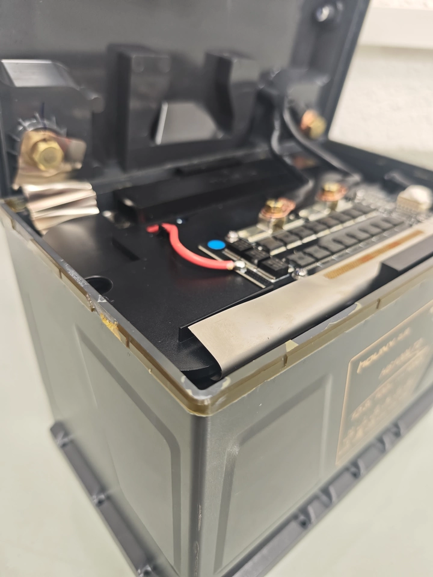](/images/hongyStruct1.webp)  
*Carte BMS avec rangée de MOSFETs de puissance et barrettes de distribution en cuivre épais*

[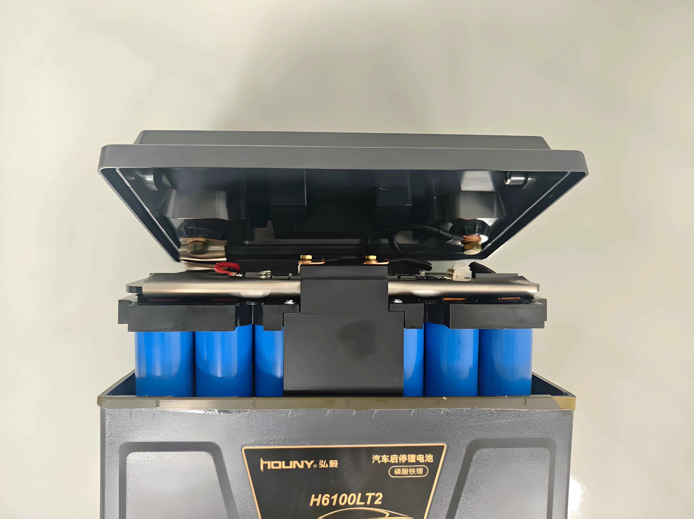](/images/hongyStruct0.webp)  
*Structure interne ordonnée et coque en ABS épais ignifugé*

[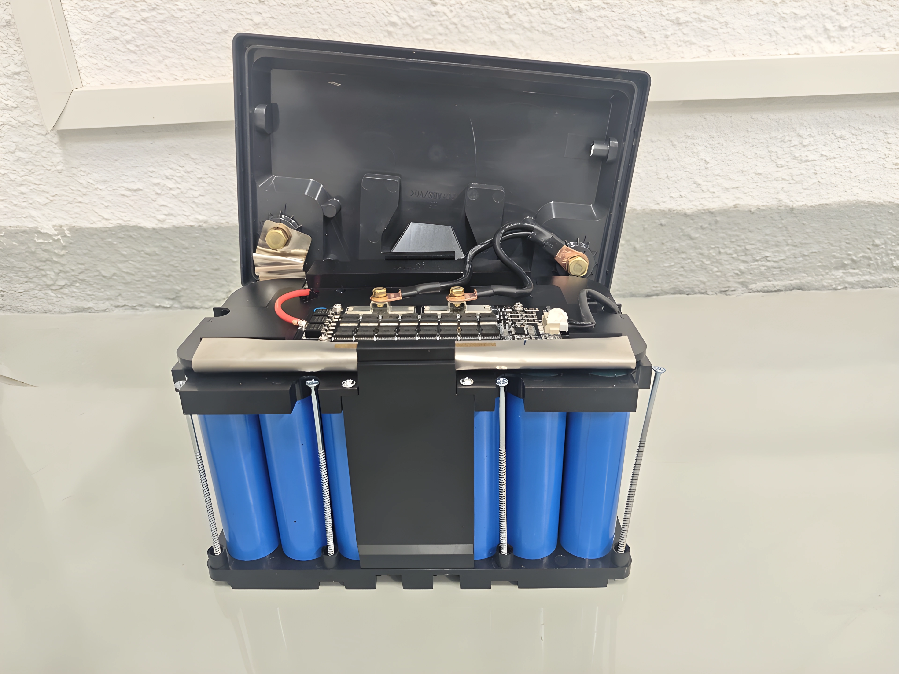](/images/hongyStruct2.webp)  
*Cellules bridées dans un berceau avec tirants filetés anti-vibrations*

## Procédure de Remplacement DIY

### Outillage Nécessaire

| Outil | Rôle et Précautions |
| :--- | :--- |
| **Douille ou clé en L de 10mm [/images/L-socket.webp](/images/L-socket.webp)** | Indispensable pour la bride de maintien au pied et les cosses polaires. |
| **[Sauvegarde Mémoire OBD](/fr/2025/memory-saving-battery.html)** | Garantit l'alimentation ininterrompue pour préserver les calculateurs. |
| **Batterie 12V d'Appoint** | Booster ou batterie auxiliaire alimentant le boîtier OBD. |
| **[Sangle de Levage](/images/battery_handle.webp)** | La batterie d'origine ne possède aucune poignée ; accessoire vivement recommandé. |

### Étapes d'Installation
> Procédure réelle étape par étape. Zéro code défaut enregistré à la remise en route.

[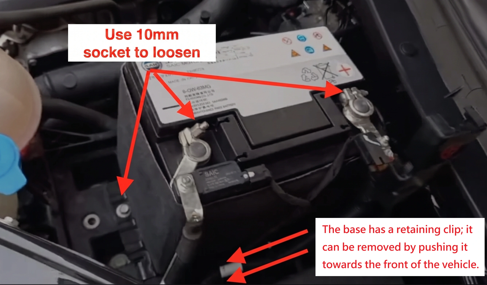](/images/en_LN2-instruction.webp)

| Étape | Opération | Détails et Astuces |
| :---: | :--- | :--- |
| **1** | **Brancher le boîtier mémoire** | Raccorder la source d'appoint au boîtier mémoire et le brancher sur la prise OBD. |
| **2** | **Mise en veille du réseau** | Fermer tous les ouvrants et patienter 5 minutes que les calculateurs passent en sommeil profond. |
| **3** | **Déposer la bride inférieure** | Dévisser le boulon de 10mm fixant la patte d'arrêt au pied de batterie et retirer la bride. |
| **4** | **Créer de l'espace de travail** | Faire glisser la batterie usagée **vers l'avant du véhicule** pour dégager le talon arrière et libérer l'accès à la borne positive. |
| **5** | **Débrancher les cosses** | Desserrer et retirer la cosse **Négative (-)** en premier, puis la cosse **Positive (+)** (à isoler immédiatement). |
| **6** | **Échanger les batteries** | Extraire l'ancienne batterie au plomb avec la sangle de levage et déposer la LiFePO4 dans son logement avec la housse thermique. |
| **7** | **Rebrancher les cosses** | Reconnecter et serrer la cosse **Positive (+)** d'abord, puis la cosse **Négative (-)**. |
| **8** | **Caler la nouvelle batterie** | Pousser la batterie **vers le côté conducteur** pour l'engager fermement dans les ergots arrière du bac. |
| **9** | **Fixer la bride au pied** | Repositionner la patte de maintien métallique et bloquer le boulon de 10mm. |
| **10** | **Finalisation** | Débrancher le connecteur OBD et mettre le contact : aucun témoin d'anomalie au combiné. |

## Bilan et Retours d'Expérience

L'intervention s'est déroulée en un quart d'heure. Le compartiment moteur du MG HS 1.5T offre un dégagement généreux, facilitant grandement la tâche.

[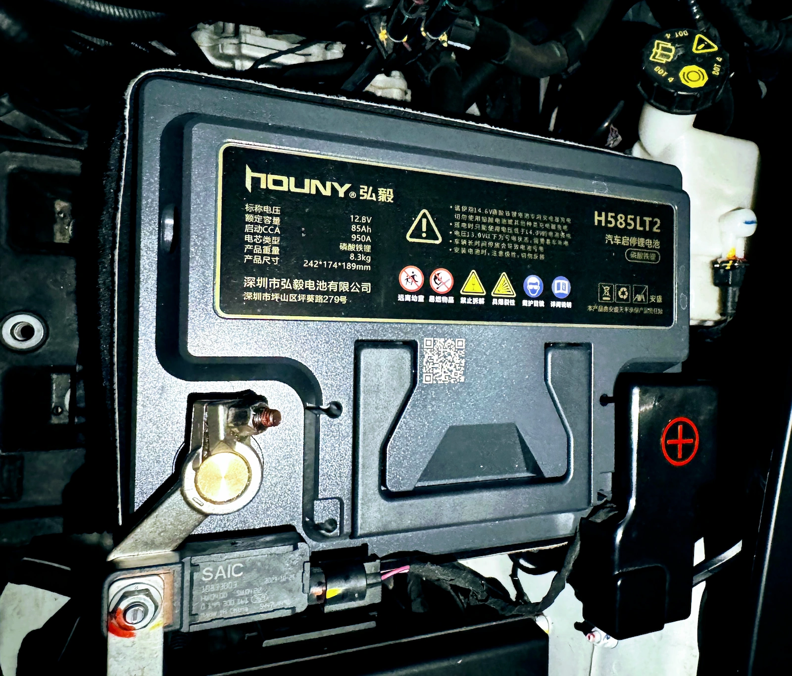](/images/LN2_HY_Install1.webp)

Les bénéfices attendus de cette mise à niveau LiFePO4 se résument ainsi :

| Domaine de Gain | Explication Technique | Effet Concret |
| :--- | :--- | :--- |
| **Performances Électriques** | [Efficacité de charge très élevée](/images/lifepo4-vs-lead-acid-recharge-speed-thesis-comparison.webp) réduisant l'effort du moteur ; [décharge instantanée](/fr/2025/lithium-vs-lead-analysis.html) stabilisant la tension. | Allège la charge sur l'alternateur et stabilise le régime de ralenti. |
| **Résistance Environnementale** | [Comportement thermique stable](/images/delta-lifepo4-vs-lead-acid-specs-comparison.webp), structure olivine ininflammable sans risque d'emballement thermique. | Sécurité accrue dans la fournaise du compartiment moteur. |
| **Gain de Poids Massif** | Poids divisé par deux (de ~17 kg d'origine à seulement 8 kg en LiFePO4) et autodécharge négligeable. | Soulage le train avant ; **idéal pour un véhicule qui ne roule que le week-end**. |
| **Consommation de Carburant** | [Recharge accélérée minimisant le frein magnétique](/fr/2025/car-bms.html) de l'alternateur piloté. | [Des études démontrent](/images/startup-lifepo4-battery-engine-performance-thesis.webp) un gain mesurable sur la consommation de carburant. |
