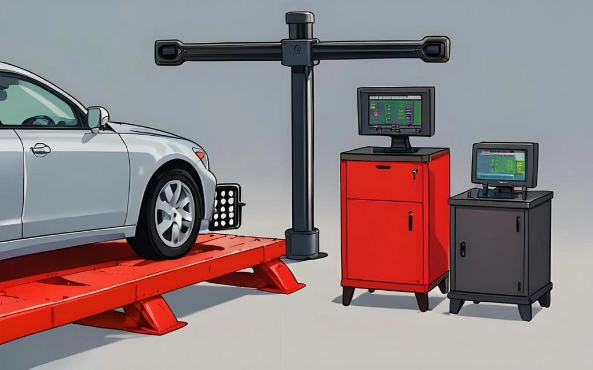

Après avoir remplacé ses pneumatiques ou des biellettes de suspension, on entend couramment parler de « Géométrie 3D ». Par rapport aux anciennes méthodes par faisceaux laser ou cordes tendues, la géométrie 3D moderne est non seulement infiniment plus rapide mais offre une précision chirurgicale. Cet article vous propose une analyse approfondie des principes optiques et algorithmiques qui régissent ces équipements.

## 1. Détection Optique Fondamentale : Caméras Industrielles et Cibles Passives

L'architecture matérielle d'un banc 3D repose sur une traverse fixe munie de deux (ou quatre) caméras numériques industrielles haute résolution à capteur CMOS/CCD.

* **Les Cibles Réflechissantes Passives :** Les panneaux fixés aux quatre roues ne renferment aucune électronique ni câble : ce sont de simples damiers passifs imprimés d'une matrice précise de points circulaires hautement réfléchissants.
* **Projection en Perspective :** Lorsque les caméras grand-angle photographient ces cibles orientées dans l'espace, la perspective optique déforme les cercles en « ellipses ».
* **Algorithme d'Estimation de Pose :** En confrontant la géométrie déformée observée aux dimensions réelles étalonnées de la mire, l'ordinateur reconstitue instantanément les **coordonnées spatiales X, Y, Z** ainsi que les **trois angles d'orientation** de chaque cible dans l'espace tridimensionnel.

## 2. L'Étape Clé Indispensable : La Compensation de Faux-Rond (Voile)

C'est ici que réside la véritable prouesse technique du 3D : **la mire n'a pas besoin d'être fixée au millimètre près au centre de la jante.**

Pourquoi ? Parce que chaque jante peut présenter un voile mécanique (bord déformé par un choc de trottoir) ou un jeu dans les griffes de préhension. Une mesure purement statique intégrerait tous ces faux-ronds mécaniques.

* **Reconstruction de l'Axe de Fusée :** L'opérateur pousse manuellement la voiture de quelques dizaines de centimètres vers l'arrière puis vers l'avant. Lors de la rotation de la roue, chaque point de la cible décrit un « arc de cercle tridimensionnel ».
* **Ajustement Géométrique Numérique :** Les caméras échantillonnent ces positions à haute fréquence et utilisent des algorithmes de régression (tels que la **méthode des moindres carrés**) pour identifier le centre commun et calculer le véritable **Axe de Fusée (Spindle Axis)**.
* **Élimination Parfaite des Erreurs :** Cet axe représente la véritable ligne de rotation dynamique de la roue. Par cette compensation dynamique, le banc soustrait intégralement le « bruit » généré par le voile de jante ou une griffe mal engagée.

## 3. Compensations Matérielles et Environnementales

Pour garantir une répétabilité de l'ordre de 0,01 degré, le système compense les perturbations externes :

* **Limites Physiques vs Réalité Mécanique :** Si une jante est sévèrement ovalisée, l'ordinateur pourra mathématiquement déterminer son axe de rotation moyen, mais le véhicule vibrera quand même en roulant. Les données affichées seront « justes à l'écran », mais la jante devra être redressée ou changée.
* **Dérive Thermique et Dilatation des Matériaux :**
    * **Dilatation Métallique :** La traverse en aluminium ou acier se dilate selon la météo de l'atelier. Des capteurs de température corrigent en temps réel la **distance de base** entre les optiques gauche et droite.
    * **Compensation des Capteurs :** Les caméras professionnelles intègrent une compensation thermique des puces d'imagerie pour neutraliser la dérive des pixels due à l'échauffement interne.
* **Étalonnage Périodique :** Un cadre étalon rigide certifié ISO permet de recalibrer les coordonnées relatives des deux axes optiques.

## 4. Intégration Logicielle et Sécurité ADAS

Le banc 3D ne se contente pas de mesurer : il croise les données avec l'ensemble des systèmes électroniques embarqués.

* **Base de Données Constructeurs (OEM) :**
    Le logiciel compare en direct les angles mesurés (Carrossage, Chasse, Pincement) aux tolérances d'usine spécifiques au numéro de châssis du véhicule.
* **Alignement Indispensable des Systèmes ADAS :**
    C'est la fonction la plus stratégique sur les véhicules récents :
    * Les radars frontaux (régulateur de vitesse adaptatif ACC) et caméras de pare-brise (maintien de ligne) doivent être alignés par rapport à l'**Axe de Poussée Géométrique** réel du train arrière.
    * Le banc 3D calcule la ligne de poussée exacte et transmet ces coordonnées aux panneaux de calibrage optiques pour que l'électronique de bord « regarde » strictement dans la direction où avancent les pneus.

## Conclusion

L'alignement 3D marie la **vision industrielle numérique** et la **géométrie analytique spatiale** pour transformer une tâche autrefois fastidieuse en un diagnostic d'une extrême rigueur. Comprendre ces mécanismes permet de saisir pourquoi « pousser la voiture sur le pont élévateur » (compensation de dévoilage) constitue l'âme fondamentale de la mesure, sans laquelle aucune précision réelle n'est possible.
