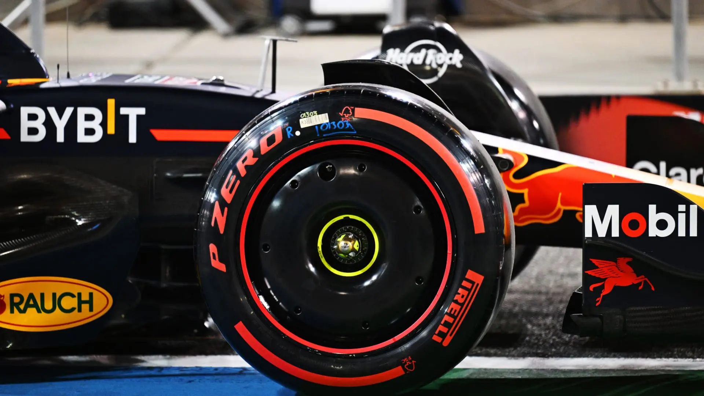
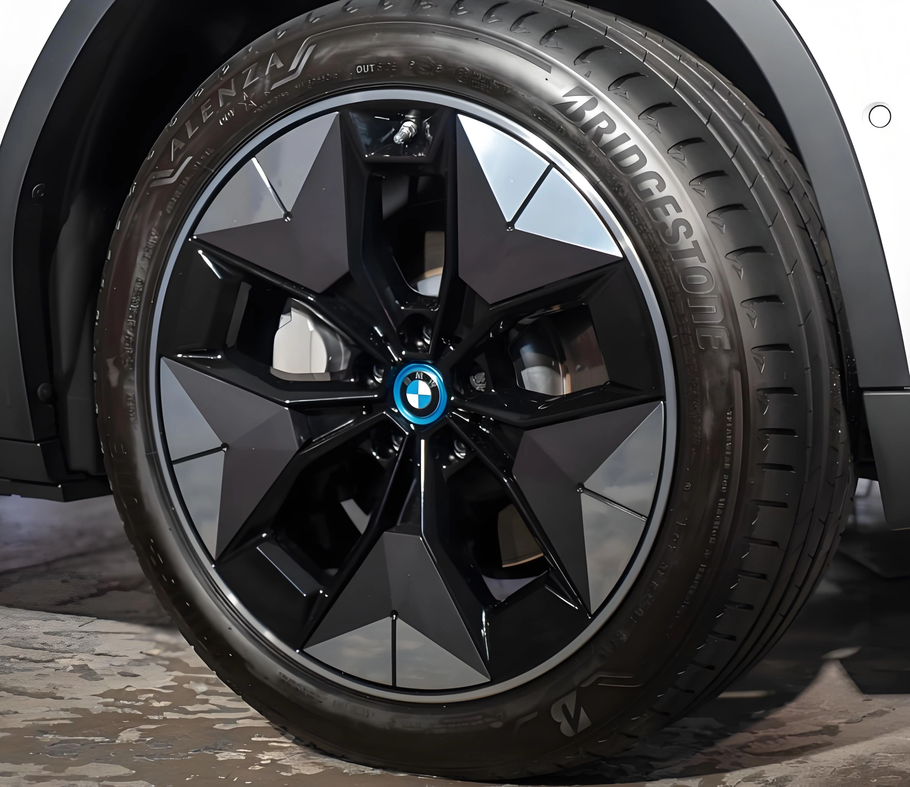

Dans l'univers de la préparation automobile, un adage populaire affirme : « 1 kg gagné sur les masses non suspendues équivaut à 10 kg sur la caisse ». Pour doper l'agilité et l'économie de carburant, de nombreux passionnés dépensent de coquettes sommes pour installer de superbes jantes forgées ultralégères, souvent en profitant pour augmenter le diamètre d'un ou deux pouces.

Cependant, la réalité physique est plus nuancée : **installer des jantes au design ultra-ajouré ou surdimensionner exagérément la taille des roues peut alourdir les relances, accroître la consommation sur autoroute et pénaliser la vitesse de pointe.** Avec l'avènement des véhicules électriques, on assiste d'ailleurs au retour en force des designs de jantes lisses et fermées dites « aéro ».

## 1. Principe Clé : À Basse Vitesse l'Inertie Compte, à Haute Vitesse l'Aérodynamisme Domine

Pour analyser scientifiquement l'effet d'une jante, il convient de distinguer deux régimes d'utilisation :
* **Régime Urbain (Basse Vitesse) :** En ville, lors des démarrages répétés aux feux, le véhicule lutte principalement contre son inertie massique et inertielle. Passer à des jantes allégées **de dimensions strictement identiques** soulage effectivement le moteur et rend la pédale d'accélérateur plus incisive.
* **Régime Autoroutier (Vitesse de Croisière) :** Dès que l'on dépasse les 100 à 130 km/h, l'air devient l'obstacle numéro un. À ce niveau, la forme aérodynamique écrase totalement l'impact du poids brut de la roue.

## 2. Le Piège de l'Inertie de Rotation : Le Poids Ne Compense Pas l'Éloignement du Centre de Gravité

Pourquoi nombre d'amateurs trouvent-ils leur voiture plus paresseuse après avoir installé des jantes haut de gamme ? L'erreur classique consiste à ne regarder que le chiffre affiché sur le pèse-personne, en négligeant l'impact géométrique du **surdimensionnement (diamètre et largeur accrus)**.

* **Effet de Levier et Déport de Masse :** Passer de 17 à 19 pouces ou élargir la jante de 7J à 8.5J repousse la matière vers l'extrême périphérie. De plus, une jante plus large impose un **pneu plus large**.
* **Le Pneu est la Masse la Plus Lourde :** Un pneu pèse souvent plus lourd que la jante elle-même, et sa carcasse se situe à l'endroit le plus éloigné de l'axe de rotation.
* **La Règle Impitoyable du Moment d'Inertie ($$I = m r^2$$) :** Le moment d'inertie ($$I$$) est proportionnel à la masse multipliée par le **carré du rayon ($$r^2$$)**. Plus la masse s'éloigne du centre du moyeu, plus il faut d'énergie pour la mettre en rotation. Un allégement apparent sur la balance se transforme ainsi en une **inertie de rotation amplifiée**.
* **Conséquences Dynamiques Réelles :**
    * **Démarrages Paresseux :** Le moteur doit fournir un surcroît de couple pour lancer les roues.
    * **Direction Lourde :** L'effet gyroscopique accru alourdit la direction et engourdit la précision de guidage.
    * **Effort de Freinage Accru :** Une énergie cinétique rotationnelle supérieure allonge les distances d'arrêt.

## 3. Le Mur Aérodynamique sur Autoroute : La Loi du Carré de la Vitesse

Lorsque l'on aborde les vitesses de croisière sur voie rapide, l'équation fondamentale de la traînée aérodynamique s'impose :

$$F_D = \frac{1}{2} \rho v^2 C_D A$$

Dans cette formule, le facteur décisif est le **carré de la vitesse ($$v^2$$)**. Lorsque vous passez de 70 km/h à 140 km/h, la vitesse double mais la résistance de l'air est **quadruplée (x4)** ! À 140 km/h, la traînée aérodynamique représente plus de **75%** de la résistance totale à l'avancement.

À ces allures, gagner quelques centaines de grammes sur une jante n'a aucun impact sensible. Seul un coefficient de traînée ($$C_D$$) optimisé permet de **conserver de la puissance et de baisser la consommation**.

## 4. Les Leçons de la Formule 1 et la « Traînée de Ventilation »

Les roues génèrent-elles beaucoup de résistance à l'air ? La réponse est : oui, et dans des proportions massives.

Depuis la réglementation 2022, la Formule 1 a réintroduit obligatoirement les **flasques de roues pleins (Wheel Covers)**.

* **Les Roues sont des Turbines à Turbulence :** Les jantes aftermarket à bâtons très fins et très ouvertes agissent à haute vitesse comme d'immenses ventilateurs centrifuges. Elles brassent violemment l'air dans les passages d'ailes et projettent des tourbillons le long des flancs du véhicule.
* **La « Traînée de Ventilation » :** En soufflerie, l'écoulement perturbé autour des quatre roues et de leurs arches représente entre **25% et 30%** de la traînée aérodynamique globale d'une automobile. Si la F1 accepte d'alourdir ses monoplaces avec des flasques pour calmer l'écoulement d'air, c'est bien la preuve que l'aérodynamisme surpasse la légèreté pure à haute vitesse.

## 5. L'Ère Électrique et le Triomphe des Jantes Aéro Lisses

Sur un véhicule thermique, un surplus de traînée se traduit par quelques décilitres de carburant en plus. Sur un véhicule électrique, cela ampute directement le nerf de la guerre : l'autonomie.

C'est pourquoi Tesla, Porsche (Taycan) ou Hyundai (Ioniq) équipent d'origine leurs modèles de **jantes semi-pleines ou d'enjoliveurs lisses**.

* **Canalisation Parfaite du Flux :** Une surface fermée guide l'air le long de la carrosserie sans le laisser s'engouffrer dans le pneu.
* **Écarts Constatés sur Route :** Les essais démontrent qu'enlever les enjoliveurs aéro d'une Tesla Model 3 dégrade l'autonomie sur autoroute de **3% à 5%**. Les jantes d'origine souvent jugées massives sont le fruit d'études approfondies en soufflerie pour fendre l'air efficacement.

## 6. Conseils Pratiques pour Vos Modifications

* **Usage Quotidien et Urbain :** Choisir des jantes légères est pertinent si vous conservez les dimensions d'origine. Les décollages seront plus vifs. Évitez toutefois de monter en diamètre et en largeur sous peine de voir votre inertie de rotation s'envoler.
* **Longs Trajets Réguliers / Véhicules Électriques :** Si vous effectuez beaucoup d'autoroute ou conduisez une électrique, abandonnez l'obsession de la jante squelette ultralégère. Privilégiez les **designs aéro lisses et semi-pleins** qui préserveront votre autonomie et vos reprises à haute vitesse.
