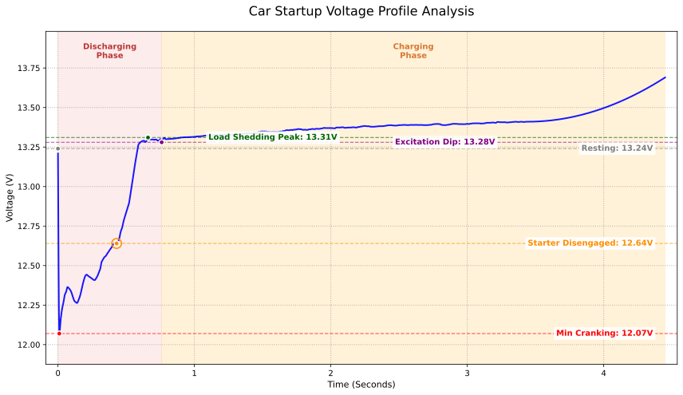

Dans l'étude des circuits électriques automobiles, la phase de démarrage est celle qui subit les variations de charge les plus brutales. Grâce à un échantillonnage haute fréquence à 100 Hz à l'échelle de la milliseconde, il est possible d'observer l'interaction physique directe entre la batterie et l'alternateur sur un intervalle temporel extrêmement court. Cette étude s'appuie sur un véhicule équipé d'un moteur 4 cylindres 2,3 L atmosphérique et d'une batterie LiFePO4 GreenRun2 de 50 Ah pour disséquer les fondements de la courbe de tension de démarrage.

## I. Analyse Transitoire de la Tension au Démarrage

Le cycle de démarrage se décompose en quatre phases physiques majeures, traduisant le passage de relais entre charge mécanique et alimentation électrique :

### 1. Chute Initiale Induite par le Courant d'Appel
Dès la fermeture du solénoïde du démarreur et son amorçage depuis l'arrêt complet, un courant d'appel massif (**inrush current**) traverse le circuit.
* **Mesure empirique :** La tension s'effondre instantanément de son niveau de repos de **13,24 V** à **12,07 V**.
* **Explication physique :** L'amplitude de cet affaissement dépend de la résistance interne $$R$$ de la batterie et de l'impédance rotorique initiale du moteur. D'après la loi d'Ohm généralisée :
$$V_{terminal} = V_{ocv} - (I_{start} \times R_{internal})$$
* **Interprétation :** En raison de ses propriétés électrochimiques, le phosphate de fer lithié (LiFePO4) offre une résistance interne extrêmement basse. À intensité de démarrage égale, la chute de tension est nettement plus modérée que sur une batterie conventionnelle au plomb. La chute n'est ici que de **1,17 V**, témoignant d'un taux de décharge exceptionnel.

### 2. Ondulations de Tension Liées aux Temps de Compression
Tant que le démarreur entraîne le vilebrequin, la tension affiche des oscillations régulières entre **12,07 V et 12,5 V**.

* **Explication technique :** Il s'agit de la répercussion directe du passage des **temps de compression** du moteur thermique.
    * **Creux :** Lorsque le piston comprime le mélange air-essence, la résistance mécanique culmine, l'appel de courant s'amplifie et la chute de tension s'accentue.
    * **Crête :** Dès que le piston franchit le point mort haut et passe en phase de détente ou d'admission, la résistance diminue, l'appel de courant baisse et la tension rebondit.
* **Portée mécanique :** La fréquence et la brièveté de ces oscillations reflètent le régime de rotation et l'efficacité du démarreur. Ici, l'allumage intervient en seulement **0,55 seconde**, preuve d'une excellente dynamique de lancement.

### 3. Délestage de Charge et Saut Inductif
Dès que le moteur s'allume et que son régime dépasse la vitesse d'entraînement du démarreur, la roue libre (lanceur) se désengage et coupe la liaison électrique.
* **Mesure empirique :** La tension bondit rapidement de **12,64 V** à **13,31 V**, puis se stabilise autour de **13,30 V**.
* **Principe :** Il s'agit du phénomène de délestage de charge (**load dump**). En tant qu'inductance massive, le moteur restitue son énergie emmagasinée à l'ouverture du circuit. Dans le même temps, la batterie se trouve instantanément libérée de plusieurs centaines d'ampères de charge, retrouvant aussitôt sa tension de palier électrochimique.

### 4. Montée en Excitation et Prise de Relais de l'Alternateur
Après le démarrage, la tension du réseau de bord ne bondit pas immédiatement, mais marque un court palier entre **13,28 V et 13,41 V** avant de grimper nettement (vers **13,69 V**).

* **Montée en excitation** : Lorsque l'alternateur commence à tourner avec le vilebrequin, son régulateur de tension interne a besoin d'un court délai pour exciter l'enroulement rotorique et établir le champ magnétique. Durant cette fraction de seconde, la tension générée reste inférieure à celle de la batterie, qui continue donc d'alimenter seule le bord.
* **Prise de relais de l'alternateur** : Une fois le champ magnétique établi, la tension de l'alternateur dépasse celle de la batterie. La batterie LiFePO4, dotée d'une résistance interne minime, absorbe aussitôt un fort courant de charge qui « bride » temporairement la tension système autour de 13,3–13,4 V. Comme le lancement n'a duré que 0,55 seconde et que la batterie était pleine, le déficit est comblé en quelques secondes. Le courant de charge chute alors fortement, l'effet de bridage disparaît et la tension monte progressivement vers la zone de régulation permanente à 13,69 V+.

## II. Analyse de la Tension de Fonctionnement à Long Terme

La surveillance continue après le démarrage met en lumière la remarquable stabilité électrique du système :

| Phase de Surveillance | Tension (V) | État Technique et Diagnostic |
| :--- | :--- | :--- |
| **Avant contact** | 13,24 | Tension en circuit ouvert (OCV) sur palier haut ; excellente santé. |
| **Début de charge** | 13,69 | L'alternateur débite, tension régulée par la forte absorption LiFePO4. |
| **Régime établi** | 13,80 - 13,90 | Entrée dans la plage de régulation constante ; pertes de ligne négligeables. |

### Synthèse Technique
1. **Stratégie de Régulation de Tension :** La tension se stabilise durablement entre **13,80 V et 13,90 V**. Pour une cellule LiFePO4, ce seuil évite la zone de contrainte maximale supérieure à 14,6 V, permettant de recharger efficacement la batterie tout en maximisant sa longévité cyclique.
2. **Diagnostic de Vieillissement :** Après 3 ans et 52 000 kilomètres de service, cette batterie conserve un palier supérieur à 12 V au point critique du démarrage. De plus, le maintien d'une tension de 13,24 V après une semaine d'arrêt confirme que la résistance interne n'a subi aucune dégradation mesurable, attestant d'un excellent état de santé (SOH).

## III. Densité Énergétique et Taux de Décharge

Pourquoi les caractéristiques intrinsèques du LiFePO4 transfigurent-elles les performances de démarrage ?

1. **Haute Densité Énergétique**
   La densité énergétique du phosphate de fer lithié est de 3 à 5 fois supérieure à celle du plomb-acide. À volume égal, elle offre une masse réduite et une chimie d'électrode plus réactive. La tension de repos reste ancrée entre **13,2 V et 13,3 V**, fournissant un potentiel initial plus élevé lors de la phase de lancement.

2. **Fort Pouvoir de Décharge (C-Rate)**
   Les accumulateurs LiFePO4 affichent une résistance interne infime permettant des taux de décharge instantanés très élevés. Conjuguée à une forte compacité, cette technologie délivre l'impulsion de courant requise sans effondrement de tension, surpassant largement les mécanismes lents de diffusion chimique des batteries au plomb traditionnelles.

---

*Données mesurées sur véhicule réel avec une précision de capteur de 0,01 V à une fréquence d'échantillonnage de 100 Hz.*
