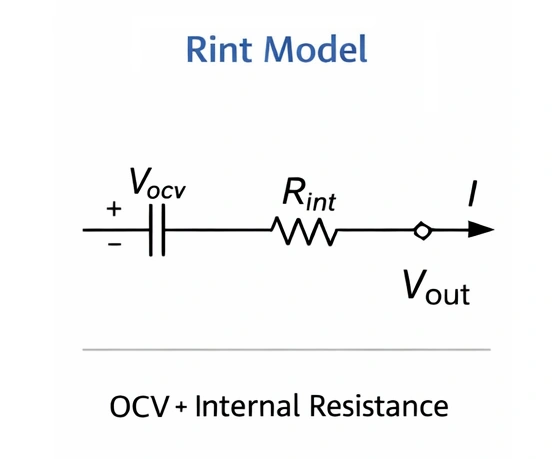

Qu'il s'agisse d'une batterie lithium-ion ou plomb-acide, le symptôme le plus marquant du vieillissement se résume à : **« se charge à la vitesse de l'éclair, se vide instantanément »**, le tout accompagné d'un échauffement marqué. Pour décrypter ce phénomène, il faut plonger dans la **résistance interne** et le schéma équivalent du générateur électrochimique.

## 1. Schéma Équivalent d'un Accumulateur

En physique, un accumulateur n'est pas un réservoir idéal d'énergie. Son circuit équivalent élémentaire comprend deux composantes montées en série :

* **Force Électromotrice Chimique ($$V_{ocv}$$)** : La tension en circuit ouvert observée aux bornes de la batterie à vide, sans aucun débit de courant.
* **Résistance Interne ($$R$$)** : L'entrave physique globale opposée au passage des électrons et ions à travers les collecteurs, la matière active, l'électrolyte et le séparateur.

---

L'introduction du bilan des **« flux de puissance »** permet d'objectiver immédiatement pourquoi un accumulateur usagé refuse d'emmagasiner l'énergie : l'électricité injectée est massivement dissipée sous forme de « chaleur ».

## 2. Le Phénomène à la Charge : Pourquoi Chauffe-t-il Davantage en Vieillissant ?

Lorsque nous raccordons un chargeur, la puissance électrique totale débitée ($$P_{total}$$) se scinde en deux parts distinctes :
$$P_{total} (V \times I) = P_{\text{thermique}} (\text{pertes par effet Joule}) + P_{\text{charge}} (\text{puissance chimique stockée})$$

### 2.1 L'Effondrement du Rendement Énergétique
Prenons l'exemple d'une charge sous 5V / 2A (puissance injectée de 10W). Comparons la conversion énergétique entre une cellule neuve et une cellule dégradée :

| État de la Batterie | Résistance Interne ($$R$$) | Puissance Thermique ($$I^2 R$$) | Puissance Réellement Stockée | Rendement |
| :--- | :--- | :--- | :--- | :--- |
| **Batterie Neuve** | $$0.1 \Omega$$ | $$2^2 \times 0.1 = \mathbf{0.4W}$$ | $$10 - 0.4 = \mathbf{9.6W}$$ | **96%** (Remarquable) |
| **Batterie Usagée** | $$1.5 \Omega$$ | $$2^2 \times 1.5 = \mathbf{6.0W}$$ | $$10 - 6.0 = \mathbf{4.0W}$$ | **40%** (Catastrophique) |

**Constat physique :** Dans l'élément âgé, plus de la moitié de l'énergie fournie par le secteur est engloutie par la résistance interne $$R$$ et dissipée en pure perte sous forme de chaleur. Voilà pourquoi une batterie fatiguée se comporte comme une « bouillotte » lors de la charge tout en se rechargeant avec une lenteur trompeuse : moins de 40% de l'énergie parvient à s'ancrer dans la matière active.

### 2.2 L'Illusion de Tension : Pourquoi l'Indicateur Affiche « Plein » Trop Vite
Le chargeur régule le processus en mesurant la **tension aux bornes** :
$$V_{\text{mesuré}} = V_{ocv} + (I \times R)$$

* **L'Illusion Électrique** : Lorsque $$R$$ grimpe en flèche, le passage d'un courant de 2A engendre une chute ohmique parasite $$(I \times R)$$ pouvant atteindre 2V voire davantage.
* **Le Résultat Pratique** : À peine branché, le chargeur relève une tension fictive qui s'envole instantanément à 4,2V (seuil d'arrêt de charge). Le contrôleur bascule alors au vert ou réduit drastiquement le courant, croyant la cellule saturée, alors que sa force électromotrice interne réelle $$V_{ocv}$$ gît encore à un niveau très bas.

C'est la raison pour laquelle une batterie usée semble **« se charger en quelques instants »** : il s'agit d'un leurre électrocinétique généré par sa résistance interne.

## 3. L'Effondrement de Tension à la Décharge : La Panne Subite

Lorsqu'un appareil consommateur tire du courant, l'équation s'inverse :
$$V_{\text{mesuré}} = V_{ocv} - (I \times R)$$

**Exemple concret :**
Un smartphone est calibré pour s'éteindre par sécurité dès que la tension descend sous 3,3V. Considérons une batterie avec une tension à vide résiduelle de 3,7V :

* **Batterie Neuve ($$R=0.1\Omega$$)** : Lors du lancement d'un jeu vidéo appelant 2A, la tension opérationnelle s'établit à $$3.7 - 0.2 = \mathbf{3.5V}$$ → **Fonctionnement stable et fluide**.
* **Batterie Dégradée ($$R=0.5\Omega$$)** : Sous ce même appel de 2A, la tension s'écroule à $$3.7 - 1.0 = \mathbf{2.7V}$$ → **Passage immédiat sous le seuil critique, l'appareil s'éteint brutalement**.

Cela résout le mystère du téléphone qui affiche 20% de batterie mais s'éteint instantanément dès qu'on ouvre l'appareil photo : l'appel de courant fait plonger la tension sous la ligne rouge.

## Conclusion : Le Vieillissement est un Étranglement Irréversible

Si l'on compare la batterie à un **château d'eau**, la résistance interne s'apparente à **l'entartrage et à l'obstruction de la conduite d'évacuation** :
* **Au remplissage** : Le tuyau obstrué crée une contre-pression immédiate qui fait déborder le manomètre, donnant l'impression que la cuve est pleine alors qu'elle demeure vide.
* **Au puisage** : Dès qu'on ouvre la vanne en grand, la résistance à l'écoulement étouffe le débit, incapable d'alimenter les appareils en aval.

Cette dégradation physico-chimique (cristallisation, dégradation de l'électrolyte) étant irréversible, le remplacement pur et simple de l'accumulateur demeure la seule démarche rationnelle pour garantir la fiabilité et la sécurité de vos équipements.

> **💡 Notion Avancée : Savez-vous que la résistance interne se mesure en « AC » et en « DC » ?**
>
> Les fiches techniques distinguent généralement deux valeurs d'impédance :
> 
> * **Résistance Interne AC (ACIR) :** Mesurée à l'aide d'un courant alternatif faible à 1 kHz. Elle ne reflète que la résistance ohmique pure (continuité des collecteurs, conduction de l'électrolyte) sans laisser le temps aux phénomènes de transfert de charge chimique de s'établir. Sa valeur est flatteuse (très faible). C'est ce que mesurent la quasi-totalité des testeurs portables du marché.
> 
> * **Résistance Interne DC (DCIR) :** Mesurée sous une décharge continue à forte intensité. Elle cumule la résistance ohmique et la résistance de polarisation (liée à la cinétique électrochimique). Nettement plus élevée, c'est elle qui reflète la **réalité opérationnelle** subie par votre démarreur de voiture ou votre équipement.
> 
> *Note : Les calculs de chutes de tension et d'échauffement Joule abordés dans cet article reposent intégralement sur la résistance continue (DCIR).*
