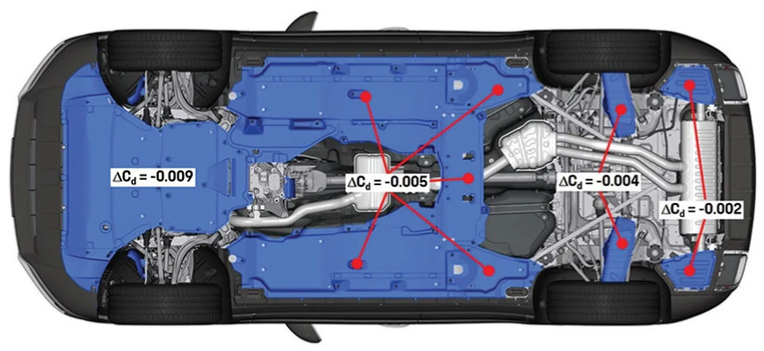

L'aérodynamique automobile se concentre souvent sur le pavillon, l'aileron arrière ou le bouclier avant, mais le soubassement exerce en réalité une influence prépondérante. Installer une « plaque de protection sous moteur » bien conçue permet de caréner le châssis, de perfectionner la tenue de cap à haute vitesse et de réduire la consommation de carburant. Si de nombreuses berlines européennes haut de gamme en sont dotées de série, certains modèles grand public en sont malheureusement dépourvus.

## Les Trois Atouts Aérodynamiques Majeurs d'un Soubassement Plat

Un soubassement d'origine non caréné regorge d'obstacles : carter d'huile, boîte de vitesses, ligne d'échappement et bras de suspension à nu. À vive allure, ces reliefs créent de violentes turbulences qui dégradent le comportement dynamique et augmentent la résistance à l'avancement.

Examinons les données scientifiques :

*(Source image : Étude aérodynamique Porsche)*

### 1. Réduction de Traînée : Un Gain Supérieur aux Jantes Forgées Allégées
D'après les recherches menées par Porsche, les bénéfices aérodynamiques du carénage sous plancher décroissent de l'avant vers l'arrière du véhicule. La plaque située sous le compartiment moteur constitue donc la pièce maîtresse pour fendre l'air. Le simple carénage sous la baie moteur réduit le coefficient de traînée (Cd) d'environ 0,009 ; un carénage intégral permet quant à lui d'abaisser la traînée globale de 6%.

Impacts concrets du coefficient de traînée :  
- **Bilan Énergétique** : Toute augmentation de 0,01 du Cd exige environ 1 cheval-vapeur supplémentaire à 100 km/h.
- **Autonomie** : Chaque réduction de 0,001 du Cd permet de gagner environ 1 km d'autonomie. Passer d'un Cd de 0,35 à 0,30 fait progresser le rayon d'action de près de 50 km.

Comparée à des jantes allégées très coûteuses, une plaque sous moteur offre un rapport coût/efficacité inégalé pour réduire la consommation, préserver l'élan cinétique et étouffer les bruits de roulement aérodynamiques.

### 2. Réduction de Portance et Suppression du Flou à Haute Vitesse
Outre la traînée, le carénage sous caisse maîtrise la portance positive ($$C_l$$). Cette impression désagréable de « flottement » lors d'un changement de voie sur autoroute provient souvent d'oscillations aérodynamiques amplifiées par un soubassement tourmenté.

* **Résistance aux Vents Latéraux** : Les mesures démontrent qu'en présence de rafales de vent latéral, la portance générée sous un châssis plat est drastiquement inférieure à celle d'un châssis nu.
* **Effet de Sol** : En vertu du théorème de Bernoulli, un plancher lisse accélère l'écoulement de l'air sous le véhicule, générant une zone de basse pression qui « aspire » la caisse vers la chaussée. L'adhérence des pneumatiques s'en trouve renforcée sans alourdir les masses suspendues.

### 3. Optimisation du Refroidissement du Compartiment Moteur
L'intuition populaire laisse penser que boucher le dessous de la baie moteur bloque l'évacuation de la chaleur. C'est une erreur technique. Un échange thermique efficace ne repose pas sur une ouverture anarchique, mais sur un guidage méthodique des flux d'air :

* **Effet de Succion à Haute Vitesse** : Le plancher lisse accélère l'écoulement d'air sous le véhicule. La chute de pression qui en résulte crée une dépression naturelle sous la baie moteur, extrayant vigoureusement l'air chaud par les déflecteurs d'évacuation prévus sur la plaque. L'évacuation thermique est nettement supérieure à celle d'un châssis ouvert où l'air tourbillonne sans direction.
* **Guidage Forcé à Basse Vitesse** : Dans les embouteillages, le refroidissement dépend des motoventilateurs. Une plaque bien profilée sert de déflecteur, utilisant la surpression des ventilateurs pour canaliser l'air brûlant vers l'arrière du véhicule, empêchant l'air chaud de stagner en boucle ou de rebondir contre le sol.

## Acier-Plastique vs Métal : Quel Matériau Choisir ?

Le marché propose principalement deux familles de matériaux : « Acier-Plastique (Composites Polymères PP/PE/ABS) » et « Métal (Alliage d'Aluminium ou Acier au Manganèse) » :

| Caractéristique | Acier-Plastique (Polymer Steel) | Métal (Alu / Acier Manganèse) |
| :--- | :--- | :--- |
| **Masse** | **Très léger**. Impact quasi nul sur le poids du véhicule. | **Plus lourd**. L'acier est le plus dense, suivi de l'aluminium. |
| **Niveau de Protection** | **Moyen**. Écran efficace contre projections d'eau, gravillons et frottements légers. | **Extrême**. Encaisse les contacts violents et impacts de rochers. |
| **Résilience et Déformation** | **Élastique**. Reprend sa forme après flexion, mais peut se fendre sous choc violent. | **Plastique**. Les chocs violents provoquent des bosses et déformations permanentes. |
| **Confort Acoustique (NVH)** | **Remarquable**. Absorbe les bruits mécaniques sans résonance. | **Médiocre**. Réfléchit les ondes sonores et peut entrer en vibration métallique. |
| **Domaines d'Usage** | **90% des trajets quotidiens**, autoroute, conduite sportive sur route. | **Tout-terrain (Off-road)**, chantiers, véhicules rabaissés sur pistes cassantes. |

**Recommandation Pratique :**
Pour un **usage routier et autoroutier quotidien visant la sobriété en carburant, l'insonorisation et l'aérodynamique**, le **composite acier-plastique** s'impose comme le choix roi par sa légèreté et son silence. Si vous vous aventurez fréquemment sur des chemins rocailleux ou faites du tout-terrain, l'**aluminium ou l'acier** sera indispensable pour protéger vos organes vitaux.

## Au Fait : Une Plaque Rigide Nuit-elle à la Sécurité d'Affaissement du Moteur ?

Certains conducteurs hésitent à poser un sabot métallique rigide par crainte d'entraver le dispositif d'affaissement du moteur : *« En cas de choc frontal, le moteur doit basculer vers le bas. Une plaque rigide ne risque-t-elle pas de bloquer le moteur et de le repousser dans l'habitacle ? »*

Cette inquiétude semble logique au premier abord, mais elle s'effondre face aux ordres de grandeur mécaniques :

* **Disproportion des Forces :** Lors d'un choc frontal destructeur, la force d'inertie nécessaire pour rompre les supports fusibles du berceau moteur dépasse **10 tonnes**. Les plaques sous moteur sont fixées par de simples vis M6 ou M8 sur la tôle de caisse.
* **Résistance Négligeable :** Sous la poussée de 10 tonnes de matière cinétique, ces petites fixations sont cisaillées ou arrachées en quelques millisecondes, et la tôle d'aluminium se déchire comme une feuille de papier. La résistance qu'elle peut opposer est infinitésimale face à l'énergie du crash.

En clair, la rigidité d'une plaque est parfaite contre les gravillons et les trottoirs, mais elle ne pourra jamais contrarier la trajectoire d'affaissement d'un groupe motopropulseur lors d'une collision à grande vitesse.

## Conclusion

Une plaque de protection sous moteur ne se résume pas à un simple bouclier mécanique : c'est un appendice aérodynamique crucial pour réduire la traînée, assagir les bruits d'air et stabiliser la trajectoire sur autoroute. En choisissant le matériau adapté à votre usage, vous profiterez pleinement de tous les bénéfices d'un châssis caréné en toute sérénité !
