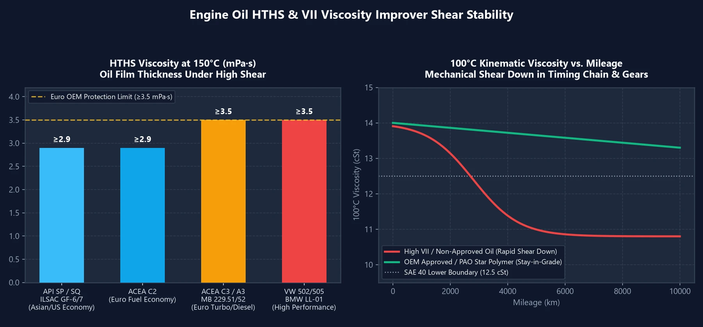

Dans nos analyses précédentes sur les lubrifiants, nous avons mis en évidence que **le HTHS régit le compromis fondamental entre économie de carburant et protection mécanique à haut régime**, et que **le simple indice VI (Indice de Viscosité) ne constitue pas un indicateur absolu de qualité**.

De nombreux automobilistes s'interrogent : pourquoi deux bidons étiquetés **`5W-30`** procurent-ils des sensations de conduite radicalement opposées ? Et pourquoi certaines huiles réputées, si soyeuses durant les $$2000$$ premiers kilomètres, deviennent-elles bruyantes et lourdes au bout de $$3000$$ km ? Les réponses résident dans deux grandeurs fondamentales : le **HTHS** et les polymères **VII**.

---

## 1. Viscosité HTHS : L'Épaisseur Réelle du Film d'Huile en Condition Extrême

Le grade `5W-30` inscrit sur le bidon ne décrit que la viscosité cinématique mesurée à $$100^\circ\text{C}$$. Or, en conduite dynamique et sous forte charge, la température entre le segment de feu et la paroi du cylindre culmine à plus de **$$150^\circ\text{C}$$**, subissant un taux de cisaillement de plusieurs millions de fois par seconde.

Le **HTHS (High Temperature High Shear)** quantifie l'épaisseur dynamique du film lubrifiant à **$$150^\circ\text{C}$$ sous fort cisaillement** (exprimé en $$\text{mPa}\cdot\text{s}$$ ou $$\text{cP}$$). Cette seule mesure scinde les huiles `5W-30` en deux familles totalement distinctes :

| Catégorie 5W-30 | Spécification HTHS | Homologations Typiques | Profil Dynamique et Véhicules Cibles |
| :---: | :---: | :--- | :--- |
| **HTHS Bas** **(Film Mince・Économie)** | **$$2.9 \sim 3.1$$** | API SP / SQ, ILSAC GF-6 / GF-7 ACEA A5/B5, **ACEA C2** | Réponse vive à l'accélérateur, faible frottement interne, sobriété maximale. Idéal pour **véhicules asiatiques, américains et motorisations hybrides**. |
| **HTHS Haut** **(Film Épais・Protection)** | **$$\ge 3.5$$** | ACEA A3/B4, **ACEA C3** MB 229.5 / 229.51 / 229.52 BMW LL-01 / LL-04, VW 504/507 | Coussin hydrodynamique très résistant, protection anti-usure supérieure. Indispensable pour **moteurs turbos européens, diesels FAP et blocs haute performance**. |

> **Règle Fondamentale d'Utilisation** :  
> Mettre une huile `ACEA C3` ($$\text{HTHS} \ge 3.5$$) dans une citadine asiatique atmosphérique n'endommagera pas la mécanique, mais générera une **lenteur de montée en régime et une légère surconsommation**. En revanche, faire tourner un moteur turbo européen exigeant $$\text{HTHS} \ge 3.5$$ avec une huile `API SP / ILSAC GF-6` ($$\text{HTHS} \approx 2.9$$) provoquera une usure prématurée accélérée des **arbres à cames et des chemises de cylindres** lors des pleines charges sur autoroute !

---

## 2. Les Polymères VII : Pourquoi Certaines Huiles S'écroulent à 3 000 km

Pour formuler une huile multigrade comme une `5W-30` ou une `0W-40`, les pétroliers partent d'une **huile de base fluide** (pour assurer le démarrage à froid) et y incorporent des **additifs polymères VII** (chaînes moléculaires élastiques en forme de ressorts) :
- **À froid** : Les chaînes de polymères s'enroulent sur elles-mêmes en billes compactes, laissant s'écouler librement l'huile de base fluide.
- **À chaud** : Les molécules se déploient et s'entrelacent en un maillage dense, épaississant artificiellement l'huile pour atteindre le grade 30 ou 40.

### Qu'est-ce que le « Cisaillement Mécanique » (Shear Down) ?

Lorsque le fluide traverse la **chaîne de distribution, les pignons de pompe à huile, les bossages d'arbres à cames et les segments**, ces longues chaînes moléculaires déployées sont littéralement sectionnées comme par une paire de ciseaux !

- **Huiles Économiques ou Gonflées (Bases de mauvaise qualité + excès de VII bon marché)** : Pour afficher un indice de viscosité séduisant ($$\text{VI} > 190$$), les formulateurs bas de gamme saturent l'huile de polymères linéaires fragiles. L'huile semble très silencieuse au début, mais au bout de $$3000\sim 5000$$ km, les chaînes de polymères sont réduites en miettes. L'huile retombe à la viscosité de son huile de base médiocre, provoquant un **effondrement catastrophique du HTHS** : le moteur devient bruyant et cliquette.
- **Huiles Synthétiques Certifiées Constructeurs (Bases PAO/GTL + polymères en étoile)** : Les huiles de prestige s'appuient sur des bases synthétiques nobles (**PAO / GTL**) qui conservent naturellement leur viscosité sans béquille chimique, et emploient des polymères en étoile (« Star Polymers ») capables de conserver leur intégrité physique bien au-delà de $$10000$$ km.

---

## 3. Les Trois Règles Pratiques pour Choisir son Huile Moteur

1. **Identifiez d'abord la « Famille HTHS » de votre Manuel Constructeur** :
   - **Voitures asiatiques, américaines et hybrides** : Privilégiez les huiles fluides économes en carburant `API SQ / SP`, `ILSAC GF-7 / GF-6` ou `ACEA C2` ($$\text{HTHS} \approx 2.9$$).
   - **Turbos et diesels européens** : Exigez impérativement la protection renforcée `ACEA C3` ou `A3/B4` ($$\text{HTHS} \ge 3.5$$).
2. **Exigez des Homologations Constructeurs Officielles (OEM Approvals)** :
   Une huile validée par des normes telles que `MB 229.5 / 229.51 / 229.52`, `VW 504/507`, `BMW LL-04` ou `Porsche A40` subit des tests de cisaillement extrême sur injecteur haute pression (test de tenue de grade), garantissant que son HTHS ne s'effondrera pas avant l'échéance de vidange.
3. **Ne Pourchassez Pas les Indices de Viscosité (VI) Artificiellement Gonflés** :
   Une excellente huile synthétique `5W-30` présente généralement un VI équilibré entre $$160 \text{ et } 175$$. Tout produit sans homologation affichant un $$\text{VI} > 190$$ ou $$200+$$ cache très souvent un cocktail instable d'épaississants prêts à se désintégrer.
