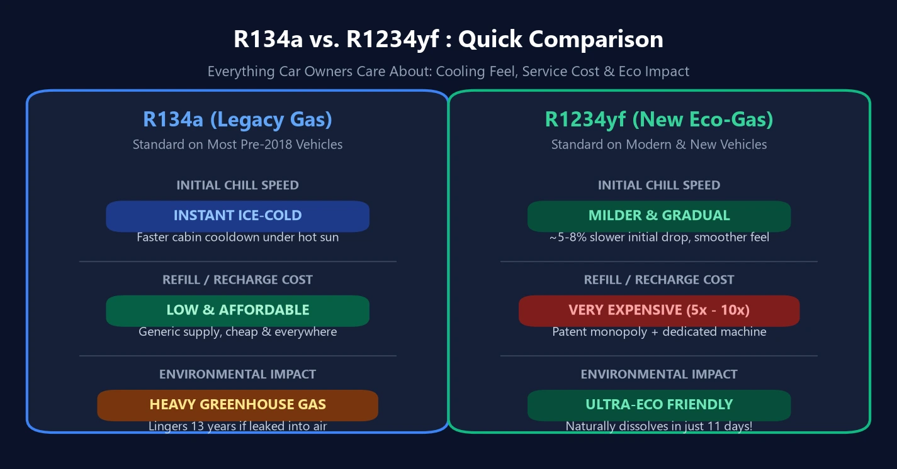

Lors d'une révision de climatisation sur un véhicule récent, de nombreux propriétaires ont la mauvaise surprise de découvrir le devis : alors qu'une recharge au **`R134a`** ne coûtait que quelques dizaines d'euros, une intervention sur un circuit au **`R1234yf`** s'élève fréquemment à plusieurs centaines d'euros !

Plus troublant encore : après avoir payé le prix fort pour ce gaz écologique haute technologie, certains conducteurs ont la sensation que l'air soufflé met plus de temps à devenir glacial lors des après-midis caniculaires. Simple impression subjective ou réalité thermodynamique ? Faisons le point avec rigueur.

---

## 1. Comparatif des Spécifications : Pourquoi cette Transition Forcée ?

L'histoire des fluides frigorigènes automobiles est dictée par les accords environnementaux internationaux :
- **1re Génération R12 (CFC)** : Pouvoir frigorifique exceptionnel, mais destructeur de la couche d'ozone ; interdit mondialement dans les années 1990.
- **2e Génération R134a (HFC)** : Aucun impact sur l'ozone ($$\text{ODP} = 0$$), mais **puissant gaz à effet de serre**.
- **3e Génération R1234yf (HFO)** : Désormais obligatoire sur tous les véhicules neufs vendus en Europe, en Amérique et au Japon.

| Critère de Comparaison | Historique : R134a | Moderne : R1234yf | Réalité Pratique au Quotidien |
| :---: | :---: | :---: | :--- |
| **Sensation de Froid Immédiat** | **Froid saisissant, chute thermique brutale** | **Légèrement plus progressif ($$5\% \sim 8\%$$ plus lent au départ)** | Le fluide historique absorbe les calories plus vite ; les condenseurs modernes sont agrandis pour compenser mais le souffle initial est moins brutal. |
| **Impact Écologique (Raison du basculement)** | Fort gaz à effet de serre (persiste $$13\text{ ans}$$ dans l'air) | **Ultra-écologique (dégradé en $$11\text{ jours}$$)** | Proscrit par les normes ; le nouveau gaz réchauffe moins la planète que le dioxyde de carbone ($$\text{CO}_2$$). |
| **Coût de la Recharge** | **Très abordable et répandu** | **Très onéreux ($$5 \sim 10\times$$ plus cher)** | Brevets verrouillés par les géants de la chimie et matières premières complexes gonflent la facture d'atelier. |
| **Outillage d'Atelier** | Manomètres et stations classiques | Stations blindées étanches anti-déflagrantes | Gaz modérément inflammable exigeant un matériel de recharge certifié très cher. |

---

## 2. Pourquoi Certains Conducteurs Trouvent-ils qu'il « Refroidit Moins Vite » ?

Cette impression que les voitures neuves mettent un peu plus de temps à cracher un air polaire n'est pas une illusion d'optique. Elle s'explique par deux réalités de physique appliquée :

1. **Frein Thermodynamique : Une Chaleur Latente Plus Faible**  
   La climatisation automobile repose sur l'ébullition du fluide frigorigène liquide dans l'évaporateur pour pomper la chaleur de l'habitacle. Le R1234yf possède une **chaleur latente de vaporisation inférieure de $$5\% \sim 8\%$$** à celle du R134a. À cylindrée de compresseur égale, il extrait un peu moins de chaleur par unité de temps.
2. **Compensations d'Ingénierie par les Constructeurs**  
   Pour pallier ce déficit, les constructeurs automobiles ont installé des **condenseurs de plus grande surface**, des **échangeurs de chaleur internes (IHX)** et des compresseurs électroniques à cylindrée variable. La température d'équilibre finale est rigoureusement identique, mais la « morsure glaciale immédiate » est légèrement adoucie.

---

## 3. Pourquoi ce Gaz est-il si Incroyablement Cher ?

Deux facteurs économiques et réglementaires expliquent ce tarif élevé :

1. **Le Monopole des Brevets Chimiques**  
   Le R1234yf a été conjointement développé et breveté par les géants américains **Honeywell** et **Chemours (ex-DuPont)**. Ce verrouillage juridique et la complexité des étapes de synthèse empêchent l'arrivée de fabricants génériques à bas coût.
2. **Normes de Sécurité et Équipements Anti-Étincelles**  
   Classé **A2L (légèrement inflammable)**, le R1234yf requiert des stations de récupération et de tirage au vide pressurisées, totalement étanches et équipées de ventilateurs anti-déflagrants. Les réparateurs doivent amortir ces équipements dont le prix atteint des sommes considérables.

---

## 4. Trois Règles Fondamentales pour Entretenir sa Climatisation

1. **Vérifiez l'Étiquette sous le Capot : Ne Jamais Mélanger les Gaz !**  
   La traverse de radiateur comporte une étiquette signalétique claire. **N'acceptez jamais qu'un garage remplisse un circuit R1234yf avec du R134a économique**. Les détendeurs, pressions et surtout les huiles de compresseur sont chimiquement incompatibles (Denso utilise la ND-OIL 8 pour le R134a et impose la ND-OIL 12 spécifique pour le R1234yf). Mélanger ces fluides décompose l'huile et grippe le compresseur !
2. **Exigez une Recharge au Gramme Près par Pesée Électronique**  
   Les climatisations contemporaines tolèrent des marges infimes : un écart de seulement $$30\text{ grammes}$$ dégrade sensiblement la puissance frigorifique. Refusez les recharges manuelles approximatives à la pression du manomètre et exigez une station automatique programmée selon la masse exacte prescrite.
3. **Le Gaz Ne Se Consomme Pas Naturellement**  
   Un circuit de climatisation est une boucle fermée hermétique. Si l'efficacité faiblit avec les années, c'est qu'une **micro-fuite** s'est déclarée (joints toriques, condenseur percé par un gravillon, évaporateur). Réinjecter aveuglément du R1234yf sans rechercher et colmater la fuite revient à jeter des centaines d'euros par la fenêtre.
