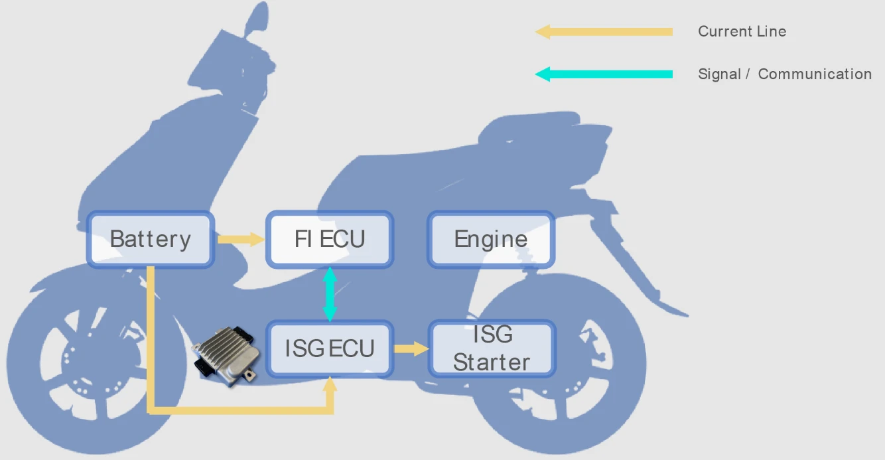

Ces dernières années, de grands constructeurs de deux-roues (tels que SYM, Kymco ou Yamaha) ont intégré la technologie **ISG (Integrated Starter Generator)** sur leurs scooters et motos. Au-delà du confort offert par le démarrage silencieux sans secousse et la coupure automatique au ralenti (Start & Stop), la fonction d'**assistance électrique au démarrage (Motor Assist / Hybridation Légère)** est devenue un argument commercial majeur.

Néanmoins, de nombreux motards constatent qu'avec la batterie d'origine au plomb-acide, ce coup de pouce électrique paraît timide. En revanche, après être passés à une **batterie au phosphate de fer lithié (LiFePO4)**, l'effet de poussée au démarrage ou à la remise des gaz est nettement amplifié. Comment s'explique ce mécanisme physique ? Et pourquoi des limites infranchissables subsistent-elles malgré l'amélioration de la batterie ? Analyse technique détaillée.

---


*Source image : [Shindengen](https://www.shindengen.com/products/electro/exhibition/private_exhibition/isg_ecu/)*

## Qu'est-ce que l'ISG ? Principe et Double Rôle Mécanique

Sur une moto conventionnelle, le démarreur électrique et l'alternateur (volant magnétique) sont deux organes indépendants. Lors de la mise en route, le démarreur doit entraîner le vilebrequin par un train d'engrenages et une roue libre, générant un cliquetis métallique bruyant et des vibrations.

**L'ISG fusionne ces deux éléments en un seul ensemble brushless**, dont le rotor et le stator sont fixés directement sur la queue du vilebrequin moteur. Il opère sous trois modes :

1. **Mode Démarrage Silencieux (Moteur)** : En tirant l'énergie de la batterie, il fait tourner directement le vilebrequin. L'absence de pignons de réduction procure un démarrage quasi instantané, fluide et totalement silencieux.
2. **Mode Assistance Électrique (Boost moteur)** : Au démarrage ou lors d'une ouverture brutale des gaz, le calculateur injecte du courant dans l'ISG pour fournir un couple d'appoint directement sur le vilebrequin, comblant le creux de couple à bas régime du moteur thermique.
3. **Mode Générateur et Récupération d'Énergie** : En régime de croisière ou lors des décélérations, l'ISG redevient un alternateur classique pour convertir l'énergie mécanique ou le frein moteur en électricité afin de recharger la batterie de bord.

## Les Limites Physiques Intrinsèques du Boost ISG

Bien que l'ISG apporte un surcroît de dynamisme appréciable, il ne s'apparente en rien à une hybridation 48V automobile ou à un véhicule électrique pur, bridé par des contraintes matérielles strictes :

* **Le Goulot d'Étranglement de la Basse Tension 12V** : Selon la relation fondamentale de puissance $$P = V \times I$$, pour délivrer une puissance d'assistance de 1 kW (environ 1,35 ch) sous une tension nominale de 12V, le courant tiré sur la batterie dépasse **90 à 100 Ampères** en tenant compte des rendements de l'onduleur (MCU) et du moteur. Vouloir doubler cette puissance ferait exploser l'intensité, provoquant un échauffement destructeur du faisceau électrique.
* **Espace Restreint et Conduction Thermique** : Le moteur ISG est logé contre le carter moteur, dans un milieu confiné exposé aux calories de la combustion (souvent au-dessus de 90°C). Une assistance électrique prolongée accumulerait une chaleur excessive dans les enroulements du stator, risquant de brûler le vernis isolant ou de désaimanter les aimants permanents.
* **Durée d'Assistance Éc возможно limitative** : Pour ménager la batterie et prévenir la surchauffe, l'ECU d'origine limite généralement le boost aux 10 à 20 premières secondes de relance, sans jamais pouvoir propulser le scooter de manière autonome à vitesse stabilisée.

## Batterie Plomb vs LiFePO4 : Pourquoi le Gain Ressenti est si Spectaculaire ?

Si l'ISG est bridé par conception, pourquoi le remplacement de la batterie d'origine au plomb par un modèle **LiFePO4** transfigure-t-il la poussée au démarrage ? La réponse réside dans **les propriétés physiques de la batterie qui libèrent le couple réel étouffé par la batterie au plomb**.

```
【Comportement de la Tension sous Appel de Courant Massif】
Plomb Traditionnel : 12.8V ──► [Fort Appel de Courant] ──► Chute IR à 10.0V~10.5V (Puissance Électrique Réduite)
Batterie LiFePO4 :   13.2V ──► [Fort Appel de Courant] ──► Tension Maintenue à 12.5V~12.8V (Pleine Puissance Développée)
```

### 1. Résistance Interne et Chute de Tension Ohmique (Chute IR)
* **Batterie au Plomb** : Sa résistance interne élevée fait chuter sa tension aux bornes selon la loi d'Ohm ($$\Delta V = I \times R_{\text{interne}}$$) lorsqu'un courant de 60 à 80 A est requis. La tension s'écroule instantanément de 12,8V vers 10,5V ou moins. Cette baisse de tension ampute directement la puissance électrique disponible pour le moteur ($$P = V \times I$$), bridant le couple d'assistance.
* **Batterie LiFePO4** : Elle dispose d'une résistance interne cinq fois plus faible et d'un taux de décharge (C-rate) très élevé. Même sous un débit de 100 A, sa tension aux bornes reste solidement ancrée au-dessus de 12,5V. Le moteur ISG reçoit ainsi une tension élevée constante et déploie l'intégralité du couple pour lequel il a été calibré.

### 2. Réceptivité de Charge et Efficacité de Récupération
À la décélération, l'ISG renvoie de forts courants de charge. Les batteries au plomb absorbent mal ces impulsions brèves en raison de leur cinétique chimique lente. À l'inverse, les accumulateurs LiFePO4 absorbent instantanément ces pointes d'énergie cinétique, restaurant promptement la réserve électrique pour le démarrage suivant.

| Propriété / Critère | Batterie Plomb Conventionnelle | Lithium Fer Phosphate (LiFePO4) |
| :--- | :--- | :--- |
| **Résistance Interne** | Élevée ; chute de tension sévère lors des fortes décharges | Infime ; maintien d'une tension très stable sous fort appel de courant |
| **Taux de Décharge (C-Rate)** | Moyen ; les fortes décharges répétées écourtent sa durée de vie | Exceptionnel ; encaisse des impulsions de 20C à 40C sans broncher |
| **Poussée ISG au Démarrage** | Étranglée par la chute de tension ; couple électrique incomplet | Pleine restitution du couple d'ingénierie prévu d'origine |
| **Rendement Récupération Énergie** | Faible absorption des pointes de courant de freinage | Récupération d'énergie cinétique maximale et quasi instantanée |
| **Masse Embarquée** | Lourde (environ 3 à 4 kg) | Très légère (environ 0,8 à 1,2 kg) |

## Les Limites Techniques Indépassables

Certains conducteurs imaginent à tort qu'une batterie LiFePO4 « augmente les chevaux du moteur ». Sur le plan de l'ingénierie, **la batterie LiFePO4 supprime simplement le goulot d'étranglement de sous-tension pour permettre à l'ISG d'atteindre ses performances nominales d'usine, sans transformer la motorisation**. Le gain plafonne devant plusieurs verrous matériels :

### 1. Limiteur de Courant du Contrôleur Moteur (MCU/ECU)
Le débit électrique maximal est borné par les puces MOSFET et la cartographie interne du boîtier de contrôle (MCU). Même si une batterie LiFePO4 peut débiter 200 A, si l'onduleur est bridé à 60 A, l'intensité réelle injectée dans le moteur restera de 60 A.

### 2. Saturation Magnétique du Moteur
L'ISG est physiquement limité par la perméabilité de ses tôles d'acier et la densité de flux de ses aimants néodyme. Lorsque la saturation magnétique est atteinte, injecter davantage d'ampères ne génère aucun couple mécanique supplémentaire : l'énergie résiduelle se dissipe intégralement sous forme de chaleur nocive.

### 3. Transmission CVT et Régime Moteur
L'assistance ISG agit directement sur le vilebrequin. Au démarrage, le variateur (CVT) se trouve sur son rapport le plus court, démultipliant efficacement le couple de l'ISG pour donner une sensation de poussée vive. En revanche, à moyenne et haute vitesse, la puissance thermique du cylindre prédomine largement ; l'appoint modeste de l'ISG devient insignifiant.

## Conclusion

Le système d'assistance électrique ISG moto est une remarquable innovation technique qui bonifie la souplesse et le rendement énergétique des deux-roues modernes.

Remplacer la batterie au plomb d'origine par une batterie LiFePO4 supprime l'effondrement de tension sous fort ampérage et permet au moteur ISG de **délivrer 100% de son potentiel d'origine**. Toutefois, l'architecture 12V, le bridage du contrôleur et l'évacuation thermique rappellent que l'ISG reste un assistant ponctuel. En comprenant ces équilibres physiques, chaque motard peut apprécier ce surcroît de brio tout en préservant la fiabilité de sa monture.
