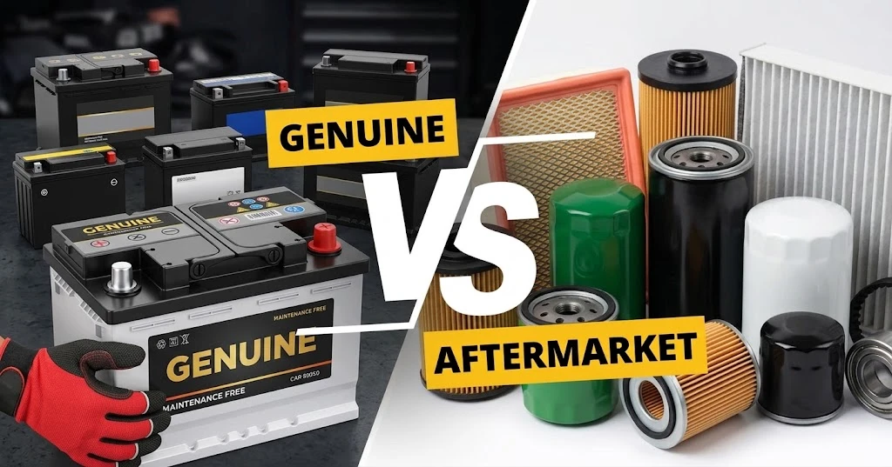

De nombreux automobilistes ont déjà vécu cette scène : après avoir fait remplacer une batterie ou des freins dans un garage indépendant, ils se rendent en concession officielle pour un entretien courant et s'entendent dire : **« Cette pièce n'est pas d'origine, c'est de l'adaptable. »** De quoi faire douter le conducteur de la probité de son garagiste indépendant.

Mais qu'est-ce qui définit exactement une pièce « d'Origine » ? L'absence du logo de la marque automobile est-elle synonyme de pièce au rabais ? Et pourquoi n'entend-on jamais parler de « pneus adaptables » ? Faisons toute la lumière sur la chaîne d'approvisionnement des pièces détachées et des pneumatiques.

## 1. Pièces Automobiles : Marques, Réseaux et Idées Reçues

Pour comprendre la hiérarchie des pièces détachées, il faut d'abord poser une réalité industrielle : **les constructeurs automobiles ne fabriquent pas la majorité de leurs composants**.

Entre 70% et 80% des organes d'une voiture moderne (bougies d'allumage, alternateurs, amortisseurs, étriers de frein, batteries) sont conçus et fabriqués par de gigantesques équipementiers de rang 1 comme Bosch, Continental, ZF Sachs, Valeo ou VARTA.

Sur le marché de la rechange, les pièces se divisent en trois grandes familles :

### 1. Pièces d'Origine (Genuine Parts)
* **Définition** : Fabriquées par l'équipementier de rang 1, contrôlées selon le cahier des charges de la marque, frappées du **logo du constructeur** et de sa référence officielle, et conditionnées dans l'emballage de la marque automobile.
* **Caractéristiques** : Disponibles quasi exclusivement dans les concessions officielles et leurs réseaux agréés. Elles portent le tarif le plus élevé (incluant royalties de marque et marges de concession) et bénéficient de la garantie constructeur intégrale.

### 2. Pièces OEM (Original Equipment Manufacturer)
* **Définition** : Fabriquées par le **même équipementier de premier rang** sur les mêmes chaînes d'assemblage, offrant les mêmes tolérances et spécifications que la pièce d'origine, mais conditionnées dans l'**emballage propre à l'équipementier** (sans le logo de la marque de voiture).
* **Caractéristiques** : Distribuées dans les réseaux indépendants et chez les grossistes de pièces à un tarif généralement inférieur de 30% à 50% par rapport à la concession.

### 3. Pièces Adaptables / Marché Indépendant (Aftermarket Parts)
* **Définition** : Pièces conçues et produites par des **usines tierces** qui ne sont pas fournisseurs d'origine du constructeur, mais qui fabriquent des équivalents dimensionnels compatibles.
* **Caractéristiques** : Les plus abordables, mais dont la qualité, la longévité et les tolérances varient sensiblement selon la réputation de la marque tierce.

## 2. Le Cas Particulier des Pneumatiques : Pourquoi Pas de « Pneu Adaptable » ?

Dans le monde du pneumatique, le vocabulaire change totalement : **personne ne qualifie un pneu Michelin, Continental ou Goodyear de pneu adaptable**.

Le pneu est un composant d'usure standardisé, et les manufacturiers possèdent une légitimité technique et une puissance de recherche & développement égales ou supérieures à celles des constructeurs automobiles. Le marché se segmente ainsi :

### 1. Première Monte d'Usine (OE Tires)
Le pneumatique monté sur la chaîne de production lors de la sortie d'usine du véhicule neuf. Les constructeurs collaborent avec les manufacturiers pour choisir les modèles les plus en phase avec le châssis.

### 2. Pneus Homologués et Marqués par le Constructeur
Sur les berlines de prestige et sportives (Porsche, BMW, Mercedes-Benz, Audi), les manufacturiers retravaillent la gomme, la carcasse et l'insonorisation avec les ingénieurs châssis, gravant un **symbole d'homologation officiel** sur le flanc :

* **`★` (Étoile)** : Homologation BMW / Mini
* **`MO` / `MOE`** : Homologation Mercedes-Benz (MOE = roulage à plat / Extended)
* **`AO` / `RO1`** : Homologation Audi (RO1 pour la gamme ultra-sportive RS)
* **`N0` à `N6` / `NA0`** : Homologation Porsche
* **`T0` / `T1`** : Homologation Tesla (avec mousse acoustique intégrée)

### 3. Pneus de Remplacement Universels
Pneus standards vendus dans le commerce grand public. Dès lors que les dimensions (ex. 225/45 R17), l'indice de charge et l'indice de vitesse respectent les prescriptions du manuel de bord, ils sont rigoureusement homologués, sûrs et légaux.

## 3. Synthèse Comparative : Pièces Mécaniques vs Pneumatiques

| Dimension | Pièces d'Origine (Constructeur) | Pièces OEM / Adaptables | Pneus Homologués (Marquage OE) | Pneus Universels de Remplacement |
| :--- | :--- | :--- | :--- | :--- |
| **Définition** | Pièce agréée, emballée et garantie par la marque de voiture. | Pièce sans logo constructeur (OEM d'usine ou fabriquant tiers). | Pneu d'usine ou optimisé spécifiquement pour le châssis d'une marque. | Pneu standard produit par le manufacturier pour le marché ouvert. |
| **Logo & Marquages** | Porte le **logo du constructeur** et la référence d'origine. | Porte la **marque de l'équipementier**, sans logo constructeur. | Porte la marque du pneu et le **symbole constructeur** (`MO`, `★`). | Porte la marque du pneu et ses **dimensions standards** uniquement. |
| **Canaux de Vente** | Concessions agréées et comptoirs de pièces de la marque. | Garages indépendants, grossistes pièces, plateformes internet. | Concessions, pneumaticiens spécialisés, centres auto. | Centres auto, pneumaticiens, garages indépendants. |
| **Garantie** | Couverte par la garantie du réseau constructeur. | Garantie assurée par l'équipementier ou le réparateur. | Garantie du fabricant de pneu ; n'altère pas la garantie auto. | Garantie du fabricant de pneu ; 100% conforme au contrôle technique. |
| **Niveau de Prix** | **Le plus élevé** (redevances de marque et marges concession). | **Modéré à très économique** (30% à 70% du prix d'origine). | **Moyen à élevé** (léger surcoût par rapport à la version universelle). | **Très flexible** (du pneu budget au pneu ultra-haute performance). |

## Conclusion : Guide pour Décider Malin

Comprendre cette structuration permet d'arbitrer rationnellement son budget d'entretien :

1. **Période de Garantie Véhicule Neuf** : Pour les organes mécaniques majeurs (moteur, boîte de vitesses, électronique de sécurité), choisir des **Pièces d'Origine** posées en réseau officiel évite toute discussion en cas de recours sous garantie.
2. **Après Garantie ou Pièces d'Usure Courante** : Pour les consommables réguliers (batteries, plaquettes, disques, filtres, bougies), opter pour des **Pièces OEM** de grands équipementiers permet de bénéficier de la qualité d'origine tout en réduisant considérablement la facture.
3. **Lors du Remplacement des Pneus** : Des pneus de grandes marques (Michelin, Continental, Bridgestone, Goodyear, Pirelli) respectant les dimensions prescrites sont irréprochables au quotidien. Pour les sportives de pointe aux trains roulants hypersensibles, les pneus marqués par le constructeur garantissent l'équilibre dynamique d'origine.
