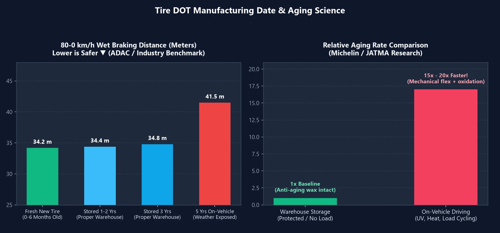

Lors du remplacement de leurs pneumatiques, de nombreux automobilistes s'accroupissent d'instinct pour scruter le **code de date de fabrication `DOT`** gravé sur le flanc. S'il a été fabriqué il y a trois mois à peine, ils s'estiment chanceux ; en revanche, s'il date d'un an ou deux en tant que stock d'entrepôt, ils suspectent immédiatement le revendeur d'écouler de la gomme durcie et dégradée.

Traiter des pneus de voiture comme des briques de lait frais va pourtant à l'encontre des lois de la physique automobile. Un pneu stocké dans les règles de l'art pendant 1 ou 2 ans compromet-il réellement votre sécurité ? Voici la réalité démontrée par les bancs d'essais internationaux.

---

## 1. Lire la date de fabrication d'un pneu (code DOT) en 10 secondes

Sur le flanc extérieur du pneu, repérez la mention commençant par **`DOT`**. Les **4 derniers chiffres** situés dans un marquage ovale indiquent le lot de fabrication :

| Exemple de marquage | Décomposition | Signification |
| :---: | :---: | :--- |
| **`3525`** | 2 premiers chiffres **`35`** (semaine) + 2 derniers chiffres **`25`** (année) | Fabriqué lors de la **35e semaine de 2025** (fin août 2025) |
| **`0826`** | 2 premiers chiffres **`08`** (semaine) + 2 derniers chiffres **`26`** (année) | Fabriqué lors de la **8e semaine de 2026** (fin février 2026) |

---

## 2. Essais scientifiques : un pneu stocké de 1 à 3 ans perd-il en performance ?

Des organismes automobiles indépendants et de grands manufacturiers ont réalisé des tests aveugles rigoureux :

- **Automobile Club Allemand (ADAC) & Agence Coréenne des Consommateurs (KCA)** : Ils ont comparé des pneus tout juste moulés à des pneus de stock inutilisés âgés de **$$2\text{ à }3\text{ ans}$$**. Sur piste à haute vitesse, lors de freinages d'urgence ABS sur sol mouillé et en résistance à l'aquaplaning, **les distances d'arrêt et le grip latéral étaient statistiquement indiscernables**.
- **SASO (Arabie Saoudite) & JATMA (Japon)** : Leurs études démontrent que rouler avec un pneu pendant seulement **$$3\text{ semaines}$$** engendre un stress oxydatif et un vieillissement thermique équivalents à **$$1\text{ an complet}$$** de stockage immobile en entrepôt !
- **Recherches Michelin & Bridgestone** : Des pneus inutilisés conservés en conditions intérieures standardisées ne vieillissent qu'à une vitesse de **$$\frac{1}{15} \sim \frac{1}{20}$$** par rapport à des pneus montés en service. De plus, la réticulation de la vulcanisation continue de se stabiliser au cours des mois suivant la production ; un pneu de stock modérément stabilisé offre souvent une résistance à l'usure supérieure.

> **Pourquoi les pneus neufs en entrepôt ne s'abîment-ils pas ?**  
> Tout mélange de gomme moderne intègre des **agents antiozonants et des cires protectrices**. Au repos, ces cires migrent naturellement vers la surface pour former un film protecteur grisâtre bloquant l'oxygène atmosphérique et l'ozone. En l'absence du poids du véhicule, du rayonnement UV du soleil et des cycles thermiques de l'asphalte, la dégradation chimique est quasi nulle.

---

## 3. Choisir intelligemment : pneu ultra-récent vs pneu de stock remisé

La compréhension du vieillissement de la gomme vous permet d'optimiser votre achat selon votre **kilométrage annuel** :

| Profil conducteur | Kilométrage annuel | Choix le plus judicieux | Justification stratégique |
| :---: | :---: | :--- | :--- |
| **Gros rouleurs / Navetteurs** | **$$> 15\,000\text{ km / an}$$** | **Pneus de stock de 1 à 2 ans** **(Meilleur rapport qualité/prix !)** | Vous userez la bande de roulement en $$2 \sim 3\text{ ans}$$, bien avant que le vieillissement calendaire n'intervienne. Profiter de remises substantielles est une excellente affaire sans compromis sur la sécurité. |
| **Petits rouleurs / Week-end** | **$$< 5\,000\text{ km / an}$$** | **Pneus récents de l'année en cours** | Comme la longévité de votre gomme atteindra la limite temporelle avant l'usure mécanique, un code DOT ultra-récent maximise vos années d'usage sécurisé. |

---

## 4. La règle d'or « 3 / 5 / 10 » pour le remplacement des pneus

1. **Moins de 3 ans (non montés) = Vendu comme neuf d'usine** :  
   Selon la norme allemande DIN et la législation européenne, des pneus stockés dans des conditions conformes jusqu'à **$$3\text{ ans}$$** sont légalement considérés comme neufs d'usine (« fabrikneu »).
2. **5 ans de service sur route = Contrôle annuel obligatoire** :  
   Après **$$5\text{ ans}$$** de roulage, un contrôle visuel annuel s'impose pour détecter d'éventuelles microfissures sur les flancs ou un durcissement des sillons, quelle que soit la profondeur restante.
3. **10 ans depuis la date DOT = Retrait et réforme obligatoire** :  
   Dès que **$$10\text{ ans}$$** se sont écoulés depuis la date DOT estampillée (roue de secours comprise), le pneu doit être systématiquement mis au rebut pour écarter tout risque d'éclatement à haute vitesse.
