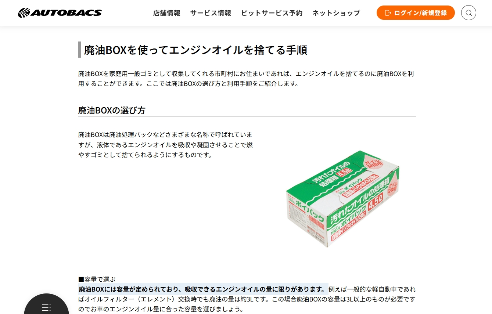
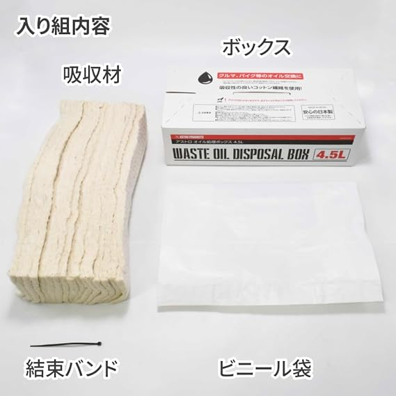
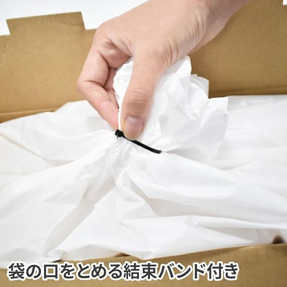

Pour les passionnés d'automobile et de deux-roues adeptes de l'entretien « Do It Yourself » (DIY), choisir une huile 100 % synthèse de haute qualité, dévisser le bouchon de carter et visser un filtre à huile neuf ne représente pas seulement une belle économie de main-d'œuvre : c'est aussi le meilleur moyen de surveiller l'état mécanique de son moteur. Cependant, une fois la clé dynamométrique rangée, une question épineuse se pose : **« Mais où donc puis-je déposer cette huile noire usagée ? »**

Autrefois, le petit atelier du coin ou la station-service acceptait volontiers de verser vos quelques litres d'huile dans leur grand fût de collecte. Aujourd'hui, on voit fleurir des panneaux « Dépôt d'huile extérieure refusé ». Quelles sont les raisons de cette évolution et comment évacuer son huile usagée en toute conformité, sécurité et propreté ?

*Référence : [Site officiel AUTOBACS - Guide d'élimination de l'huile moteur : solidifier, absorber, incinérer ou recycler ?](https://www.autobacs.com/static_html/srv/engineoil/article/1031/)*

## La solution DIY japonaise : le bac absorbant pour huile usagée (Waste Oil Box)

Le Japon possède l'une des cultures d'entretien automobile DIY les plus avancées au monde. Le réseau d'équipements et centres d'entretien [AUTOBACS](https://www.autobacs.com/static_html/srv/engineoil/article/1031/) détaille dans ses guides pratiques le fonctionnement de ces boîtes de vidange absorbantes :

### Les 4 composants techniques d'un bac de vidange absorbant
Loin d'être un simple carton, ce bac est conçu pour répondre aux contraintes réelles de la vidange. Prenons l'exemple du bac [ASTRO PRODUCTS 4.5L](https://www.amazon.co.jp/dp/B0DJTH698N) :

*Crédit image : [Amazon.co.jp - Boîte de vidange 4.5L | ASTRO PRODUCTS](https://www.amazon.co.jp/dp/B0DJTH698N)*

1. **Carton extérieur renforcé (Box)** : Fournit un maintien stable au sol et une isolation thermique, empêchant l'huile chaude de détériorer le sol tout en évitant le basculement sous le débit de vidange.
2. **Matériau absorbant haute densité (Absorbent Core)** : Fait de fibres de coton multicouches ou de polymères spéciaux qui piègent instantanément plusieurs litres de fluide, transformant le liquide en masse solide non fuyante.
3. **Doublure plastique étanche et résistante à la chaleur (Plastic Liner)** : Sac étanche à haute résistance aux perforations, supportant les huiles chaudes sans fondre.
4. **Collier de serrage haute résistance (Cable Tie)** : **Le composant indispensable garantissant « zéro fuite et zéro odeur » !**

*Crédit image : [Amazon.co.jp - Détails boîte de vidange 4.5L ASTRO PRODUCTS](https://www.amazon.co.jp/dp/B0DJTH698N)*

### Pourquoi le collier de serrage (Cable Tie) est-il l'âme du système ?

Après écoulement, le sac renferme 3 à 5 kg d'huile chaude et dense. Se contenter d'un simple nœud à la main présente de graves faiblesses :
* **Micro-canaux créés par les plis épais** : Le plastique renforcé ne se comprime pas hermétiquement à la main. Dès que le sac bouge dans le coffre, le suintement est quasi inévitable.
* **Perte de volume utile** : Nouer le sac à la main exige de tirer fort sur les parois, comprimant la ouate et faisant refluer l'huile vers l'ouverture.
* **Force de compression totale et étanchéité absolue** : Grâce au collier en nylon, il suffit de chasser l'air excédentaire, de **torsader le goulot comme une corde**, puis de serrer fermement le collier à la base. Même si le carton se renverse lors du trajet, aucune goutte ni odeur ne s'échappera !

| Capacité | Types de véhicules recommandés | Remplacement filtre à huile |
|:---:|:---:|:---:|
| **2,5 L** | Scooters, motos de petite/moyenne cylindrée | Capacité très large (motos : 0,8L à 1,5L) |
| **4,5 L** | Berlines essence 4 cylindres standard, compactes, grosses cylindrées moto | Volume idéal pour moteurs 4 cylindres habituels |
| **6,5 L** | Moteurs 6 cylindres, SUV turbo, moteurs diesel | Moteurs à fort volume de carter d'huile |

> **Précision réglementaire (Japon vs autres pays)** : Dans le système de gestion des déchets ménagers japonais, de nombreuses communes autorisent l'incinération ménagère de ces bacs absorbants scellés. **En Europe et dans de nombreux autres pays, les huiles minérales sont des déchets dangereux soumis à filière dédiée (déchetteries).** L'avantage de ces bacs réside alors dans **la propreté absolue du travail et le transport sans risque de fuite dans votre coffre** jusqu'au point d'apport volontaire agréé.

## Les 4 règles d'or de la manipulation des huiles usagées

1. **Ne jamais verser d'huile dans les égouts, canalisations ou sur le sol** :  
   Un seul litre d'huile moteur peut polluer jusqu'à un million de litres d'eau potable. Ces actes constituent des infractions environnementales passibles de lourdes amendes pénales.
2. **Ne jamais mélanger différents fluides** :  
   Le recyclage et la régénération exigent une pureté chimique rigoureuse. Ne mélangez jamais **liquide de refroidissement (éthylène glycol), liquide de frein (esters de glycol), essence ou eau** avec votre huile de vidange.
3. **Bannir les contenants fragiles (bouteilles d'eau en plastique PET)** :  
   Les bouteilles d'eau minérale ont un goulot trop étroit et un plastique fin qui se déforme instantanément sous la chaleur de l'huile. Elles risquent d'éclater sous une pression modérée dans votre coffre.
4. **Traitement adéquat du filtre à huile usagé** :  
   Un filtre à huile dévissé contient encore beaucoup d'huile. Laissez-le s'égoutter tête en bas pendant au moins 12 heures dans votre bac ou récipient, puis déposez le corps métallique dans les bacs de ferraille de la déchetterie.

## Conclusion : allier plaisir de la mécanique et responsabilité environnementale

Entretenir soi-même sa voiture ou sa moto apporte une véritable satisfaction. **« Conclure l'intervention par un recyclage propre et irréprochable » est la signature d'un passionné mature et compétent.** Que vous utilisiez le bidon d'origine en PEHD ou un bac absorbant hermétiquement clos par son **collier de serrage renforcé**, vous profitez des économies du DIY tout en préservant scrupuleusement notre environnement !
