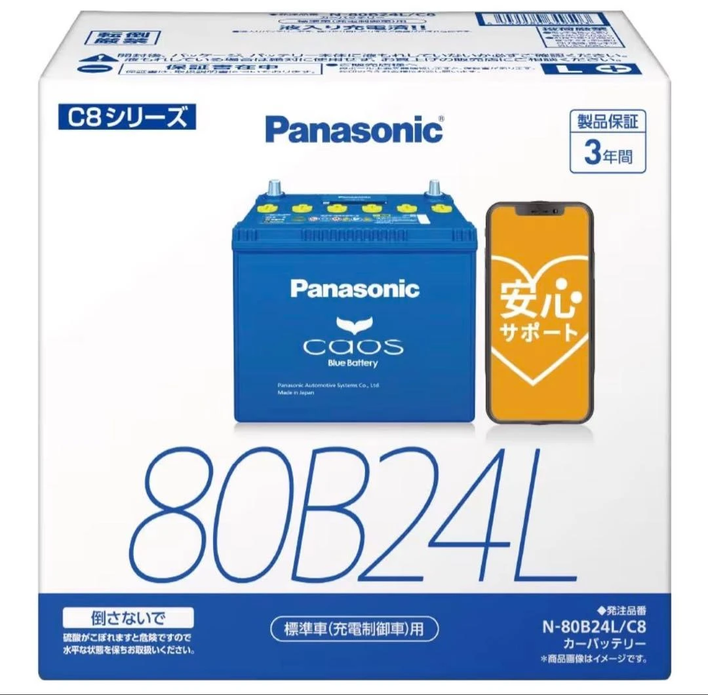

Lors du choix ou du remplacement d'une batterie pour un véhicule japonais, vous rencontrez fréquemment des codes alphanumériques tels que **`80B24L`** ou **`55D23L`**. Bien qu'ils paraissent mystérieux de prime abord, ces identifiants respectent scrupuleusement la norme industrielle japonaise (**JIS D 5301**). Chaque lettre et chaque chiffre définit avec précision les performances électriques et l'encombrement physique de la batterie. Voici l'analyse détaillée de chaque paramètre.

---

## 1. Décomposition du code de modèle d'une batterie japonaise : l'exemple « 80B24L »

La norme JIS structure la désignation du modèle en quatre segments clés :

| Exemple | Désignation | Signification et explication technique |
| :---: | :--- | :--- |
| **80** | **Rang de performance** | Plus le nombre est grand, plus la puissance de démarrage et la capacité de réserve sont élevées. |
| **B** | **Code largeur & hauteur** | Définit les dimensions transversales standardisées (largeur et hauteur du bac). |
| **24** | **Longueur du bac** | Représente une longueur extérieure approximative de **24 cm** ($$240\text{ mm}$$). |
| **L** | **Polarité de la borne positive** | Indique que la borne positive (+) est située sur le côté **gauche** (Left). |

---

### Analyse approfondie de chaque segment

1. **Rang de performance (ex. 80)**
   * Il s'agit d'une note composite reflétant la puissance globale de démarrage et la capacité électrique de la batterie. Un chiffre plus élevé garantit un démarrage vigoureux et une meilleure endurance.
   * Lors du remplacement, vous pouvez choisir la valeur d'origine ou **monter en gamme vers un indice supérieur** (par exemple, passer de 46 à 60 ou 80) afin de stabiliser le réseau de bord face aux accessoires électroniques récents.

2. **Code de section du bac (ex. B)**
   * Ces lettres anglaises désignent des dimensions transversales strictes :
     * **B** : Largeur env. $$129\text{ mm}$$, hauteur env. $$203\text{ mm}$$.
     * **D** : Largeur env. $$173\text{ mm}$$, hauteur env. $$204\text{ mm}$$.
   * **Attention** : Cette lettre détermine directement si la batterie rentre dans le bac d'origine et sous la patte de fixation moteur. Elle ne doit en aucun cas être modifiée.

3. **Longueur du bac (ex. 24)**
   * Indique la longueur extérieure approximative en centimètres (**24 cm / $$240\text{ mm}$$**).
   * L'espace du bac moteur étant délimité, cette dimension doit correspondre au support de votre véhicule.

4. **Polarité des bornes (ex. L ou R)**
   * **Règle de vue** : Regardez la batterie de face, les bornes étant le plus près de vous :
     * **L** (Left) : La borne positive (+) est à **gauche**.
     * **R** (Right) : La borne positive (+) est à **droite**.
   * **Avertissement crucial** : Les faisceaux de câbles d'origine sont calibrés au plus juste. Si vous choisissez la mauvaise polarité, les câbles ne pourront pas s'étirer pour atteindre les bornes inverses, rendant le branchement impossible.

---

## 2. Connaissance technique approfondie : comment le rang de performance est-il calculé ?

Selon la norme JIS D 5301, le chiffre initial (comme 50 ou 80) n'est pas un argument marketing inventé. Il est calculé mathématiquement à l'aide de la formule suivante et arrondi à l'entier le plus proche :

$$\text{Rang de performance} = \sqrt{\text{CCA} \times \text{RC} \times 0.28}$$

Cette formule intègre deux métriques fondamentales de l'accumulateur : le **CCA** et la **RC** :

* **Courant de démarrage à froid (CCA - Cold Cranking Amperes)** :
  * **Définition** : L'intensité maximale qu'une batterie peut délivrer à **$$0^\circ\text{F}$$ (env. $$-17,8^\circ\text{C}$$)** pendant 30 secondes tout en maintenant une tension minimale utilisable.
  * **Importance** : Reflète la vigueur du démarreur par grand froid ou lors des démarrages difficiles.
* **Capacité de réserve (RC - Reserve Capacity)** :
  * **Définition** : Le nombre de minutes pendant lesquelles une batterie peut fournir un courant continu de **$$25\text{ A}$$ à $$25^\circ\text{C}$$** avant que sa tension aux bornes ne descende à $$10,5\text{ V}$$.
  * **Importance** : Mesure l'autonomie électrique de secours en cas de défaillance de l'alternateur ou lors de l'utilisation prolongée d'accessoires moteur éteint.

---

## 3. Guide pratique d'achat et de remplacement

1. **Les dimensions physiques doivent correspondre exactement (Lettre + Longueur)** : Les gabarits comme `B24` ou `D23` sont non négociables sous peine de ne pouvoir fixer la batterie.
2. **Ne jamais inverser la polarité (L vs R)** : Ouvrez le capot et vérifiez l'emplacement du pôle positif avant de passer commande.
3. **Le rang de performance peut être augmenté en toute sécurité** : Si votre véhicule est équipé d'une dashcam permanente, d'un système audio haute puissance ou d'autres accessoires gourmands, monter en indice au sein du même gabarit (ex. passer de `46B24L` à `80B24L`) apporte une fiabilité et une endurance incomparables.
