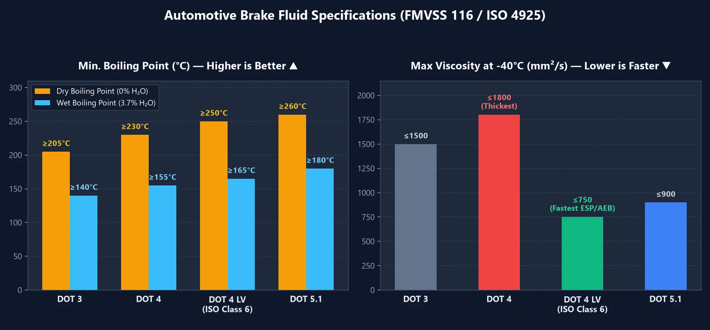

Lors de l'entretien de votre véhicule, vous apercevez fréquemment sur les bidons de liquide de frein les mentions **`DOT 3`**, **`DOT 4`**, **`DOT 4 LV`** ou **`DOT 5.1`**. Un chiffre plus grand indique-t-il obligatoirement une meilleure efficacité ? Et pourquoi les mécaniciens recommandent-ils de remplacer ce liquide tous les deux ans, même si vous roulez très peu ? Voici le guide le plus accessible pour tout comprendre sur le liquide de frein et votre sécurité.

---

## 1. Tableau comparatif des liquides de frein : les 3 critères déterminants

Lors du choix d'un liquide de frein, trois indicateurs techniques sont primordiaux :
1. **Point d'ébullition sec** : Seuil thermique maximal du liquide neuf tout juste sorti d'un bidon scellé ($$0\%$$ d'humidité).
2. **Point d'ébullition humide** : Point d'ébullition après environ 1 à 2 ans d'utilisation en conditions réelles (**$$3,7\%$$ de teneur en eau**)—**c'est le véritable indicateur de sécurité au quotidien**.
3. **Viscosité cinématique à basse température** : Une valeur plus **faible** garantit un écoulement plus rapide et un déclenchement ultra-vif des systèmes ABS, ESP et AEB.

| Spécification | Point d'ébullition sec (neuf) | Point d'ébullition humide (3,7% d'eau) | Viscosité max à $$-40^\circ\text{C}$$ | Propriétés et applications |
| :---: | :---: | :---: | :---: | :--- |
| **DOT 3** | $$\ge 205^\circ\text{C}$$ | $$\ge 140^\circ\text{C}$$ | $$\le 1500\text{ mm}^2/\text{s}$$ | Courant sur les citadines et anciens modèles asiatiques ; absorbe l'humidité plus lentement mais bout à plus basse température. |
| **DOT 4** | $$\ge 230^\circ\text{C}$$ | $$\ge 155^\circ\text{C}$$ | $$\le 1800\text{ mm}^2/\text{s}$$ | Point d'ébullition plus élevé que le DOT 3, mais **plus épais et visqueux à basse température**. |
| **DOT 4 LV** **(Classe 6)** | $$\ge 250^\circ\text{C}$$ | $$\ge 165^\circ\text{C}$$ | **$$\le 750\text{ mm}^2/\text{s}$$** | **Le meilleur choix moderne !** Haute tenue en température + fluidité record ; indispensable pour véhicules avec ESP/AEB. |
| **DOT 5.1** | $$\ge 260^\circ\text{C}$$ | $$\ge 180^\circ\text{C}$$ | $$\le 900\text{ mm}^2/\text{s}$$ | Liquide haute performance pour conduite sportive en montagne ou véhicules lourdement chargés. |
| **DOT 5** | $$\ge 260^\circ\text{C}$$ | **(Non hygroscopique)** | $$\le 900\text{ mm}^2/\text{s}$$ | **À base de silicone (militaire / collection)** ; **strictement interdit** sur voitures de série équipées d'ABS ! |

> **Pourquoi le liquide `DOT 4 LV` (`ISO 4925 Classe 6`) est-il la référence actuelle ?**  
> Si le `DOT 4` classique résiste mieux à la chaleur que le `DOT 3`, sa viscosité est nettement plus élevée. Or, les voitures modernes disposent du contrôle de trajectoire **ESP** et du freinage automatique d'urgence **AEB**, qui doivent injecter du liquide de frein à travers des micro-valves en une fraction de seconde. Passer au liquide **`DOT 4 LV`** réduit le temps de montée en pression hydraulique, maximisant la sécurité d'urgence !

---

## 2. Pourquoi remplacer son liquide de frein régulièrement ? Le danger du « Vapor Lock »

Bien des automobilistes s'interrogent : **« Le circuit de freinage n'est-il pas totalement étanche ? D'où provient cette humidité ? »**

En réalité, l'humidité atmosphérique s'infiltre en permanence à travers les micropores des quatre **flexibles en caoutchouc** et les joints des étriers. Les liquides de frein conventionnels (DOT 3 / 4 / 5.1) sont conçus pour être délibérément **hygroscopiques (ils absorbent l'eau)** :
- **Pourquoi absorber l'eau plutôt que la repousser ?** Si le liquide repoussait l'eau (comme le DOT 5 silicone), celle-ci descendrait par gravité au point le plus bas et le plus chaud du circuit : les **étriers de frein**. Des poches d'eau pure se formeraient, bouillant à seulement $$100^\circ\text{C}$$ et corrodant les pistons. En dispersant et dissolvant l'humidité de manière homogène, le fluide au glycol évite cette ébullition locale précoce, mais **son point d'ébullition global baisse au fil des mois**.

### Qu'est-ce que le phénomène de « Vapor Lock » ?

- **Fonctionnement normal (les liquides sont incompressibles)** : Lorsque vous appuyez sur la pédale de frein, la colonne de liquide transmet instantanément $$100\%$$ de votre effort musculaire aux pistons d'étrier.
- **Défaillance par Vapor Lock (les gaz sont compressibles)** : Lorsque le liquide usagé (teneur en eau supérieure à $$3\%$$, point d'ébullition chutant vers $$140^\circ\text{C}$$) est soumis à des freinages répétés lors d'une longue descente de montagne, la chaleur intense des disques et plaquettes fait entrer le liquide dans l'étrier en **ébullition, générant des bulles de vapeur**. Les gaz étant compressibles, l'enfoncement de la pédale se contente d'écraser les bulles sans pousser les plaquettes : **la pédale s'enfonce jusqu'au plancher et le freinage devient nul** !

---

## 3. Trois recommandations pratiques pour l'entretien et l'achat

1. **Remplacer selon la « durée », pas seulement le « kilométrage »** :  
   L'humidité traverse la gomme des flexibles jour et nuit, même avec une voiture garée au garage. Remplacez votre liquide de frein tous les **2 ans ou 40 000 km** (au premier des deux termes atteint).
2. **Ne pas se fier uniquement aux stylos testeurs ou à une simple aspiration du bocal** :  
   Le circuit ne circule pas en boucle. L'humidité entre par les roues et la chaleur se concentre aux **quatre étriers**. Tester le bocal moteur avec un stylo conductivimètre donne souvent un faux voyant vert, alors que le fluide aux étriers est déjà saturé d'eau. Exigez toujours une purge complète par **les vis de purge de chaque étrier**.
3. **Quel choix pour une mise à niveau ?**  
   Si votre manuel constructeur préconise du `DOT 3` ou du `DOT 4`, optez simplement pour un liquide **`DOT 4 LV` (`ISO 4925 Classe 6`)** réputé (comme ATE SL.6 ou Bosch ENV6) pour bénéficier d'une meilleure résistance thermique et d'une réactivité accrue des assistances électroniques.
