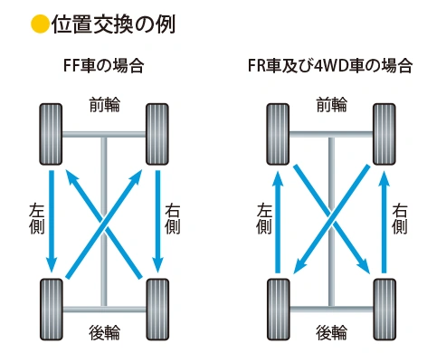
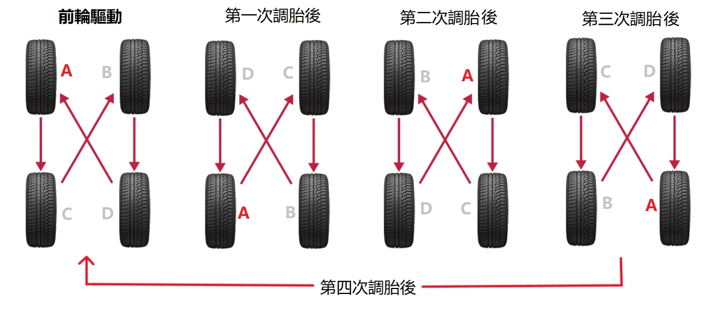
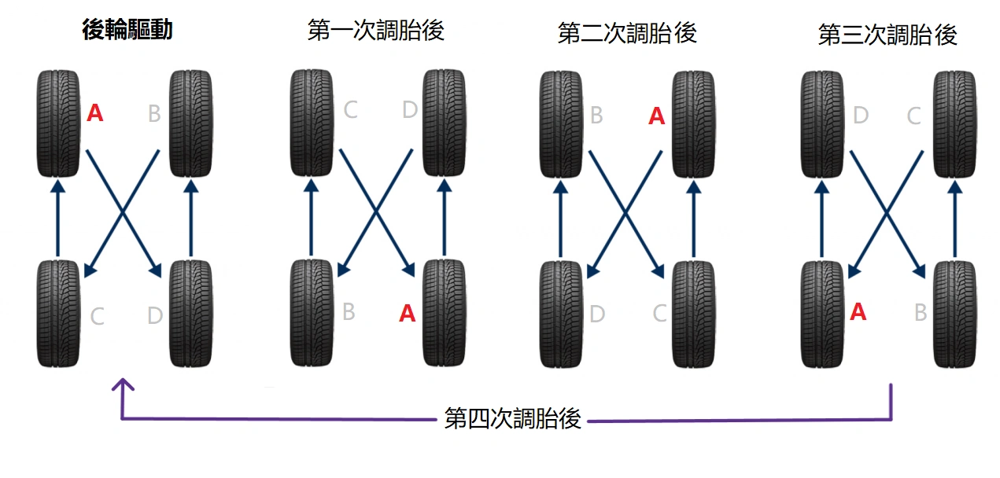

É consenso na engenharia automotiva que o rodízio de pneus a cada **5.000 km** uniformiza o desgaste, prolongando significativamente a vida útil da borracha e prevenindo o desgaste irregular prematuro.

Embora existam diversos métodos no mercado, a **NHTSA (National Highway Traffic Safety Administration)** nos EUA e a **JATMA (Japan Automobile Tyre Manufacturers Association)** prescrevem **diretrizes de rodízio estritamente equivalentes**.

Com apenas **três rodízios**, cada pneu terá passado pelas quatro posições do veículo, representando uma abordagem lógica e cientificamente balanceada. Ao levar seu veículo ao autocenter, solicite ao técnico a execução exata deste procedimento.

## Visão Geral das Diretrizes NHTSA / JATMA

Para memorizar facilmente: «O eixo tracionado move-se em linha reta; o eixo não tracionado move-se em X (cruzado)»:

| Tipo de Tração | Movimento dos Pneus Dianteiros | Movimento dos Pneus Traseiros | Lógica Mecânica |
| :--- | :--- | :--- | :--- |
| **Tração Dianteira (FF / FWD)** | Recuo **em linha reta** para a traseira | Avanço **cruzado** para a dianteira | Eixo motriz (dianteiro) reto; eixo livre (traseiro) em X |
| **Tração Traseira (FR / RWD)** / **Integral (AWD)** | Recuo **cruzado** para a traseira | Avanço **em linha reta** para a dianteira | Eixo motriz (traseiro) reto; eixo livre (dianteiro) em X |

## Diagrama para Tração Dianteira (FF / FWD)
Nos veículos de tração dianteira, as rodas frontais suportam esforço duplo de esterçamento e tração motora. No rodízio, **os pneus traseiros sobem cruzados para a dianteira, e os dianteiros descem retos para a traseira**.

## Diagrama para Tração Traseira (FR / RWD) e Tração Integral (AWD)
Em veículos com tração traseira ou integral, a lógica inverte-se harmonicamente. **Os pneus dianteiros descem cruzados para a traseira, e os traseiros sobem retos para a dianteira**.

