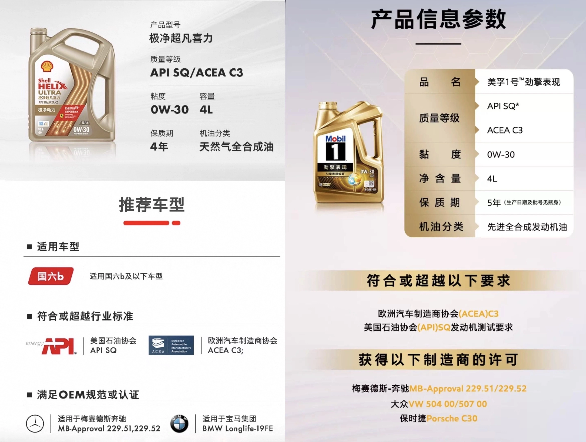

## Critérios para a Escolha do Óleo de Motor

Para qualquer automóvel, a seleção do óleo deve **partir impreterivelmente das homologações oficiais da montadora**. Apenas após igualar as normas é que analisamos viscosidade e métricas de laboratório.  
Nos motores a gasolina do Mercedes-Benz W205, as principais referências continuam sendo as homologações **MB 229.5 e MB 229.6**, conhecidas por sua ampla reserva de basicidade (TBN).

### **O Fenômeno do LSPI (Pré-Ignição) e a Seleção de Lubrificantes**
Em virtude da injeção direta associada à sobrealimentação, o W205 pode sofrer com **LSPI (Low-Speed Pre-Ignition)**, capaz de fraturar pistões em frações de segundo. Para eliminar o risco:
- **Em rotações baixas sob marcha alta, reduza a marcha antes de exigir potência plena no acelerador**
- A especificação do lubrificante é decisiva: além de buscar **[formulação com baixo teor de cálcio (< 2000 ppm)](/pt/2021/oil-parameter.html)**, é imprescindível optar por óleos que **exijam aprovação no teste oficial de LSPI (Sequence IX)**.

### **Normas que Exigem Teste Específico de LSPI**
- **DEXOS1 GEN 2 / GEN 3**: Exige teste mandatório de LSPI
- **DEXOS2**
  - Específico para veículos a gasolina: Exige aprovação de LSPI
  - **Uso misto flex/diesel: NÃO exige teste de LSPI**
- **API SN Plus**: Certificação criada em maio de 2018 com foco em mitigar o LSPI
- **API SP**: Lançada em maio de 2020, com exigência anti-LSPI e proteção avançada da corrente de sincronismo
- **API SQ**: **Norma de última geração**, impondo controle rígido contra LSPI para injeção direta aliada a ganhos substanciais em economia de combustível
- **MB 229.5 / 229.51 / 229.52 / 229.6**: Homologações emitidas ou renovadas pós-2018 com teste de validação de LSPI

## **Óleos de Destaque que Unem Homologação Mercedes e Mitigação de LSPI**
Opções renomadas que atendem aos requisitos da Mercedes-Benz e possuem chancela contra LSPI (confirme no rótulo as certificações atualizadas SP ou SQ):

| Marca   | Linha / Modelo | Viscosidade | Homologação Oficial | Base / Norma | Destaque Técnico |
|---------|----------------|-------------|---------------------|--------------|------------------|
| RAVENOL | SSV            | 0W-30       | **229.6** (Aprov. 2019)| SL PAO       | Raro 0W-30 com MB 229.6 |
| Shell   | HELIX ULTRA    | 0W-40       | **229.5** VW        | SP/SQ        | Atualização rápida de normas |
| Shell   | HELIX ULTRA    | 5W-40       | **229.5** A40 LL01  | SP/SQ        | Viscosidade nobre e versátil |
| Shell   | HELIX ULTRA    | 5W-30       | **229.5** LL01      | SP/SQ        | Referência de topo em 5W-30 |
| Total   | Quartz INEO MC3| 5W-30       | **229.52** LL04 D2  | SN+/SP       | Excelente custo-benefício |
| Castrol | EDGE M         | 5W-30       | **229.52** LL04     | SN+/SP       | Ampla aplicação em europeus |

### **Comparativo Detalhado de Lubrificantes**
Para aprofundar na análise comparativa de cada formulação:  
[Homologações Mercedes + Óleos Anti-LSPI (Parte 2)](/pt/2021/benz-and-lspi-02.html)

## **Análise Técnica: MB 229.5 versus MB 229.52**
- **Homologação MB 229.5**: HTHS > 3,5 mPa.s, TBN > 10 mg KOH/g, perda por evaporação Noack < 10%
- **Homologação MB 229.52**: Baixo teor de cinzas sulfatadas (Low-SAPS), TBN > 6 mg KOH/g  
  Aprofunde-se em nosso **[Guia de Parâmetros de Óleos](/pt/2021/oil-parameter.html)**

Ambas as normas oferecem elevada margem de proteção contra o desgaste das partes nobres do motor.

## **Critérios de Seleção da Viscosidade**
Muitos acreditam que se deve mudar a viscosidade conforme o tipo de trajeto. Entretanto, **o motor opera com temperatura estabilizada por termostatos e ventoinhas**:
- Tanto no tráfego urbano intenso quanto na rodovia expressa, o sistema arrefece e mantém o fluido em temperatura controlada.
- Se a temperatura do motor subir de forma contínua, **há uma falha no sistema de arrefecimento**, e não inadequação da viscosidade.

### **Veículos com Alta Quilometragem e Viscosidade**
Conforme indicado nos portais de engenharia de lubrificação:
- Acima de **75.000 milhas (cerca de 120.000 km)**, pode-se avaliar o uso de viscosidade superior:
  - **O desgaste natural dos componentes amplia as tolerâncias, e um filme mais viscoso veda melhor os anéis, sustentando a compressão.**
- Há também os chamados **Óleos para Alta Quilometragem (High Mileage Oils)**:
  - Preservam a viscosidade nominal original (como 5W-30), mas adicionam agentes condicionadores de vedações e retentores
  - Evitam quedas de compressão e gotejamentos sem onerar a fluidez
  - **[Artigo Técnico de Referência](https://www.machinerylubrication.com/Read/31414/high-mileage-oil)**

## **Nova Geração de Óleos: API SQ + MB 229.52**
No cenário internacional, os lubrificantes associando **API SQ e MB 229.52** tornaram-se o novo padrão de referência tecnológica.

Ao adquirir lubrificantes:
- Cuidado com lotes remanescentes de importação paralela com datas de fabricação antigas.
- Verifique o selo circular oficial da API no verso da embalagem para atestar se o produto possui certificação recente (SP ou SQ).

### **Exemplo: Shell Helix Ultra X 0W-30 / Equivalente Mobil 1**

