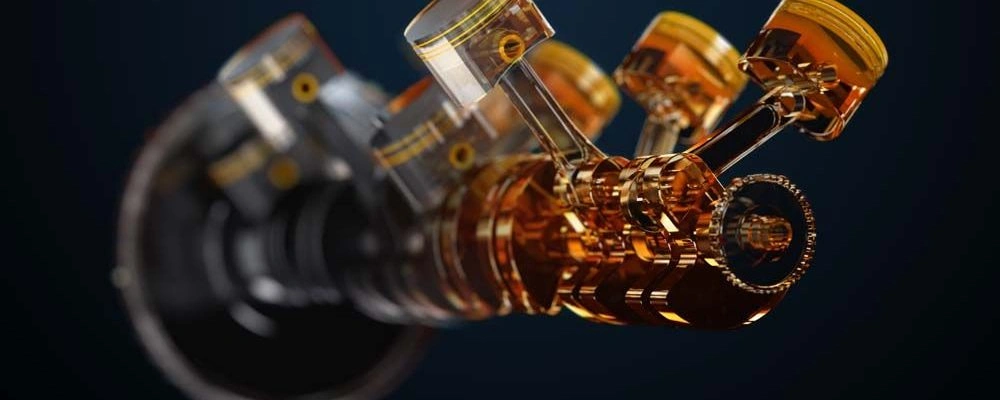

## Principais Padrões e Homologações

### Normas API
- **SN Plus / SP**: Exigência de aprovação no teste específico de mitigação do LSPI.
- **SQ (ILSAC GF-7)**: Norma de última geração que intensifica a salvaguarda contra LSPI, reduz o desgaste prematuro da corrente de distribuição, melhora a economia de combustível e restringe as cinzas sulfatadas (≤ 0,9%) para compatibilidade com GPF.

### Homologações de Montadoras Européias

| Homologação Oficial | HTHS (mPa.s) | TBN (mg KOH/g) | Volatilidade Noack (%) |
|------|------|------|------|
| **API SP / SQ** | > 2,6 | Sem especificação | Sem especificação |
| **ACEA A3/B4** | > 3,5 | > 10 | < 13 |
| **ACEA A5/B5** | 2,9 - 3,5 | > 8 | < 13 |
| **ACEA C3** | > 3,5 | > 6 | < 13 |
| **MB 229.5** | > 3,5 | > 10 | < 10 |
| **MB 229.51 / 52** | > 3,5 | > 6 | < 10 |
| **VW 502.00 / 505.00** | > 3,7 | > 7 | - |
| **VW 504.00 / 507.00** | > 3,5 | > 6 | < 11 |
| **BMW Longlife-98** | > 3,5 | > 9,5 | - |
| **BMW Longlife-01** | > 3,5 | > 10 | - |
| **BMW LL-01 FE** | > 3,0 | > 9,5 | - |

## O Efeito da Sobreposição de Homologações

- **Homologação MB 229.5**: Requisitos mecânicos antidesgaste extremamente rigorosos, porém sem testes de LSPI nas especificações antigas.
- **Normas API SP / SQ**: Requisitos antidesgaste genéricos mais amenos, com testes rigorosos focados em LSPI.
- **Óleo que reúne MB 229.5 e API SP/SQ** → Combina a máxima resistência mecânica ao desgaste com proteção ativa contra LSPI.
- **Ferramenta de referência para comparação**: [Gráfico comparativo interativo Lubrizol](https://online.lubrizol.com/relperftool/pc.html)

## Jogos de Palavras nas Embalagens de Óleo

**Termos que comprovam aprovação oficial de fábrica:**
- Approvals
- Freigaben

**Termos meramente comerciais sem certificação (evite o uso):**
- Performance Level
- OEM Performances
- Recommendations
- OEM Compatibility
- Suitable for

## Métricas Comparativas Sob a Mesma Homologação

- **Ponto de Fulgor (Flash Point)**: Temperatura de inflamabilidade dos vapores; quanto mais alto, maior a resistência térmica do lubrificante.
- **Viscosidade a 100°C**: Dentro do mesmo grau SAE e homologação, valores moderadamente baixos reduzem o arrasto hidrodinâmico.
- **Viscosidade a 40°C**: Quanto mais baixa, mais ágil é a lubrificação inicial na partida a frio.
- **Noack (Taxa de Evaporação)**: Mede as perdas voláteis a 250°C; procure números inferiores a 10%.
- **HTHS (High Temperature High Shear)**: Resistência do filme protetor a 150°C sob alta taxa de cisalhamento; valores elevados protegem em altos giros, sendo recomendável > 2,9 mPa.s.
- **TBN (Número de Base Total)**: Capacidade de neutralização ácida; preferencialmente > 8 mg KOH/g para intervalos estendidos.
- **Ponto de Fluidez (Pour Point)**: Menor temperatura em que o fluido ainda escoa; índices inferiores a -50°C sugerem alta presença de PAO.
- **VI (Índice de Viscosidade)**: Variação da viscosidade em função da temperatura; deve ser ponderado junto à estabilidade dos polímeros.

## Famílias de Óleos Básicos

- **Ésteres / Polióis Ésteres**: Bases de altíssimo desempenho, excelente polaridade metálica, mas oxidação acelerada em trocas longas.
- **Alquilnaftalenos (ANs)**: Bases de alta tecnologia, empregadas para otimizar a solubilidade de aditivos em formulações PAO.
- **PAO (Polialfaolefina)**: Grupo IV sintético puro, excepcional estabilidade térmica e fluidez no frio.
- **GTL (Gas-to-Liquid)**: Grupo III+ originado da síntese química Fischer-Tropsch a partir do gás natural, desempenho muito próximo ao PAO.
- **VHVI (Hidrocraqueado)**: Óleo mineral altamente purificado e hidroisomerizado (Grupo III).

## Elementos Aditivos e Suas Funções

- **Cálcio (Ca)**: Agente detergente e dispersante, porém gatilho de LSPI; restringido a < 2000 ppm no API SP/SQ.
- **Magnésio (Mg)**: Detergente substituto do cálcio que não induz LSPI.
- **Molibdênio (Mo)**: Modificador de atrito e reforço antidesgaste.
- **Fósforo (P)**: Aditivo antidesgaste clássico de extrema pressão.
- **Zinco (Zn)**: Forma o composto ZDDP junto ao fósforo, pilar tribológico de proteção mecânica.
- **Boro (B)**: Dispersante e agente inibidor de corrosão.
- **Tungstênio (W) / Titânio (Ti)**: Aditivos de superfície modernos para redução de atrito.

## Marcas Recomendadas

### Uso Urbano Diário *(Adquira em canais oficiais para mitigar riscos de falsificação)*
- **Mobil**
- **Shell**
- **Castrol**

### Foco em Performance e Rotações Altas
- **Liqui Moly**
- **Motul**
- **AMSOIL**
- **Red Line**
- **Ravenol**

### O que evitar
- Marcas locais obscuras sem corpo técnico de engenharia próprio.
- Marcas desconhecidas: consulte o portal oficial [Mercedes-Benz Bevo](https://bevo.mercedes-benz.com/bevolisten/bevo-sheets-sort1.html); se a marca não possuir uma lista expressiva de aprovações genuínas, evite a aquisição.

## **Material Técnico Recomendado**
- [Technical QA - Fórum FerrariChat](https://www.ferrarichat.com/forum/threads/motor-oil-all-chapters-inclusive-copy-and-save-this.136052/)

