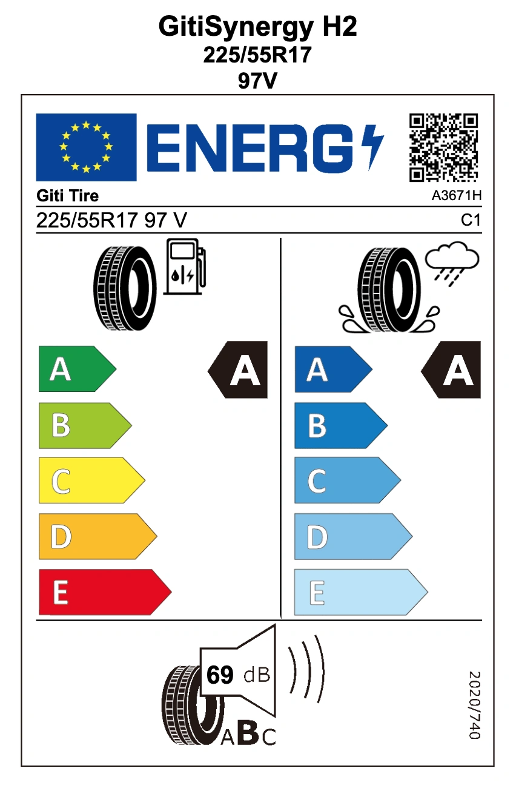
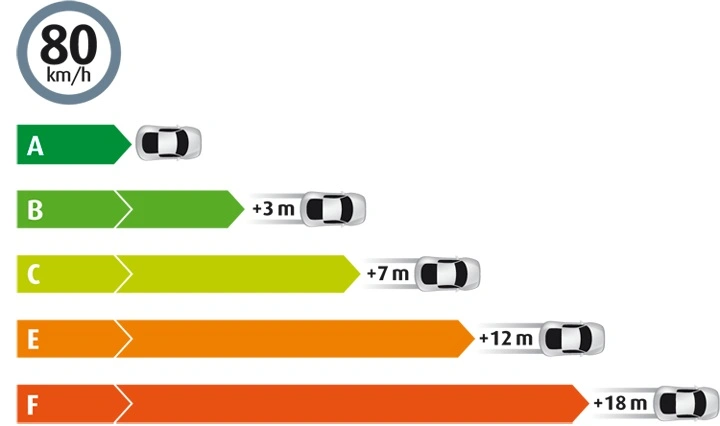

Tempestades repentinas de verão frequentemente resultam em graves acidentes de aquaplanagem nas rodovias. Muitos motoristas avaliam apenas o preço e o índice de durabilidade (Treadwear), ignorando a **etiqueta oficial de desempenho do pneu**, elemento que determina diretamente a distância de frenagem de emergência em piso molhado. Todos os protocolos técnicos derivam da norma **ECE R117 da ONU**, que estabelece critérios severos de homologação.

Atualmente, o consumidor dispõe de métricas auditadas em laboratório independente cobrindo **Aderência no Molhado (A a E)**, **Resistência ao Rolamento (A a E)** e **Ruído Externo de Rolamento (A/B)**, com consulta direta por QR Code nas etiquetas físicas.

## Onde Consultar as Etiquetas de Pneus

### 1. Bases de Dados Internacionais
- **Base Europeia Oficial (EPREL - União Europeia)**: [https://eprel.ec.europa.eu/screen/product/tyres](https://eprel.ec.europa.eu/screen/product/tyres)
- **Base de Dados do Japão (Kakaku Tire Database)**: [https://kakaku.com/car_goods/tire/](https://kakaku.com/car_goods/tire/)

### 2. Plataformas Regionais e Calculadoras
- **Plataforma Oficial de Eficiência de Pneus (ARTC / CNS 1431)**: [https://tire.artc.org.tw/](https://tire.artc.org.tw/)
- **Calculadora de Economia de Combustível ARTC RRC**: [https://energy.artc.org.tw/Tire/rrCalculate](https://energy.artc.org.tw/Tire/rrCalculate)

Antes de efetuar a troca dos seus pneus, consulte sempre essas notas. Desde que a **medida, o índice de carga e o código de velocidade** sejam rigorosamente idênticos, a especificação técnica mantém coerência global. **Evite** pneus sem certificação formal ou com **avaliação de aderência no molhado inferior à Nota A**.

Salvo em cenários de combustíveis com preços abusivos, nunca comprometa a frenagem na chuva por ganhos irrisórios de resistência ao rolamento.  
**Ordem de prioridade recomendada**: **Frenagem no Molhado > Conforto Acústico > Eficiência de Combustível**.

## Classificação de Aderência no Molhado (Wet Grip)

| Índice de Aderência (Valor G) | Grau UE (Regulamento 2020/740) | Grau Japão (JATMA) | Grau Padrão Global (CNS 1431) |
| :--- | :---: | :---: | :---: |
| 1,55 ≤ G | **A** | **a** | **A** |
| 1,40 ≤ G ≤ 1,54 | **B** | **b** | **B** |
| 1,25 ≤ G ≤ 1,39 | **C** | **c** | **C** |
| 1,10 ≤ G ≤ 1,24 | **D** | **d** | **D** |
| G ≤ 1,09 | **E** | - | **E** |

> *Nota: O sistema de notas A–E harmoniza-se mundialmente com base no regulamento automotivo da ONU ECE R117.*

## Classificação de Resistência ao Rolamento (Eficiência RRC)

| Coeficiente de Resistência (RRC em kg/t) | Grau UE | Grau Japão | Grau Padrão 2026 |
| :--- | :---: | :---: | :---: |
| RRC ≤ 6,5 | **A** | **AAA** | **A** |
| 6,6 ≤ RRC ≤ 7,7 | **B** | **AA** | **B** |
| 7,8 ≤ RRC ≤ 9,0 | **C** | **A** | **C** |
| 9,1 ≤ RRC ≤ 10,5 | **D** | **B** | **D** |
| RRC ≥ 10,6 | **E** | **C** | **E** |

> *Nota: A matriz de 5 níveis (A a E) adotada pela UE serve como parâmetro mundial de benchmarking.*

## Classificação de Ruído Externo de Rolamento

| Grau de Ruído | Limite Regulamentar Europeu (2020/740) | Descrição Técnica |
| :--- | :---: | :--- |
| **Classe A** | **≥ 3 dB(A) abaixo do limite legal** | Silêncio de rodagem superior, menor perturbação acústica |
| Classe B | 0 a 2 dB(A) abaixo do limite legal | Em total conformidade com os limites legais vigentes |
| Classe C | Acima do limite máximo permitido | Descontinuado para homologação em veículos novos |

> *Nota: A etiqueta estampa o número exato aferido em **decibéis (dB)**; quanto menor o número, mais silencioso é o pneu.*

## Tabela de Conversão de Pressão de Pneus

### Referência Técnica Mercedes-Benz (Fonte: Etiqueta original A205 584 70 11)
> *Nota: As marcas em Bar foram calibradas em intervalos de 0,05 bar para facilitar a operação em bombas e calibradores manuais.*

| PSI | kPa | **Bar** |
| :---: | :---: | :---: |
| 31 | 210 | 2,10 |
| 32 | 220 | 2,20 |
| **33** | **230** | **2,30** |
| **34** | - | **2,35** |
| **35** | **240** | **2,40** |
| **36** | **250** | **2,50** |
| **37** | - | **2,55** |
| **38** | **260** | **2,60** |
| 39 | 270 | 2,70 |
| 40 | - | 2,75 |
| 41 | 280 | 2,80 |
| 42 | 290 | 2,90 |

## Diretrizes e Documentos Oficiais

- **Banco de Dados Oficial EPREL (União Europeia)**: [Portal EPREL Tyres](https://eprel.ec.europa.eu/screen/product/tyres)
- **Regulamento Europeu (UE) 2020/740 (PDF)**: [Documento Oficial do Parlamento Europeu](https://eur-lex.europa.eu/legal-content/EN/TXT/PDF/?uri=CELEX:32020R0740&from=EN)
- **Diretrizes Oficiais JATMA (Japão)**: [Resumo de Etiquetagem JATMA](https://www.jatma.or.jp/labeling/outline.html)
