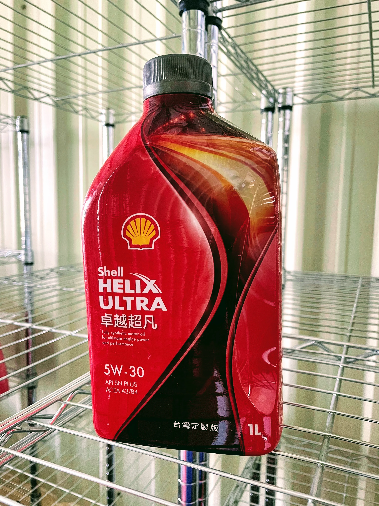

## **Avaliação Prática: Shell Helix Ultra X 5W-30**
**【Grau SAE 30, Homologação MB 229.5, Padrões API SP/SQ, Base Grupo III+ GTL】**

Aqueles que acompanharam meus artigos técnicos anteriores sabem que minha opção final recaiu sobre o **Shell Helix Ultra X 5W-30** (denominado HUX530). Relato aqui minha avaliação de campo após percorrer 7.500 km, confrontando o comportamento com o óleo original de concessionária **MB 229.5 5W-40** (MB540):

* **Tempo de Aquecimento**
    A fase de aquecimento até a temperatura estável de trabalho encurtou-se visivelmente. A menor viscosidade a 40°C garante circulação veloz e pressurização instantânea no momento da partida.

* **Silêncio e Suavidade em Marcha-lenta**
    A vibração e o ruído mecânico em ponto-morto reduziram-se de modo surpreendente em comparação ao MB540 original. Trata-se de uma virtude das cadeias moleculares homogêneas da base pura GTL.

* **Resposta Dinâmica e Subida de Giro**
    Graças à viscosidade equilibrada do grau SAE 30, o motor responde de forma muito mais solta e desembaraçada. Nas retomadas de estrada para ultrapassagens, as reduções de marcha entregam aceleração sem hesitações.

* **Deslocamento por Inércia (Roda Livre)**
    O veículo sustenta a velocidade por um trajeto notavelmente mais longo quando se alivia o acelerador, em função da drástica atenuação do arrasto viscoso interno.

* **Estabilidade e Consumo de Óleo**
    Mesmo completando 7.500 km de uso vigoroso, a suavidade de marcha e a resposta mantiveram-se intactas. A inspeção visual na vareta confirmou nível rigorosamente estável, sem consumo volumétrico.

### **Conclusão Técnica**
Frente ao óleo tradicional de concessionária, o HUX530 entrega uma evolução imediata e perceptível na dirigibilidade.

Com a consolidação do padrão **API SQ** na formulação da Shell, o pacote de aditivos agrega salvaguarda definitiva contra o LSPI e o desgaste de correntes de distribuição, mantendo este produto no topo das escolhas técnicas para o Mercedes-Benz W205 dentro do equilíbrio **SAE 30, MB 229.5, API SP/SQ e base GTL Grupo III+**.

