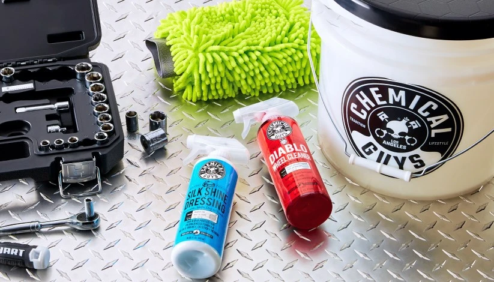

**Ordem de Execução Padrão: Interior > Rodas e Caixas > Exterior**

### Limpeza e Conservação do Interior

* **Higienização de Superfícies**
    * Meguiar's D101 Detailer All Purpose Cleaner (Diluição 1:10)
    * Limpador de Interiores Multiuso SONAX
    * Collinite Leather & Vinyl Wax #855 (Limpa e condiciona couro e vinil)
* **Condicionamento e Proteção UV (Plásticos e Painéis)**
    * 3M PN38143 Restaurador de Couro e Vinil
    * Meguiar's Ultimate Protectant, G14716
    * Meguiar's Ultimate Interior Detailer, G16216
    * Turtle Wax DASH & GLASS Interior Detailer
    * Turtle Wax INSIDE & OUT Car Protectant

---

**Passo a Passo da Carroceria: Lavagem > Descontaminação > Corte > Refino > Glaze > Selante > Cera > Detailer**

### Sugestões de Produtos com Alto Custo-Benefício (Para Iniciantes)

#### 1. Compostos Abrasivos / Corte (Eliminação de Riscos e Redemoinhos)
> *Formulados com partículas abrasivas para nivelar o verniz da pintura.*
* **Corte Pesado (Correção Agressiva de Defeitos):**
    * Finish Kare BWM 114: Rubbing Compound
    * Poorboy's Master Cut Super Cut Compound
    * Poorboy's SSR3
    * Meguiar's Ultimate Compound, G17216
* **Polidores Finos / AIO (Refino / Ceras Limpadoras - Abrasivos Suaves):**
    * Turtle Wax Hybrid Solutions Ceramic Polish & Wax (AIO)
    * Turtle Wax Hybrid Solutions Pro 1 & Done
    * Collinite 631 (Fleetwax) / 920 (Limpador de Fibra)

#### 2. Glaze (Preenchimento Óptico de Defeitos e Brilho Molhado)
> *Isentos de abrasivos e sem proteção selante longa; criados para preencher micro-riscos e gerar profundidade de reflexo.*
* Poorboy's White Diamond (Cores claras) / Black Hole (Cores escuras)
* 3M Hand Glaze 5990 (Preenchedor puramente estético)

#### 3. Selantes Sintéticos (Sealants - Proteção de Longa Duração)
> *Polímeros sintéticos desenvolvidos com foco em blindagem química e longevidade.*
* **Finish Kare 1000P**: Hi-Temp Paste Wax (Resistência térmica e proteção incomparáveis)
* Finish Kare 2180 / 118
* Meguiar's M21 Synthetic Sealant
* Poorboy's EX Sealant com Carnaúba
* 3M 39030 Performance Finish
* Collinite 476S / 885 (Super double coat à prova de detergentes)
* Meguiar's M27 SiO2 Sealant
* Turtle Wax Hybrid Solutions Pro to The Max Wax

#### 4. Cera de Carnaúba Natural (Brilho Quente e Efeito Molhado)
> *Destaca a intensidade da cor e repelência de gotas d'água; excelente camada de acabamento sobre selantes.*
* Finish Kare #2685: Cherry Pink Paste Wax
* 3M Perfect-It Boat Wax 36112 / 36113
* Collinite 915 (Marque D'Elegance) / Collinite 845 (Insulator Wax)
* Poorboy's World Liquid Natty's Blue / Red
* Turtle Wax Super Hard Shell

#### 5. Ceras em Spray / Quick Detailers (Auxílio na Secagem e Manutenção Rápida)
* **Quick Detailers (Lubrificação e Limpeza Rápida de Poeira):**
    * Meguiar's Quik Detailer Mist & Wipe, A3316
    * Meguiar's D155 Last Touch Spray Detailer
* **Ceras em Spray e Boosters de Proteção:**
    * Meguiar's Ultimate Quik Detailer, G14422 (UQD)
    * Meguiar's M799 Pro Hybrid Ceramic Bead Booster
    * Turtle Wax Hybrid Solutions Ceramic Wax 3-in-1 Detailer
    * Turtle Wax Express Shine Carnauba Spray
    * Turtle Wax Pro Graphene Flex Wax

### Bibliografia e Guias de Referência:
* [Ciclo de 5 etapas para cuidado com a pintura Meguiar's](https://meguiarsonline.com/forum/information-station/how-to-articles/66299-meguiar-s-5-step-paint-care-cycle)
* [Guia completo de detalhamento automotivo Turtle Wax](https://www.turtlewax.com/blogs/how-to/the-complete-car-detailing-guide)
