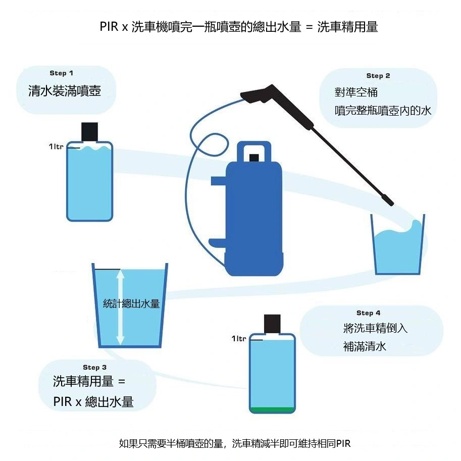

## Compreendendo o Conceito de PIR (Panel Impact Ratio)

Muitos entusiastas diluem o shampoo automotivo por mera suposição no frasco do canhão de espuma (como 1:10), resultando em espumas excessivamente ralas que escorrem sem agir ou desnecessariamente densas que geram desperdício financeiro. Isso ocorre porque cada lavadora de alta pressão opera com vazão (L/h) e pressão (PSI/bar) distintas.  

O **PIR** é a metodologia técnica mais precisa para definir a «concentração final de trabalho» da espuma sobre a pintura automotiva.

## Como Medir a Vazão Real do Seu Equipamento

Antes de aplicar a fórmula, você precisa descobrir a **Vazão Total de Água** proporcionada pela combinação da sua lavadora de pressão e do seu canhão de espuma.

### Procedimento de Medição:
1.  **Abasteça o recipiente:** Encha o frasco do seu canhão de espuma com exatamente **1 litro** de água limpa (sem shampoo).
2.  **Ajuste o botão regulador:** Gire o botão de controle de mistura do canhão totalmente para o fechamento máximo (posição de maior sucção/espuma).
3.  **Pulverize e colete:** Aponte a pistola para o interior de um balde grande e acione o gatilho ininterruptamente até que todo o 1L de água do frasco seja aspirado.
4.  **Aferição no balde:** Meça a quantidade total de água acumulada dentro do balde.  
    * *Exemplo: Se o balde acumulou 10 litros de água no total, o fator de diluição do seu equipamento é de 1:10.*

## A Fórmula de Cálculo do PIR

Tendo a sua **Vazão Total de Água** definida, utilize o percentual de PIR indicado pelo fabricante do produto químico para determinar o volume de shampoo concentrado:

> **Dosagem de Shampoo Puro = Percentual do PIR x Vazão Total de Água**

### Exemplo Prático de Aplicação:
Caso esteja utilizando o conceituado **Meguiar's D110 Hyper Wash**, cujo PIR recomendado em pré-lavagem é de **1:100 (ou seja, 1%)**, e sua **Vazão Total de Água** aferida foi de **10.000 ml (10 L)**:

* **10.000 ml x 0,01 (1%) = 100 ml**

**Conclusão Operacional:** Você deve despejar **100 ml** de shampoo concentrado no reservatório do canhão de espuma e completar o restante com água limpa. Assim, a espuma que incidir sobre o veículo estará perfeitamente na proporção 1:100 projetada pelos engenheiros químicos da marca.

## Vantagens Técnicas do Cálculo de PIR

1.  **Economia Real:** Evita o consumo desmedido de shampoos automotivos importados de alto custo.
2.  **Desempenho e Lubrificação:** Assegura película lubrificante ideal para amolecer a sujeira sem arranhar o verniz e sem remover ceras protetoras.
3.  **Consistência Profissional:** Ao trocar de lavadora ou bico injetor, basta recalibrar o cálculo para manter o mesmo padrão de lavagem.

### Dica Profissional:
A substituição do giclê interno do canhão (orifício) por um bico de **1,1 mm** (em vez do bico padrão de 1,25 mm) reduz o volume de água demandado em lavadoras residenciais de menor vazão. Refaça a medição no balde sempre que alterar componentes de hardware!
