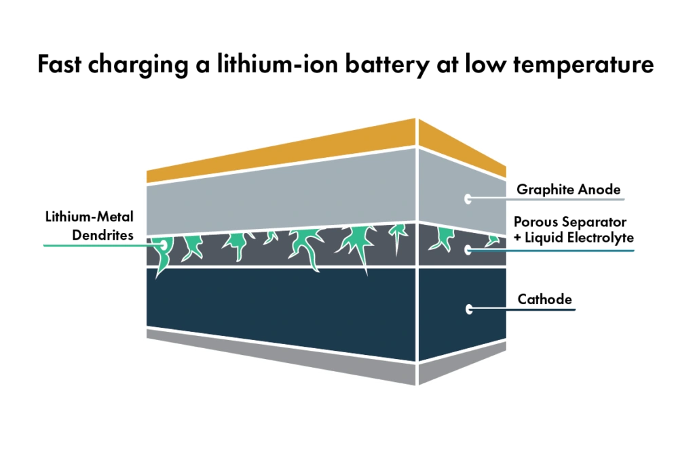

A norma SAE J537 é uma diretriz de teste de partida a frio estabelecida pela **Society of Automotive Engineers (SAE)** voltada exclusivamente para **baterias de chumbo-ácido**. Ela tem como finalidade mensurar a capacidade de fornecimento de corrente de arranque em climas de inverno rigoroso. Todavia, certos fabricantes têm utilizado essa certificação para validar baterias automotivas de Fosfato de Ferro e Lítio (LiFePO₄). Essa prática é tecnicamente inconsistente e induz o consumidor a conclusões equivocadas.

## Conteúdo e Finalidade do Procedimento SAE J537

O roteiro de testes da SAE J537 fundamenta-se em:
- Manter a bateria estabilizada em câmara térmica a **-18°C** por 24 horas.
- Descarregá-la sob alta intensidade de corrente (por exemplo, 150 A durante 30 segundos).
- **Executar a recarga com o acumulador em temperatura ambiente.**
- Aferir a curva de tensão residual e degradação de capacidade.

Esse ciclo foi dimensionado para a reação redox do chumbo e do eletrólito ácido. **Ele não contempla as particularidades termodinâmicas e os riscos operacionais intrínsecos aos compostos de íon de lítio.**

## O Ponto Cego Fatal: Recarga no Frio e Formação de Dendritas

Baterias de lítio possuem uma restrição física intransponível quando submetidas à corrente de carga sob temperaturas baixas (especialmente abaixo de **0°C**): o **chapeamento metálico de lítio (Lithium Plating)**.

1.  **Chapeamento de Lítio:** No frio, a resistência à difusão atômica sobe vertiginosamente. Incapazes de penetrar na rede cristalina do anodo, os íons reduzem-se a lítio metálico bruto depositado na superfície.
2.  **Crescimento de Dendritas:** Com os ciclos sucessivos de recarga em temperaturas desfavoráveis, esses depósitos desenvolvem ramificações perfurantes microscópicas denominadas **dendritas**.
3.  **Curto-Circuito Interno:** Com o tempo, as pontas das dendritas perfuram a membrana microporosa do separador dielétrico, deflagrando curto-circuito interno e disparando embalamento térmico descontrolado (fogo químico).

**A falha metodológica da norma SAE J537 quando aplicada ao lítio é que ela permite aquecer a bateria antes da recarga.** Isso elimina justamente a condição mais comum e perigosa na rotina veicular: o alternador enviando 60 a 100 amperes de carga enquanto o motorista trafega sob geada a -3°C.

## Conclusão: Cuidado com Dados Seletivos

Quando uma marca enaltece a aprovação de uma bateria de partida de lítio na SAE J537, está utilizando uma narrativa promocional que oculta o verdadeiro gargalo técnico do produto.

Baterias de lítio automotivas sérias devem ser certificadas segundo normas rigorosas como a **UL 2580** ou a **IEC 62660**, integrando sistemas eletrônicos avançados de gerenciamento (BMS) dotados de sensores térmicos capazes de cortar a carga do alternador sempre que as células estiverem abaixo de 0°C.
