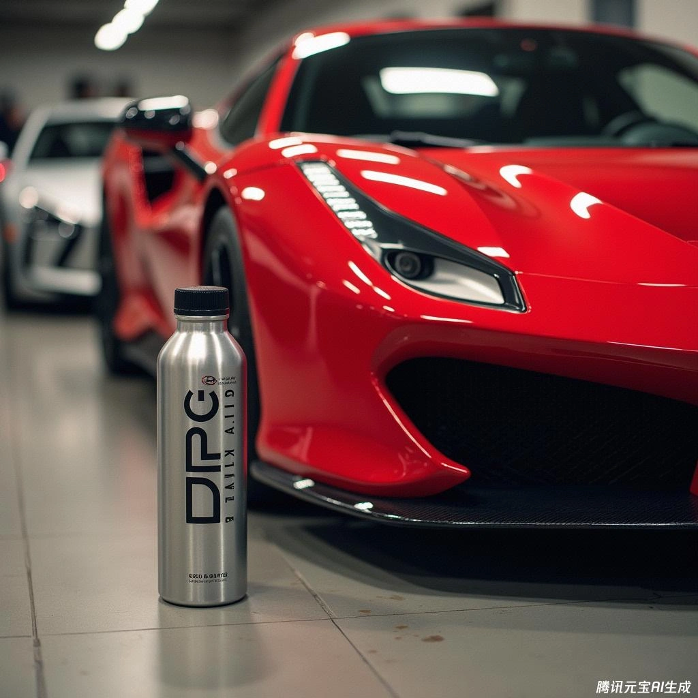

## RedLine SI-1 (Aditivo com Tecnologia PEA)

> **Cálculo da concentração teórica** > 15 oz em 20 galões US ≈ 0,0058 (0,6%)

### Tratamento de Choque (Descarbonização Curativa)
* **25 L de Gasolina : 150 ml**

### Manutenção Preventiva Regular
* **25 L de Gasolina : 75 ml**

## Chevron Techron Concentrate Plus

> **Cálculo da concentração teórica** > 1 oz em 1 galão US ≈ 0,0078 (0,8%)

### Proporção Recomendada
* **25 L de Gasolina : 200 ml**

## Álcool Isopropílico (IPA) como Dispersante de Água

> **Cálculo da concentração teórica** > 8 oz em 17 galões US ≈ 0,0036 (0,37%)

### Proporção Recomendada
* **25 L de Gasolina : 92 ml**

## Fórmula Caseira DPC Mix (DIY Fuel Additive)

> ⚠️ **【Aviso de Segurança & Isenção de Responsabilidade】** ⚠️
> A fórmula DPC e os parâmetros informados destinam-se exclusivamente a estudos técnicos entre entusiastas avançados.
> * **Riscos Químicos:** Solvente de nafta e querosene são inflamáveis e voláteis. Manipule exclusivamente ao ar livre, longe de faíscas ou calor, usando óculos de proteção e luvas adequadas para solventes.
> * **Tolerância Mecânica:** Sistemas de injeção direta de alta pressão possuem tolerâncias químicas sensíveis.
> * **Isenção Legal:** A preparação e aplicação deste composto são de total responsabilidade do proprietário. O autor e o blog não assumem responsabilidades sobre danos veiculares. Para uso cotidiano livre de riscos, recomenda-se a compra de aditivos comerciais homologados.

### Limites Máximos no Tanque
* Diesel < 1%
* Querosene < 0,2%
* Nafta / Solvente de limpeza < 0,05%

### Proporção de Pré-Mistura dos Solventes
> **D (Diesel) : P (Querosene) : C (Solvente Nafta) = 2 L : 0,5 L : 0,1 L**

### Dosagem no Abastecimento
* **25 L de Gasolina : 300 ml**
* **27 L de Gasolina : 325 ml**
