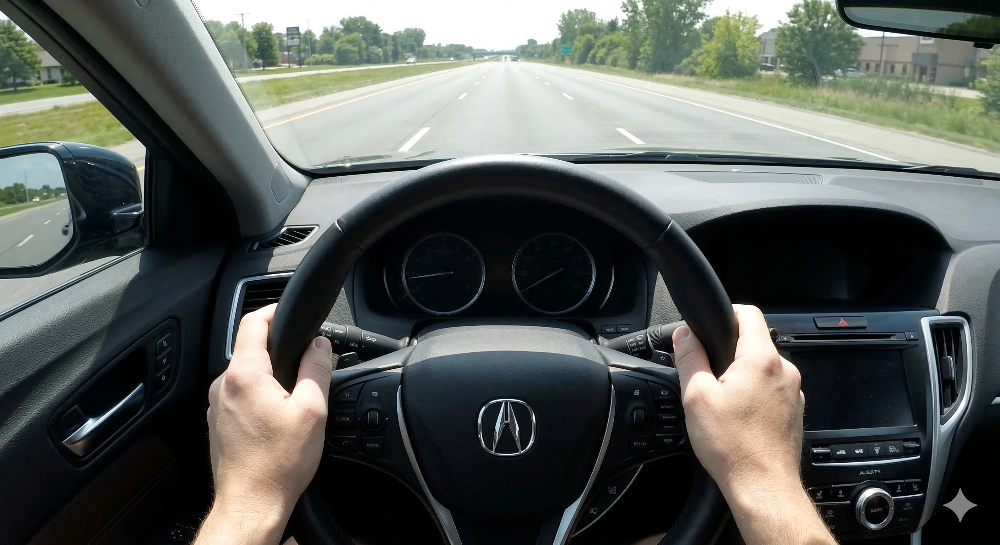

Ao retirar um carro zero quilômetro na concessionária, todo proprietário espera uma condução milimetricamente perfeita. Todavia, não é incomum notar que, mesmo em linha reta, o volante parece «ligeiramente inclinado para um dos lados». Trata-se de um veículo defeituoso ou de um desvio de alinhamento?

Na realidade, essa sensação é extremamente frequente na engenharia automotiva. Antes de se aborrecer na assistência técnica, vale a pena compreender as quatro causas físicas e mecânicas mais comuns.

## 1. A Geometria das Vias: A Abóbada de Escoamento (Road Crown)
As ruas e rodovias asfaltadas quase nunca são perfeitamente horizontais. Para evitar poças d'água perigosas e aquaplanagem em dias de chuva, as estradas possuem uma curvatura transversal sutil: o centro é elevado e as laterais possuem declive de escoamento.

Ao trafegar pelo lado direito da via, a força gravitacional naturalmente induz o veículo a deslizar suavemente para a direita. Para manter a trajetória perfeitamente reta, o motorista exerce uma microcompensação contínua com as mãos para o lado esquerdo. Essa pressão inconsciente cria a ilusão de que o volante está descentralizado.

## 2. O Torque Esterçante (Torque Steer) em Carros de Tração Dianteira
A expressiva maioria dos sedãs, hatches e SUVs compactos contemporâneos adota motores dianteiros transversais. Devido à posição da transmissão, os semieixos homocinéticos esquerdo e direito possuem comprimentos e massas diferentes.

Em arrancadas fortes e acelerações repentinas, a defasagem elástica e angular na entrega de torque às rodas motrizes dianteiras gera uma tendência temporária de desvio para um dos lados. Trata-se do **Torque Steer**, uma característica física da arquitetura mecânica de semieixos desiguais, e não um defeito de montagem.

## 3. Calibração do Ponto Neutro (Ponto Zero) da Direção Elétrica (EPS)
Os veículos atuais contam com direção eletroassistida (EPS). O sistema monitora a posição angular do volante através de um sensor de alta precisão para identificar o ponto zero (0° exato). Se a calibração eletrônica original estiver desalinhada por frações de grau, ou se o sistema não for resetado via scanner após o alinhamento das barras de direção, o motor elétrico da assistência continuará empurrando sutilmente o volante, gerando sensação de descentralização.

## 4. Tolerâncias Construtivas de Alinhamento de Fábrica
Na montagem na linha de produção, os parâmetros de convergência, câmber e cáster não representam um valor decimal isolado, mas sim uma **faixa aceitável de tolerância**. Se o veículo for liberado na extremidade dessa margem, somado ao assentamento natural das buchas de borracha da suspensão durante os primeiros 500 km rodados, um ligeiro desvio direcional pode se evidenciar.

## Como Avaliar e Solucionar?
Caso desconfie do volante do seu automóvel, realize o seguinte diagnóstico:
1. Procure uma **área ampla, segura, asfaltada e totalmente plana** (como um estacionamento vazio sem desnível de drenagem).
2. Em velocidade constante e segura, solte as mãos do volante por um instante.
3. Se o carro seguir em linha reta mas o volante mantiver-se torto, o problema restringe-se ao ponto zero do sensor ou ao ajuste das barras axiais.
4. Se o veículo mergulhar rapidamente para um lado, confira em primeiro lugar **a pressão de calibragem dos pneus a frio**.

Permanecendo o sintoma, agende uma verificação. Um mecânico com equipamento de alinhamento computadorizado 3D ajustará os ângulos de suspensão e realizará a **calibração eletrônica do ponto zero da direção EPS** via conector OBD-II.
