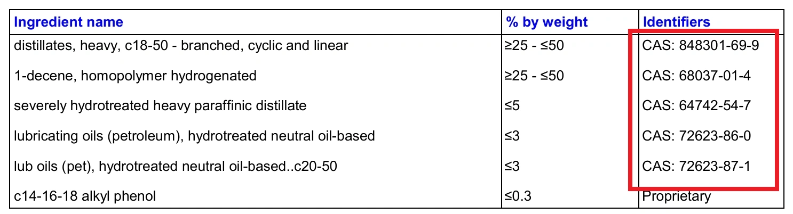

Ao escolher um lubrificante, muitos motoristas e preparadores se perguntam se o rótulo "100% Sintético" realmente reflete o uso de bases nobres como PAO (Grupo IV) e Ésteres (Grupo V) ou se trata de óleo mineral hidrocraqueado de Grupo III (VHVI). A forma mais transparente e técnica de atestar a formulação é consultar a **Ficha de Informação de Segurança de Produtos Químicos (FISPQ / SDS)**.

<figure>
  
  <figcaption align="center">Ilustração : FISPQ Mobil 1 0W-40</figcaption>
</figure>

Na FISPQ, cada componente químico relevante possui um **Número CAS (Chemical Abstracts Service)**, que atua como o código de identificação universal da substância. Este guia consolida os números CAS mais comuns em óleos básicos (Grupos I a V) e pacotes de aditivação modernos (ZDDP, modificadores de atrito MoDTC, detergentes, dispersantes).

  <label for="casSearchInput" style="font-weight: bold; margin-right: 10px;">Busca Rápida:</label>
  <input type="text" id="casSearchInput" placeholder="Digite o número CAS (ex.: 68037-01-4)" style="padding: 8px; width: 250px; border: 1px solid #ccc; border-radius: 4px;">
  <button onclick="searchCAS()" style="padding: 8px 15px; background-color: #04384c; color: white; border: none; border-radius: 4px; cursor: pointer;">Buscar</button>
  

| Classificação do Básico / Aditivo | Número CAS | Descrição da Substância Química |
| :--- | :--- | :--- |
| **Grupo IV (Sintéticos PAO)** | 68037-01-4 | 1-Deceno, homopolímero hidrogenado |
| | 68649-12-7 | Tetrâmero de 1-deceno misturado com trímero de 1-deceno, hidrogenado |
| | 68649-11-6 | 1-Deceno, dímero hidrogenado |
| | 163149-29-9 *(e 8002-05-9)* | 1-Deceno homopolímero hidrogenado; polímeros de octeno, deceno e dodeceno |
| | 151006-63-2 | 1-Dodeceno, homopolímero hidrogenado |
| | 151006-62-1 | 1-Dodeceno, trímero hidrogenado |
| | 151006-60-9 | 1-Dodeceno polimerizado com 1-deceno, hidrogenado |
| | 163149-28-8 | 1-Deceno polimerizado com 1-octeno e 1-dodeceno, hidrogenado |
| **Grupo III (GTL Gas-to-Liquid)**| 848301-69-9 | Destilados de síntese Fischer-Tropsch pesados C18-50 ramificados |
| | 1262661-88-0| Destilados pesados de gás natural Fischer-Tropsch C18-50 |
| **Grupo III (Hidrocraqueados VHVI)** | 64741-89-5 | Óleos parafínicos severamente hidrotratados |
| | 64742-54-7 | Destilados parafínicos pesados hidrotratados |
| | 64742-55-8 | Destilados parafínicos leves hidrotratados |
| | 64742-70-7 | Óleos parafínicos desparafinados cataliticamente |
| | 72623-87-1 | Hidrocarbonetos parafínicos severamente tratados (C20-50) |
| | 72623-85-9 | Óleos lubrificantes neutros hidrotratados de alta viscosidade |
| | 72623-86-0 | Óleos básicos neutros hidrotratados |
| | 178603-64-0 | Óleos pesados hidrocraqueados e hidroisomerizados C15-30, alto VI |
| | 178603-65-1 | Óleos pesados hidrocraqueados e hidroisomerizados C20-40, alto VI |
| | 178603-66-2 | Óleos pesados hidrocraqueados e hidroisomerizados C25-55, alto VI |
| **Grupo I / II (Óleos Minerais)** | 64741-50-0 | Destilados parafínicos leves |
| | 64741-50-5 | Destilados de petróleo parafínicos leves |
| | 64741-52-2 | Destilados naftênicos leves de refino |
| | 64742-65-0 | Destilados parafínicos pesados desparafinados com solvente |
| | 64742-58-1 | Óleos lubrificantes gastos hidrotratados |
| | 64742-56-9 | Destilados parafínicos leves desparafinados com solvente |
| | 64742-62-7 | Óleos residuais desparafinados a solvente |
| **Grupo V (Ésteres / Especiais)** | 27178-16-1 | Adipato de di-isodecila |
| | 16958-92-2 | Óleos básicos sintéticos do tipo éster |
| | 28472-97-1 | Azelato de di-isodecila (base diéster) |
| | 9003-13-8 | Polialquileno glicol (PAG) |
| **Aditivos Antidesgaste (ZDTP / ZDDP)** | 68649-42-3 | Ditiomono/dialquilfosfato de zinco ZDTP |
| | 84605-29-8 | Sais de zinco do ácido fosforoditioico, ésteres mistos de O,O-bis |
| **Modificadores de Atrito (MoDTC / MoDTP)**| 68958-92-7 | Ditiofosfato de molibdênio |
| | 68958-92-9 | Di(2-etilhexil)fosforoditioato de molibdênio |
| **Antioxidantes**| 36878-20-3 | Bis(nonilfenil)amina |
| | 128-39-2 | 2,6-di-terc-butilfenol |
| **Detergentes**| 61789-86-4 | Sulfonato de cálcio de petróleo |
| | 68783-96-0 | Ácidos sulfônicos, sais de cálcio superbaseados |
| | 115733-09-0 | Fenato sulfeto de alquila de cadeia longa e cálcio |
| **Dispersantes** | Sem CAS | Poliolefina poliamina succinimida, poliol |
| | 296-404-1 *(N° CE)*| Ésteres de ácido fosfórico |
| | 84605-20-9 | Poli-isobutileno succinimida (PIBSI) |
| **Melhoradores de Viscosidade (VM)** | 25038-36-2 | Copolímero de olefina (OCP) |
| | 127883-08-3 | Aril poliolefina etileno/propileno |
| **Abaixadores de Ponto de Fluidez (PPD)** | Sem CAS | Éster polimetilmetacrilato |
| **Antiespumante**| 63148-62-9 | Polidimetilsiloxano (óleo de silicone) |

## Referências Técnicas
* [Estudo de Formulações de Lubrificantes - PAO Grupo IV, GTL, Hidrocraqueados Grupo III, Ésteres - Fórum Oil-Club.ru](https://www.oil-club.ru/forum/topic/2120-izuchaem-sostav-masla-pao-group-iv-gtl-gidrokreking-vhvi-group-iii-mineralnoe-maslo-group-i-ili-ii-estery-itd/page/31/)
