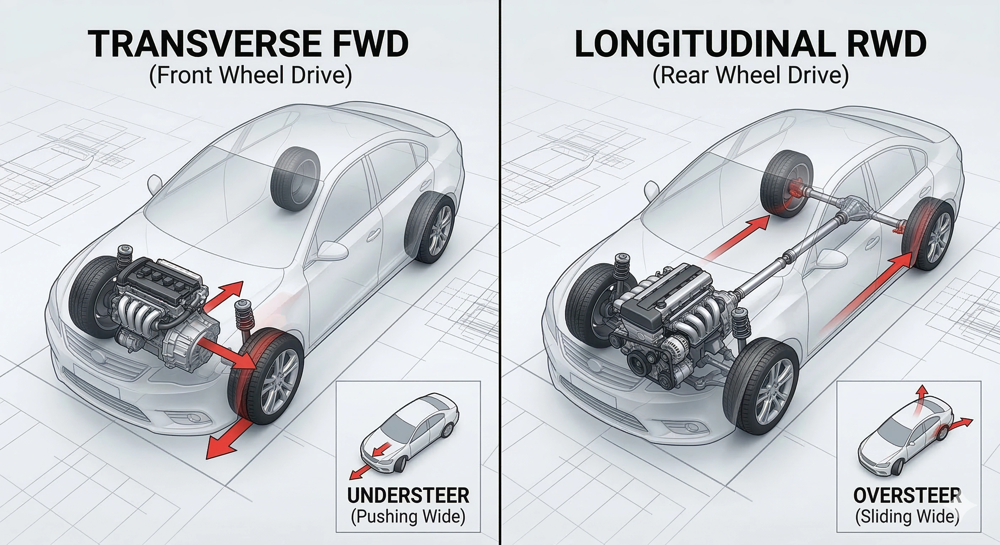

Na sequência do nosso artigo sobre desvios e alinhamento de direção, muitos leitores questionaram quais são as diferenças dinâmicas profundas entre ter um carro com «Tração Dianteira» ou «Tração Traseira». Analisaremos como a disposição do motor e o eixo tracionado transformam o comportamento dinâmico do veículo.

## 1. Tração Dianteira Transversal (FWD): O Mago do Aproveitamento de Espaço
Como a denominação indica, o propulsor é montado lateralmente (transversal) na frente do cofre, descarregando a potência diretamente sobre as rodas dianteiras. É a configuração onipresente na frota global de hatches, sedãs compactos e SUVs familiares.

**Particularidades Dinâmicas de Direção:**
* **Espaço Interno Otimizado:** Sem a necessidade de um pesado eixo cardã cruzando o assoalho até a traseira, a cabine ganha assoalho plano e porta-malas espaçoso.
* **Boa Aderência em Condições Urbanas:** A massa combinada do bloco do motor e da transmissão repousa verticalmente sobre o eixo de tração, gerando excelente aderência inicial em saídas de semáforo com pista molhada.
* **O Limite do «Subesterço» (Saída de Frente):** Os pneus frontais exercem dupla função: precisam esterçar a trajetória e tracionar a carroceria simultaneamente. Ao ingressar rápido demais em uma curva, os pneus dianteiros saturam e o veículo tende a desgarrar em linha reta para fora da curva: é o **subesterço**.
* **Torque Steer:** Conforme já abordado, semieixos de comprimentos desiguais costumam puxar ligeiramente a direção nas acelerações a fundo.

## 2. Tração Traseira Longitudinal (RWD): A Excelência em Engenharia Dinâmica
Nesta configuração tradicional, o motor é alinhado no sentido longitudinal do chassi, transmitindo o torque mecânico por meio de um eixo cardã até o diferencial traseiro. É a assinatura de engenharia de sedãs alemães de luxo e cupês esportivos de alta estirpe.

**Particularidades Dinâmicas de Direção:**
* **Equilíbrio de Massas Superior:** A montagem longitudinal permite recuar o motor para trás da linha do eixo dianteiro. Somado ao peso do diferencial traseiro, o chassi atinge uma **distribuição de peso próxima ao ideal de 50:50**, reduzindo momentos de inércia em curvas fechadas.
* **Especialização de Funções:** As rodas da frente dedicam-se apenas a direcionar o carro, enquanto as de trás empurram. Sem sobrecarga de atrito nas rodas dianteiras, a direção ganha precisão milimétrica e comunicação táctil com o asfalto.
* **A Emoção do «Sobre-esterço» (Saída de Traseira):** Próximo ao limite de aderência ou com retomada forte de acelerador na curva, a traseira pode quebrar a tração e rotacionar suavemente: é o **sobre-esterço**. Embora exija habilidade corretiva ao volante, é o que confere a célebre esportividade às máquinas de tração traseira.
* **Túnel de Transmissão:** O cardã exige um túnel central elevado que invade o assoalho traseiro, penalizando o passageiro central.

## Conclusão: Qual Arquitetura Atende Melhor o Seu Perfil?

* **Opte pela Tração Dianteira (FWD)** caso sua prioridade absoluta seja a economia de combustível, espaço generoso para a família e reações previsíveis e dóceis no trânsito do dia a dia.
* **Opte pela Tração Traseira (RWD)** se você ama o «prazer de dirigir», exige precisão de contorno de curva e aprecia a sensação nobre de empuxo esportivo em viagens rodoviárias.

Independentemente do eixo de tração, dominar os limites da física automotiva é a chave mestra para uma condução segura e prazerosa!
