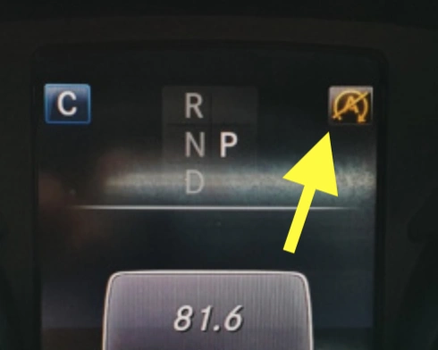

## Sinais de Fadiga da Bateria Original

- **O Start-Stop (Modo Eco) Deixa de Funcionar:** O sintoma mais evidente é o ícone «A» no painel de instrumentos permanecer permanentemente amarelo ou o motor não mais desligar nas paradas de semáforo. O sensor de bateria do carro identifica que o estado de carga ou saúde da bateria AGM caiu abaixo dos limites operacionais seguros.
- **Alertas nas Revisões:** O mecânico acusa queda na condutância e capacidade residual. Caso haja estufamento nas laterais ou baixa voltagem estática, a troca torna-se urgente.
- **Partidas Pesadas:** Se o motor de arranque perdeu a vivacidade e parece girar com dificuldade pela manhã, antecipe a substituição para não ficar enguiçado no trânsito.

## Tabela Comparativa de Fabricantes

| Marca | Origem & Características das Células | Partida de Emergência | Garantia | Custo Relativo |
|:---|:---|:---:|:---:|:---|
| **Great Power (GreenRun)** | Células OEM de Primeira Linha ([Certificação Incombustível Automotiva](https://batteryfinds.com/wp-content/uploads/2021/09/Great-Power-100Ah-Lithium-Iron-PhosphateLiFePO4-LFP-Battery-Cell-Product-Specification.pdf)) | Não | 2 Anos | Acessível |
| **Houny** | Antiga Fornecedora OEM da Nokia / [Padrão Construtivo de Alto Nível](https://youtu.be/qL8HSL3h-MU) | Não | 3 Anos | Intermediário |
| **Tieli** | Marca Recente / Procedência de Células Não Declarada | Não | 2 Anos | Intermediário |

## Motivos da Escolha pela Green Run 2 (Great Power)

- **Exclusão de Montadores Informais:** Evito oficinas artesanais sem CNPJ industrial transparente que apoiam suas vendas em apelos de marketing sem respaldo laboratorial.
- **Segurança em Primeiro Lugar:** As células prismáticas da Great Power contam com laudos independentes de incombustibilidade automotiva. Em um compartimento de motor confinado e quente, este quesito é inegociável.
- **Relação Custo-Benefício:** Entrega o equilíbrio ideal para resolver de vez as limitações das baterias AGM no W205 sem atingir os preços proibitivos de baterias de competição.

### Vantagens do LiFePO4 frente ao Chumbo AGM:
1.  **Redução de Peso:** Alívio de aproximadamente **20 kg** no balanço dianteiro, aprimorando imediatamente a resposta de direção em curvas rápidas.
2.  **Tensão Estável:** A curva de voltagem plana e superior resulta em centelha mais vigorosa nas velas e trocas de marcha mais suaves.
3.  **Durabilidade Estendida:** Vida útil estimada entre 5 e 10 anos, contrastando com as baterias AGM convencionais que raramente superam 2 a 3 anos sob calor excessivo.

### **Recomendação na Instalação**
Utilize impreterivelmente um **alimentador de memória conectado na porta OBD-II** durante a troca. O Mercedes W205 possui módulos sensíveis a cortes repentinos de energia. Manter a alimentação evita desconfigurações nos comandos de vidro, teto solar e calibrações de câmbio.
