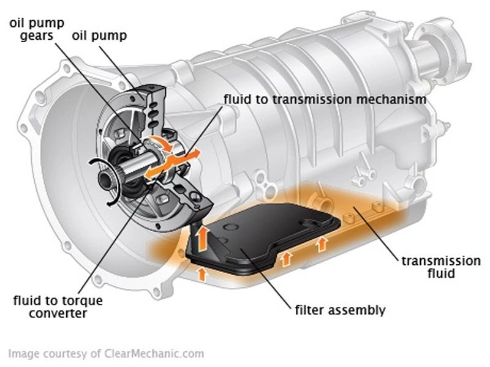
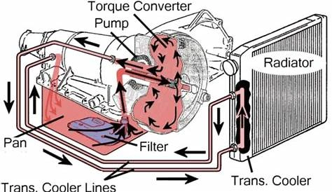

<iframe width="560" height="315" src="https://www.youtube.com/embed/zcwG97VMOVk?si=svbJ4WHcnP2I0Zgr&amp;start=410" title="YouTube video player" frameborder="0" allow="accelerometer; autoplay; clipboard-write; encrypted-media; gyroscope; picture-in-picture; web-share" referrerpolicy="strict-origin-when-cross-origin" allowfullscreen></iframe>

A animação acima demonstra com precisão a rota de circulação do fluido de transmissão (ATF):
- A **Bomba de Óleo** succiona o fluido armazenado no **Cárter (Sump)**. O óleo passa obrigatoriamente pelo **Filtro / Tela**, dividindo-se em seguida em dois circuitos de fluxo principais:
  - Uma linha segue diretamente para o **Conversor de Torque**.
  - A outra linha alimenta o **Mecanismo de Engrenagens e o Corpo de Válvulas**.
- O fluido cumpre sua função de lubrificação e controle hidráulico e então **retorna por gravidade ao cárter de óleo**.

### Diagramas de Fluxo Hidráulico da Transmissão
 

Essa arquitetura hidráulica é idêntica à **lubrificação de um motor a combustão**:
- **Assim que a bomba puxa o óleo, o primeiro passo absoluto é a passagem pelo elemento filtrante.**
- Isso assegura que apenas óleo limpo e desprovido de detritos abrasivos alcance os componentes de extrema precisão (pistões, carretéis de válvulas e atuadores eletromagnéticos).

## A Importância Crítica do Filtro de Transmissão

Muitos proprietários ficam apreensivos ao notar resíduos de borra metálica ou partículas no fundo do cárter durante a troca de óleo. Contudo, desde que o **filtro** esteja íntegro e funcionando, essas impurezas permanecem retidas no fundo ou presas no elemento filtrante, sem ameaçar o sensível corpo de válvulas.

### Padrões Construtivos de Filtros:

1.  **Telas Metálicas Convencionais:** Compostadas por malhas de aço inoxidável ou bronze. Retêm com eficácia fragmentos maiores de desgaste, porém deixam passar a borra ultrafina de embreagem.
2.  **Sistemas de Filtro Duplo (Alto Desempenho / Projetos Recentes):** Unem a tela metálica no cárter a um **Elemento de Papel Filtrante** secundário externo ou dedicado. Essa combinação oferece máxima proteção para eletroválvulas de alta precisão.
3.  **Filtros Internos Não Substituíveis:** Alguns fabricantes posicionam o filtro no interior profundo da carcaça do câmbio. A sua substituição exige desmontar totalmente a transmissão.

### **A Polêmica dos Filtros Chamados de «Vitalícios»**

Quando uma transmissão é concebida de forma que o filtro não possa sofrer manutenção periódica, a saturação gradativa do meio filtrante inevitavelmente condenará o sistema à contaminação permanente. Esse arranjo é amplamente criticado por especialistas e engenheiros como **Obsolescência Programada**—uma escolha de projeto que barateia custos aparentes de garantia nos primeiros anos, mas compromete a longevidade mecânica de longo prazo.

### Resumo:
Na manutenção periódica do câmbio automático, **trocar apenas o fluido é metade do serviço.** Sempre que o projeto do seu veículo permitir, **substitua o filtro ou elemento filtrante.** Manter os «rins» da sua transmissão desobstruídos é a garantia real para que o corpo de válvulas e o conversor de torque durem centenas de milhares de quilômetros.
