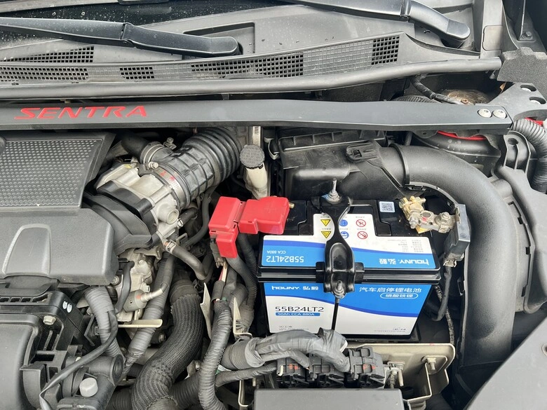
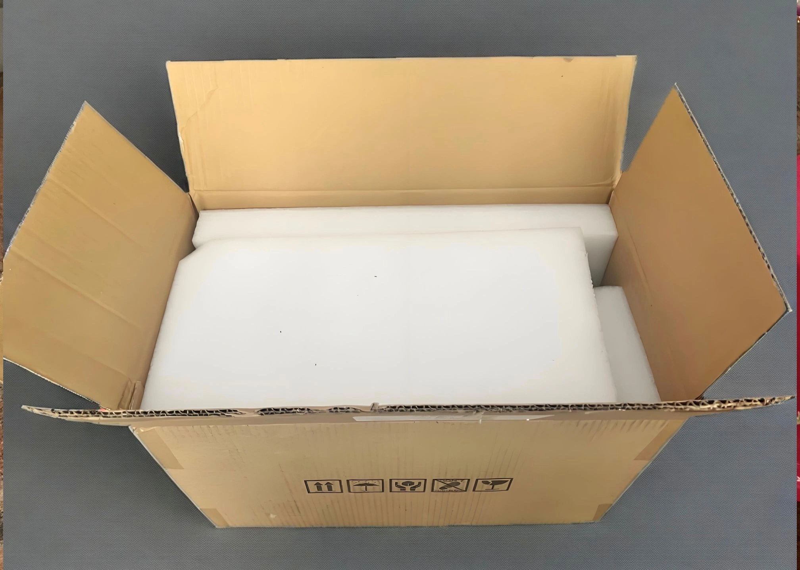
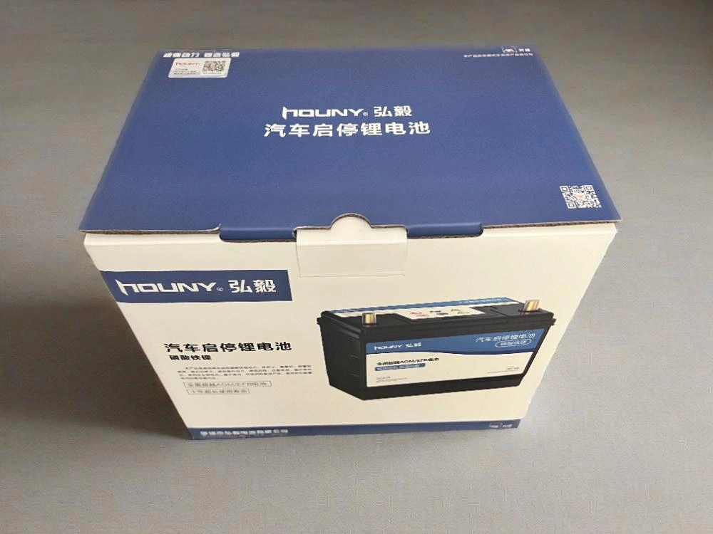
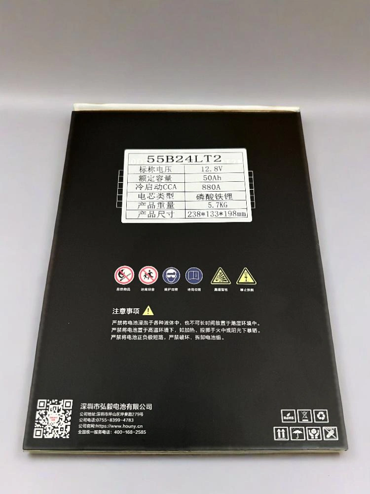
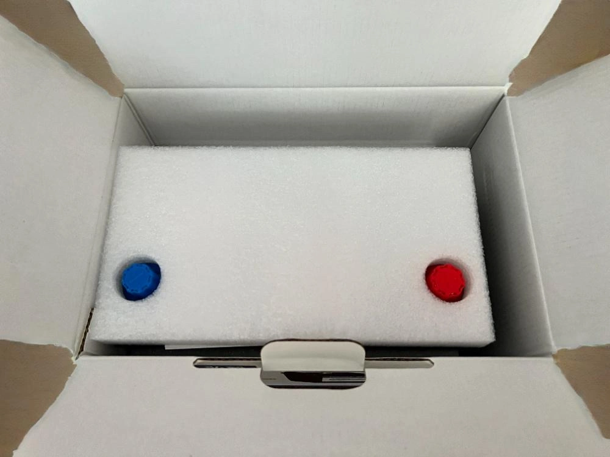
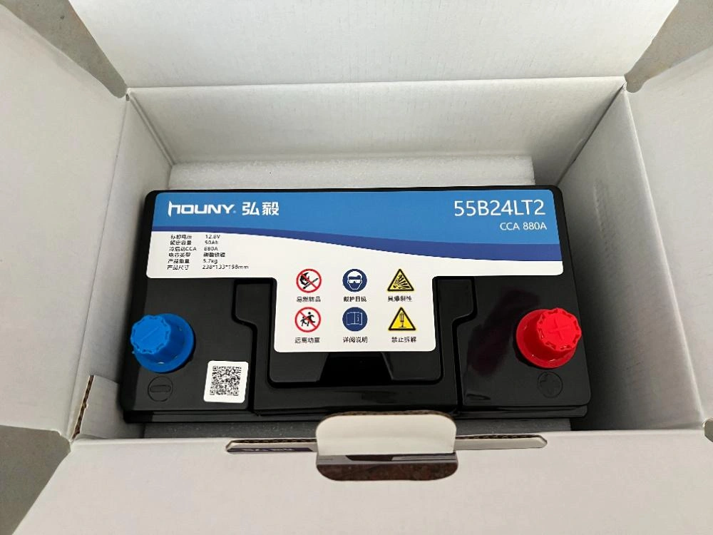
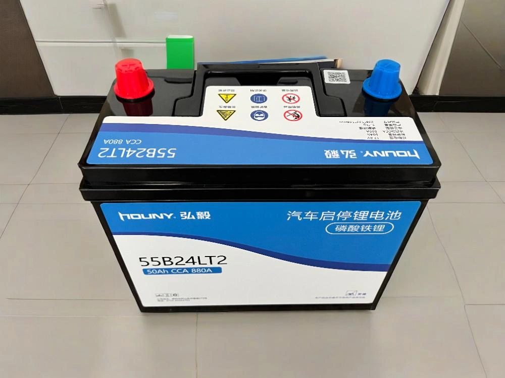
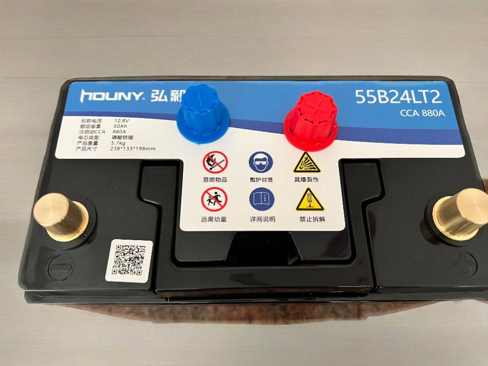
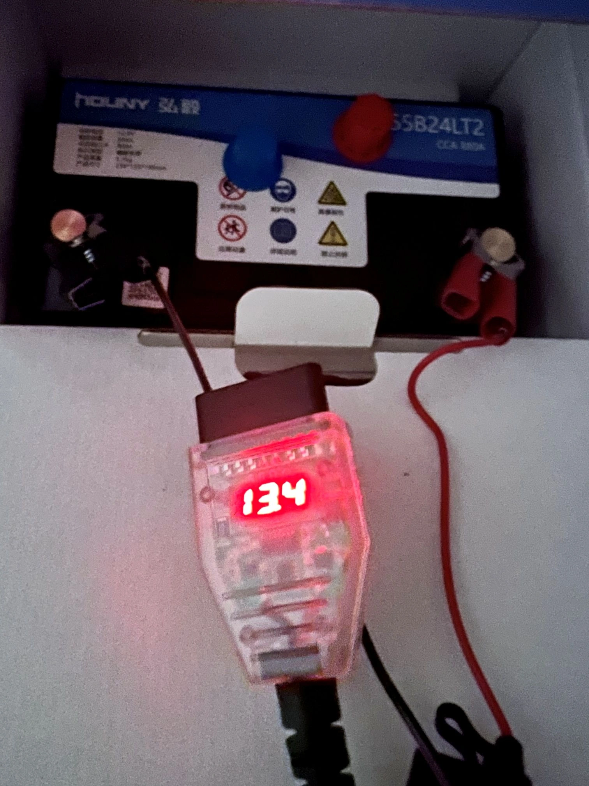
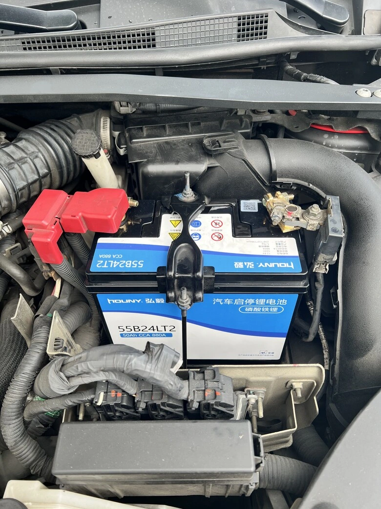

**Modelo do Veículo**: NISSAN SENTRA B17  
**Marca da Bateria**: [Bateria Houny (Houyi)](https://www.houny.cn/)  
**Código do Modelo**: 55B24LT2, 50Ah  

## Contexto da Escolha

Nos últimos anos, nossa família foi gradualmente migrando para as [baterias de lítio-ferro GreenRun](/pt/2025/greenrun.html). Tanto em resposta ao volante quanto em vida útil, os resultados foram amplamente satisfatórios. Como a bateria de chumbo-ácido Panasonic CAOS Blue montada neste SENTRA já dava indícios de perda de rendimento após mais de três anos de uso, decidimos aproveitar o momento para migrar para a química LiFePO4.

Entretanto, as opções de baterias de lítio-ferro com medidas padrão japonês no mercado local ainda são escassas, resumindo-se em sua maioria a montagens artesanais sem transparência de fabricação. Embora o mercado chinês conte com diversas marcas de 12V, algumas sofrem com capacidades nominais infladas e montagem precária. Após extensa pesquisa e comparação, optamos pela **Houny**, principalmente pelos seguintes fatores:

- Antiga **fabricante OEM de baterias de celular para a Nokia**, detentora de profundo domínio tecnológico.  
- Além de sua linha própria de baterias automotivas de partida, também produz sistemas de armazenamento residencial e comercial em regime OEM para marcas europeias e americanas.  
- Reconhecida por entusiastas do setor como uma [marca séria e confiável](/images/houny-lifepo4-battery-netizen-review.webp).  
- Vídeos de desmontagem disponíveis na rede, como [neste reel do Facebook](https://www.facebook.com/reel/670416912191093), revelam acabamento interno impecável; a segurança do conjunto também foi atestada em testes destrutivos rigorosos ([confira este vídeo](https://www.facebook.com/reel/1804670450453719)).  
- Recentemente, passou a contar com [distribuidor em Taiwan](https://imgur.com/a/mkuKuAg) e garantia de fábrica de três anos.

Como a profundidade de descarga real (DoD) do fosfato de ferro e lítio é bastante superior, sua capacidade utilizável é cerca de 1,6 vez maior que a do chumbo: uma bateria LiFePO4 de 50Ah entrega autonomia prática comparável a uma bateria de chumbo-ácido de 80Ah, garantindo ampla folga energética.

## Detalhes do Unboxing

### Proteção da Embalagem
  
*A caixa de transporte é preenchida internamente com blocos de espuma de alta densidade para máxima proteção.*

  
*A caixa interna possui impressão refinada e papelão estrutural de altíssima rigidez.*

  
*Etiqueta com dados técnicos detalhados na lateral da embalagem.*

  
*Ao abrir a caixa interna, uma camada adicional de espuma cobre todo o topo.*

  
*Aspecto da bateria assim que retirada a primeira camada protetora.*

### Corpo da Bateria
  
*Apresentação e acabamento externo robusto da bateria.*

  
*Os polos positivo e negativo vieram configurados no padrão europeu com diâmetro maior.*

## Procedimento de Instalação

### Ferramentas Utilizadas
1. Chave soquete em L de 10mm [/images/L-socket.webp](/images/L-socket.webp)  
2. [Cabo de retenção de memória OBD](/pt/2025/memory-saving-battery.html) (para evitar desprogramação da centralina)  
3. Bateria auxiliar de 12V ou auxiliar de partida

### Atenção: A Questão do Diâmetro dos Polos
Ao receber o produto, deparamos com um detalhe crucial: **a espessura dos bornes polares** :  
- A grande maioria dos carros no mercado chinês utiliza **polos grossos no padrão europeu (19,5mm / 17,9mm)**.  
- Veículos japoneses (como o SENTRA) adotam **polos finos no padrão JIS (14,7mm / 13mm)**.

Como havíamos solicitado o modelo incorreto por engano, a instalação foi pausada por uma semana até a chegada de buchas redutoras torneadas em cobre puro (de polo grande para pequeno).

### Processo de Troca
A montagem final foi conduzida sem interrupção de energia conectando o estabilizador na porta OBD.

  
*Medição da voltagem pela porta OBD antes da partida: bateria recebida com 13,4V estáveis.*

## Conclusão e Avaliação Prática

  
*Instalação concluída no cofre do motor.*

Primeiras percepções:
- **Nível Construtivo**: Cuidado impecável no acondicionamento e carcaça sólida com encaixes perfeitos.  
- **Estabilidade de Tensão**: O sistema BMS atinge a tensão de repouso programada com visível prontidão.  
- **Acionamento do Motor**: A velocidade de giro do motor de arranque é instantânea e muito mais vigorosa que a da antiga bateria de chumbo.  
- **Longevidade**: Resta acompanhar se manterá a durabilidade exemplar das baterias [GreenRun](/pt/2025/greenrun.html) ao longo dos próximos anos.

Após seis meses de convivência:  
Familiares relataram que as ocasionais hesitações ou engasgos na transmissão que ocorriam esporadicamente antes da troca cessaram por completo após a migração para a bateria de lítio.
