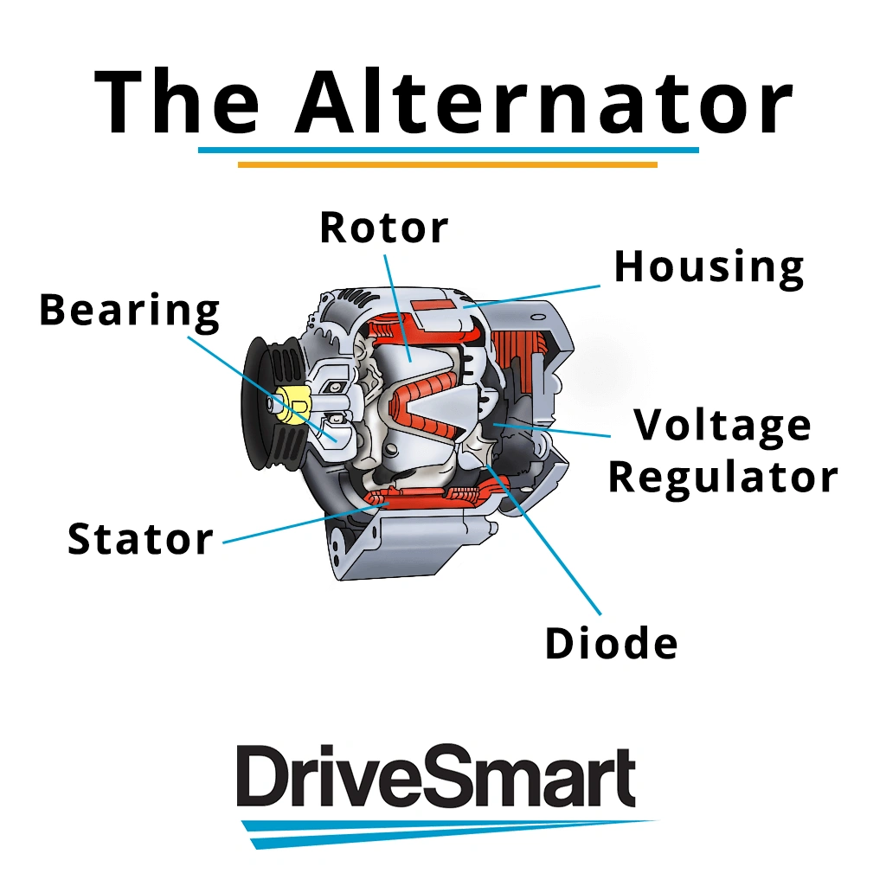
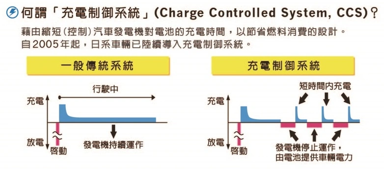

### Fatores que Determinam a Durabilidade do Alternador

Os principais itens sujeitos a desgaste que limitam o tempo de serviço de um alternador são:

- **Escovas de Carvão**: Sofrem desgaste abrasivo contínuo contra os anéis coletores durante o funcionamento.  
- **Rolamentos**: Estão expostos a fadiga mecânica e variações térmicas ao longo da quilometragem.  
- **Ponte Retificadora**: Transforma a corrente alternada em contínua; falhas térmicas ou sobrecargas de corrente podem queimar os diodos.

## Tecnologia de Controle de Carga e Taxa C (C-rate)

O rotor do alternador de um automóvel funciona na prática como um **eletroímã giratório**. Alterando a intensidade do campo magnético, o regulador calibra a geração de eletricidade. Quando há grande solicitação de carga:

- O campo magnético se intensifica → A resistência física do rotor aumenta → A carga sobre o virabrequim se eleva → **O consumo de combustível cresce.**

Buscando eficiência energética, os fabricantes desenvolveram o **Sistema de Controle de Carga (Charging Control System - CCS)**:  
O alternador só entrega amperagem plena quando a bateria realmente precisa de reposição. Assim que o estado de carga é atingido, o sistema reduz o fluxo no eletroímã, permitindo ao alternador **girar quase livre, com resistência magnética próxima de zero**.

### Como a Taxa C Define a Eficiência do Ciclo

A taxa C representa a velocidade com que uma bateria consegue "engolir" corrente elétrica em relação à sua capacidade total:

- **Bateria de Alta Taxa C (ex.: LiFePO4)**: Se o alternador gera 10A, a bateria consegue absorver 8A imediatamente.  
- **Bateria de Baixa Taxa C (ex.: Chumbo-Ácido)**: Se o alternador gera 10A, a alta resistência interna faz com que ela consiga aceitar apenas cerca de 2A.

Como a bateria de alto C-rate aceita corrente de forma muito mais dinâmica, a reposição de carga é concluída em fração do tempo habitual. O alternador retorna rapidamente ao modo de rotação livre, livrando o motor do arrasto parasitário. Isso gera **ganho real na economia de combustível** e **prolonga a vida útil das escovas de carvão** ao reduzir o tempo sob arco elétrico.

## Por Que o Titanato de Lítio (LTO) Nem Sempre É a Melhor Escolha

Embora o **Titanato de Lítio (LTO)** tenha taxas de corrente impressionantes e suporte milhares de ciclos a mais que o LiFePO4, ele traz desvantagens práticas no uso como bateria automotiva de partida:

1.  **Incompatibilidade de Tensão Operacional**: Com tensão nominal de 2,3V a 2,4V por célula, 5 células em série somam apenas ~14,0V (muitas vezes insuficiente para absorver a carga de forma ótima) e 6 células exigem ~16,2V (incompatível com a eletrônica de bordo de 14,4V).
2.  **Menor Densidade Energética**: Para entregar a mesma capacidade nominal, uma bateria LTO é sensivelmente mais pesada e volumosa do que um conjunto LiFePO4 equivalente.
3.  **Custo Elevado**: A relação custo-benefício para funções de partida rápida é desfavorável frente a uma boa bateria LiFePO4 provida de um BMS de qualidade.
