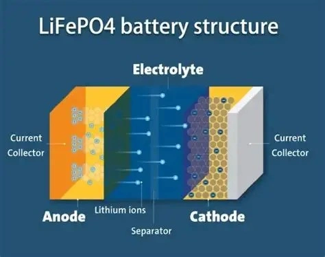

## Tempo de Resposta na Descarga da Bateria

| Tipo de Bateria | Resistência Interna | Tempo de Resposta (0 a 200A) | Características da Cinética |
| :--- | :---: | :---: | :--- |
| **LiFePO4 (Fosfato de Ferro e Lítio)** | Extremamente baixa | **< 10 ms** | Resposta atômica instantânea |
| **Chumbo-Ácido (AGM / EFB / Convencional)** | Alta | **100 a 500 ms** | Reação química dependente de fase lenta |

Muitos motoristas comentam que o veículo parece responder mais prontamente nas arrancadas após a instalação de uma bateria de lítio. Longe de ser ilusão ou efeito psicológico, a cinética eletroquímica explica esse ganho: a agilidade com que a bateria supre picos repentinos de corrente afeta diretamente a **saturação das bobinas de ignição** e a estabilidade da tensão dos bicos injetores.

## Por Que o LiFePO4 é Muito Mais Rápido?

### 1. Alta Reversibilidade Eletroquímica por Intercalação
Nas baterias LiFePO4, a condução de energia dá-se pela livre **intercalação e desintercalação** dos íons de lítio no retículo cristalino da estrutura olivina, sem exigir reações de dissolução e precipitação. A transferência de carga é instantânea e com baixíssima barreira energética.

### 2. Eletrólito de Baixa Resistência Interna
Empregam-se **solventes orgânicos de altíssima condutividade** como eletrólito. Em combinação com coletores de corrente de cobre e alumínio de baixa impedância, a bateria sustenta correntes maciças de descarga sem sofrer quedas drásticas de tensão em regime dinâmico.

### 3. Área Superficial Ativa em Escala Nanométrica
O material catódico ativo do LiFePO4 é refinado em **escala nanométrica**. Essa característica amplia exponencialmente a área de contato entre o sólido e o eletrólito líquido, oferecendo incontáveis canais simultâneos para movimentação dos íons.

## As Barreiras Físicas da Química do Chumbo-Ácido

Em contraste, as baterias convencionais de chumbo dependem de reações de conversão de fase morosas:
- **Deposição de Sulfato de Chumbo:** Ao fornecer corrente pesada, precipitados isolantes de sulfato de chumbo (PbSO4) formam-se sobre a superfície das placas, elevando a resistência exatamente quando a corrente é solicitada.
- **Área Específica Limitada:** As partículas ativas de óxido de chumbo são comparativamente volumosas, restringindo o número de íons capazes de reagir na fração de segundo da ignição.
- **Resistência do Eletrólito Aquoso:** A solução aquosa de ácido sulfúrico sofre polarização de concentração sob alta demanda, gerando o atraso característico de 100 a 500 ms.

### Resumo
Em automóveis equipados com modernos sistemas de injeção direta e ignição eletrônica rápida, uma bateria de resposta instantânea alimenta o primário das bobinas sem flutuação, gerando **centelhas de ignição mais fortes e homogêneas**. Isso proporciona uma **combustão mais eficiente**, **respostas de acelerador mais nítidas** e um funcionamento mais suave do motor.
