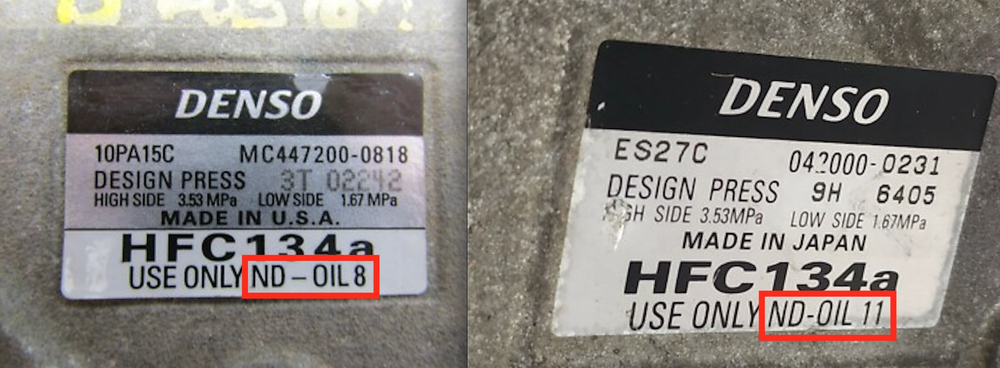

<figure>
  
  <figcaption>Compressores Denso: USE APENAS linha ND (inclui ND-OIL 8 e ND-OIL 11)</figcaption>
</figure>

## Entendendo o Óleo ND8 (ND-OIL 8)

Para quem dirige automóveis japoneses de marcas como **Toyota** e **Honda**, o compressor do sistema de ar-condicionado é quase certamente fabricado pela **Denso**. Esses componentes de engenharia de precisão foram projetados para trabalhar exclusivamente com um lubrificante dedicado: o **ND8**. Embora pertença à classe genérica dos óleos **PAG (Polialquileno Glicol)**, trata-se de uma formulação proprietária altamente purificada, com propriedades bem superiores aos óleos PAG multiuso encontrados em oficinas independentes.

## Principais Vantagens do ND8 Sobre Óleos PAG Convencionais

### 1. Superior Estabilidade Contra Umidade (Baixíssima Higroscopicidade)
Óleos PAG padrão de mercado são notoriamente higroscópicos, absorvendo a umidade do ar atmosférico com extrema rapidez ao menor contato.
* **O Perigo Químico:** A umidade acumulada reage com o gás refrigerante R134a gerando **ácido fluorídrico**.
* **A Resposta do ND8:** O ND8 é quimicamente estruturado para minimizar a absorção de vapor de água. Com isso, evita a acidificação do sistema e impede a corrosão das galerias de alumínio e das lâminas do compressor.

### 2. Miscibilidade Ideal com Fluido HFC-134a
O óleo precisa circular homogeneamente misturado ao gás por todo o evaporador e condensador, retornando de forma fluida ao carter do compressor. O ND8 possui o equilíbrio perfeito de viscosidade para assegurar retorno contínuo de óleo em todas as faixas térmicas de operação.

### 3. Elevada Resistência à Oxidação Térmica
Compressores trabalham sob forte pressão e calor elevado. Óleos inferiores sofrem degradação por oxidação prematura, formando **verniz e borras** que obstruem a válvula de expansão. O pacote de aditivos do ND8 preserva as tubulações limpas durante anos a fio.

## O Risco dos Chamados Óleos "Universais"

Muitos reparadores utilizam óleos genéricos "universais" PAG 46 ou PAG 100 para simplificar o estoque. No entanto, as folgas construtivas dos compressores Denso são micrométricas. A aplicação de óleo fora da norma provoca:
* **Ruídos Estranhos e Zumbidos:** Vibrações anormais ao acoplar a embreagem magnética.
* **Queda no Rendimento Térmico:** Formação de película espessa nas aletas do evaporador, diminuindo a troca de calor.
* **Travamento Irreversível do Compressor:** O defeito mais caro e prejudicial de todo o circuito de climatização.

## Conclusão

Sempre que efetuar uma recarga de gás ou substituir componentes do ar-condicionado do seu veículo, exija que a oficina aplique o óleo **Denso ND8 genuíno** (ou ND11 para compressores acionados por motor elétrico de híbridos). O lubrificante é o fluido vital do seu sistema, e a especificação correta é a melhor garantia contra manutenções corretivas astronômicas.
