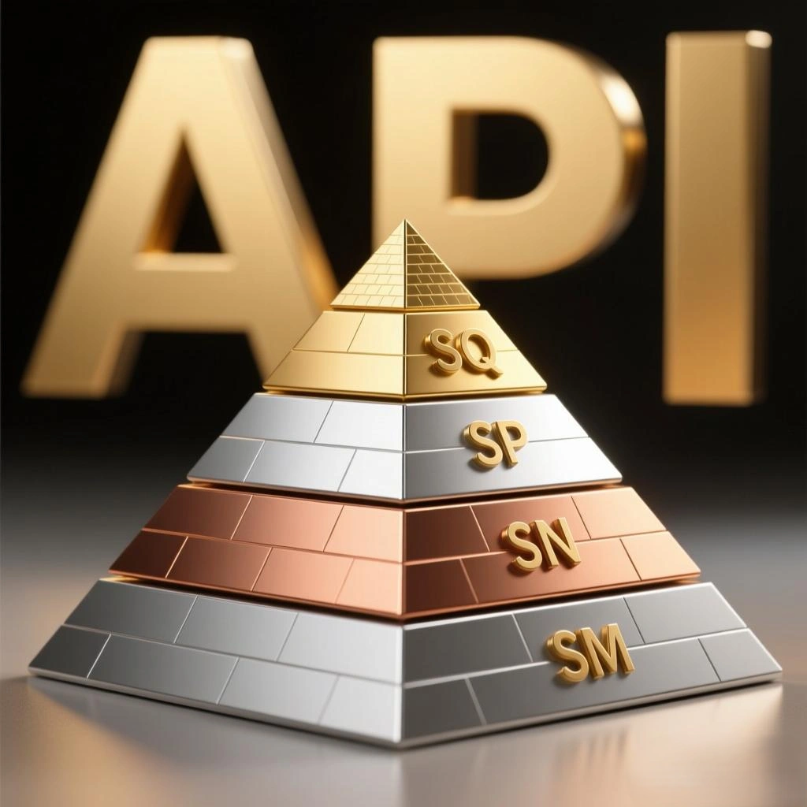

- **Nenhuma especificação nova de óleo de motor jamais baixou a régua de exigência: cada norma representa um salto qualitativo à frente.**
- **A alegação de que ‘o novo é pior do que o antigo’ é pura pseudociência e uma tentativa descarada de desovar estoques de produtos obsoletos.**

## Tabela Comparativa de Especificações Técnicas

| Categoria de Ensaio (Sequence) | API SM (2004) | API SN (2010) | API SP (2020) | API SQ (2024) |
| :--- | :--- | :--- | :--- | :--- |
| **Depósitos no Pistão (IIIH)** | Não aplicável (IIIG) | Sem exigência explícita | ≥ 3,5 pts | **≥ 4,0 pts** |
| **Aumento de Viscosidade (IIIH)** | ≤ 275% | ≤ 200% | ≤ 150% | **≤ 125%** |
| **Volatilidade do Óleo (IIIH)** | Não aplicável (IIIG) | Sem exigência explícita | ≤ 80 mL | **≤ 60 mL** |
| **Borra em Baixa Temp. (VH)** | Pistão ≥ 4,0 (VG) | Pistão ≥ 5,0 | Pistão ≥ 7,6 | **Pistão ≥ 8,0** |
| **Desgaste no Trem de Válvulas (IVB)** | Não aplicável (IVA) | Média < 90µm | Perda Volume < 2,7% | **Perda Volume < 2,3%** |
| **Proteção Anti-LSPI (IX)** | Não aplicável | Não aplicável | Média 0 Pré-ignições | **Critério Ainda Mais Severo** |
| **Desgaste da Corrente (X)** | Não aplicável | Não aplicável | Alongamento ≤ 0,085% | **Alongamento ≤ 0,070%** |
| **Compatibilidade de Combustível** | Padrão | Padrão | Padrão | **Suporte a Etanol E85** |
| **Otimização para Híbridos** | Não | Não | Básica | **Compatibilidade Plena** |

## Análise dos Pilares da Norma API SQ (ILSAC GF-7)

### 1. Limpeza Incomparável e Anti-Depósitos (Sequence IIIH)
No rigoroso teste Sequence IIIH, a nota mínima de limpeza nas canaletas dos pistões subiu de 3,5 para **4,0 pontos**. O óleo precisa comprovar capacidade extrema de detergência para impedir que os anéis de compressão travem com a queima de combustível.

### 2. Resistência ao Espessamento por Oxidação
O limite de elevação da viscosidade sob calor extremo caiu para apenas **125%**. Isso assegura que o lubrificante mantenha a fluidez adequada sem virar graxa ou borra pesada em motores turbo submetidos a altas temperaturas.

### 3. Proteção Específica para Correntes de Sincronismo
Nos motores com injeção direta (GDI), a fuligem fina tende a acelerar o desgaste dos elos da corrente de distribuição. A API SQ reduziu o alongamento aceitável de 0,085% para **0,070%**, eliminando falhas de sincronismo de válvulas.

### 4. Preservação dos Sistemas de Pós-Tratamento
A formulação atende com precisão aos requisitos dos **Filtros de Partículas para Motores a Gasolina (GPF)** e Diesel (DPF), evitando que cinzas sulfatadas e compostos voláteis obstruam o catalisador.

## Conclusão

A trajetória evolutiva da API SM até a API SQ evidencia um progresso técnico contínuo em proteção mecânica, economia de combustível e controle de emissões. Ao realizar a troca de óleo, dê sempre preferência à especificação mais moderna aceita pelo seu motor. A norma **API SQ (GF-7)** não é mero marketing; trata-se de um protocolo de testes altamente exigente desenvolvido para atender às severas demandas dos motores turboalimentados, híbridos e com injeção direta de combustível.
