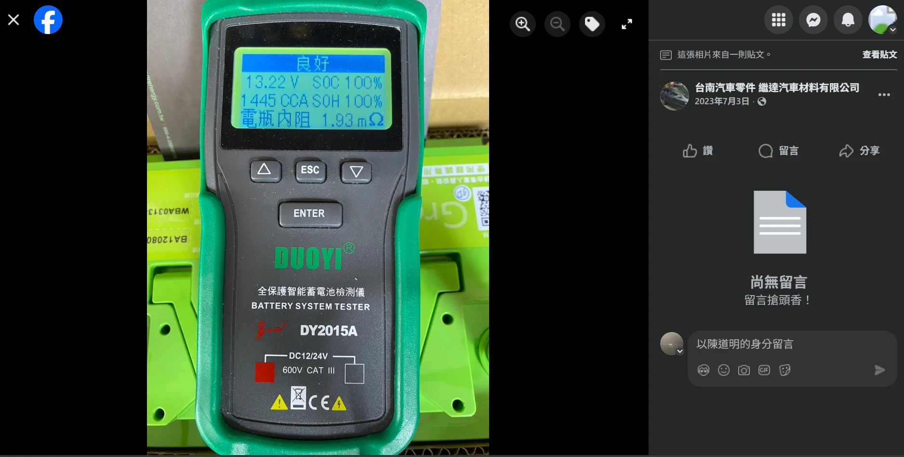

Se você separou um orçamento para aprimorar a alimentação elétrica do seu veículo, certamente já se deparou com este dilema:

👉 Vale a pena gastar dinheiro instalando um **«Supercapacitor»**?  
👉 Ou é melhor investir diretamente em uma **«Bateria LiFePO4 (Fosfato de Ferro e Lítio)»**?

**Vamos direto ao ponto sem rodeios: instalar um supercapacitor auxiliar não é apenas uma volta desnecessária e cara, é na prática um «downgrade» técnico.**

## Leis Básicas da Elétrica: Circuitos em Paralelo e Divisão de Corrente

Antes de comparar os produtos, é preciso relembrar dois conceitos consolidados da física:

### 1. Fórmula de Resistências em Paralelo
A fórmula de impedância equivalente para geradores ou resistores ligados em paralelo é: ([Calculadora de Resistência em Paralelo](/pt/2026/ir-caculator.html))

  RImpedância Total = 
  
    RBateria × RCapacitor
    RBateria + RCapacitor
  

Isso estabelece uma regra matemática: **se a impedância de um dos lados for drasticamente menor que a do outro, a redução obtida na resistência total será quase nula.**

### 2. Princípio de Divisão de Corrente
A corrente elétrica comporta-se como o fluxo de água: prioriza sempre a rota de **menor resistência interna (impedância)**. Quando uma carga pesada solicita alta corrente instantânea (acionamento do motor de arranque ou batida de subwoofer), o dispositivo que possuir a menor resistência será o encarregado de entregar a energia.

## Motivo 1: A Bateria LiFePO4 Já É um Monstro em Desempenho

A concepção original dos supercapacitores nasceu para tentar compensar as deficiências das velhas baterias de chumbo-ácido, que possuem [alta resistência interna e lentidão eletroquímica](/pt/2025/lithium-vs-lead-analysis.html)—atuando como um buffer na frente de uma fonte lenta.

Entretanto, a química LiFePO4 traz de nascença:
- [Resistência interna incrivelmente baixa (2 a 3 mΩ)](/images/greenrun_ir.webp)
- Taxa C de descarga altíssima (de 50C a 80C)
- [Tempo de resposta de subida imediato (< 10ms)](/pt/2025/lithium-vs-lead-analysis.html)

👉 A capacidade de pico de uma bateria LiFePO4 **há muito superou o papel «auxiliar» que um supercapacitor poderia oferecer.**

## Motivo 2: Na Prática, o Supercapacitor Responde Mais Lento que o LiFePO4

Em teoria ideal de laboratório, capacitores descarregam em velocidades impressionantes. Contudo, na engenharia automotiva real, um módulo comercial de supercapacitores reúne várias células cilíndricas em série providas de placas de balanceamento resistivo. Esse arranjo eleva a resistência série equivalente (ESR) do conjunto para a faixa de **20 a 30 mΩ**—pior que uma boa bateria de chumbo! Quando surge uma demanda violenta de corrente, essa alta resistência interna causa queda imediata de tensão e dissipa energia em calor. Na prática, a resposta dinâmica e o poder de entrega de um supercapacitor montado ficam aquém de uma bateria LiFePO4 de 2 a 3 mΩ.

## Motivo 3: Ligar LiFePO4 em Paralelo com Supercapacitor Não Faz Efeito Algum

Coloquemos os números reais na fórmula do circuito em paralelo:

- Resistência interna DC de uma bateria LiFePO4: **cerca de 2 a 3 mΩ**  
  
- Resistência interna de um módulo de supercapacitores comercial: **cerca de 20 a 30 mΩ**  
  

Calculando a ligação em paralelo de uma bateria LiFePO4 GreenRun com um supercapacitor conceituado (Eaton), a resistência interna do sistema cai apenas **cerca de 0,15 mΩ**—uma diferença insignificante que é facilmente anulada pela resistência dos próprios cabos de ligação!  
Pelo princípio da divisão de corrente, mais de 90% da amperagem continuará fluindo pela bateria LiFePO4. O capacitor fica como mero enfeite inerte.

> Repare nos vídeos promocionais dos fabricantes de capacitores: eles quase sempre comparam **«Chumbo + Capacitor vs Chumbo Original»**.  
> Eles jamais divulgam dados de **«LiFePO4 + Capacitor vs LiFePO4 Isolada»**, pois isso revelaria que gastar milhares de reais na caixinha adicional produz **rigorosamente zero ganho prático.**

## Motivo 4: Elevada Autodescarga dos Capacitores

Além de armazenar uma quantidade risível de energia e sofrer com o calor, o supercapacitor possui alta taxa de autodescarga espontânea:
- Fuga em repouso do supercapacitor: **de vários mA até centenas de mA**
- Fuga em repouso da bateria LiFePO4: **apenas dezenas de µA** (1 mA = 1.000 µA)

Se o veículo ficar estacionado por alguns dias, a voltagem do supercapacitor cai bastante. Ao ligar a ignição, ele vira uma carga morta consumindo energia da bateria principal para tentar se restabelecer.

## Motivo 5: Riscos com Chicotes e Módulos Adicionais

- **Risco de Montagem**: Cablagens extras no cofre do motor podem roçar nas chapas, sofrer esmagamento e causar curtos-circuitos, além do risco de desprendimento do módulo em colisões.
- **Risco do Produto**: Históricos de defeitos em capacitores revelam casos de sobreaquecimento e princípio de incêndio no cofre.

Em oposição, a bateria LiFePO4 substitui a original mantendo o chicote original do fabricante, garantindo integridade estrutural e total segurança.

## Motivo 6: As Baterias LiFePO4 Ficaram Muito Acessíveis

No passado, quando células LiFePO4 eram raras e caras, os capacitores tinham apelo comercial. Hoje, os custos de produção caíram vertiginosamente:
- Bateria automotiva LiFePO4 100Ah de marca: cerca de R$ 2.000 a 2.500
- Bateria para motocicleta LiFePO4 5.5Ah: cerca de R$ 450 a 500

👉 Com os preços de baterias LiFePO4 tão acessíveis, **por que gastar valores expressivos em um supercapacitor com menos de 0,4Ah de capacidade, sensível ao calor e que ainda drena corrente parado?**

## Motivo 7: Capacidade Excessivamente Lenta para Filtragem de Ruído

Em filtragem de ruídos elétricos, **velocidade em alta frequência é prioridade sobre capacidade bruta**.
- Devido à indutância série equivalente (ESL) elevada de sua estrutura enrolada, o supercapacitor não reage com rapidez a ruídos de alta frequência da ignição ou alternador.
- Pequenos capacitores cerâmicos ou eletrolíticos de poucos microfarads são ordens de magnitude mais rápidos e adequados para filtrar oscilações finas. O supercapacitor é inútil para essa finalidade.

## Conclusão: Gaste Seu Dinheiro com Inteligência

A era dos supercapacitores no mercado de acessórios automotivos chegou ao fim:

* **Se você já usa bateria LiFePO4**: O capacitor em paralelo é **inútil**, pois a bateria é mais rápida e potente que ele.
* **Se você ainda usa bateria de chumbo**: Comprar um capacitor **não compensa**, pois o valor somado aproxima-se do custo de trocar diretamente para uma bateria LiFePO4, que entrega salto definitivo de rendimento.

👉 Guarde a verba destinada ao supercapacitor e invista diretamente em uma **bateria de partida LiFePO4 de qualidade**. Esse é o caminho mais racional, seguro e eficiente.
