[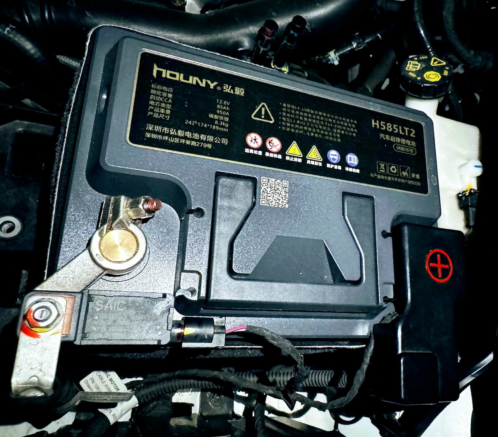](/images/LN2_HY_Install2.webp)

| Item | Especificações |
| :--- | :--- |
| **Veículo Aplicado** | MG HS 1.5T Versão Gasolina |
| **Marca Adotada** | [Bateria Houny (Houyi)](https://www.houny.cn/) |
| **Modelo da Bateria** | H585LT2 85Ah (Padrão Dimensional LN2) |

## Contexto e Seleção da Bateria

Anos atrás, substituímos a bateria de um veículo importado da família por uma [LiFePO4 GreenRun](/pt/2025/greenrun.html), com resultados extremamente satisfatórios em resposta de condução e vida útil. Recentemente, um colega proprietário de um MG HS 1.5T notou que a bateria de chumbo original já dava mostras de cansaço, com resistência interna em ascensão contínua. Após avaliarmos as opções, a decisão foi avançar para o Fosfato de Ferro e Lítio (LiFePO4).

A bateria de fábrica do MG HS é uma Sail 6-QW-63MG, com dimensões correspondentes ao padrão **LN2**. Embora a bandeja do cofre permita acomodar o tamanho maior LN3, essa alteração exigiria descartar a manta térmica protetora original. Por essa razão, optamos por manter o padrão dimensional LN2.

No mercado local, encontrar baterias LiFePO4 de primeira linha no formato LN2 é um desafio similar aos padrões japoneses B24 e D23, havendo predominância de montagens caseiras sem procedência fabril. Após minuciosa pesquisa, escolhemos a **Houny**, uma indústria de grande porte dedicada à fabricação de acumuladores de partida e fornecedora OEM/ODM para renomadas marcas europeias e americanas.

[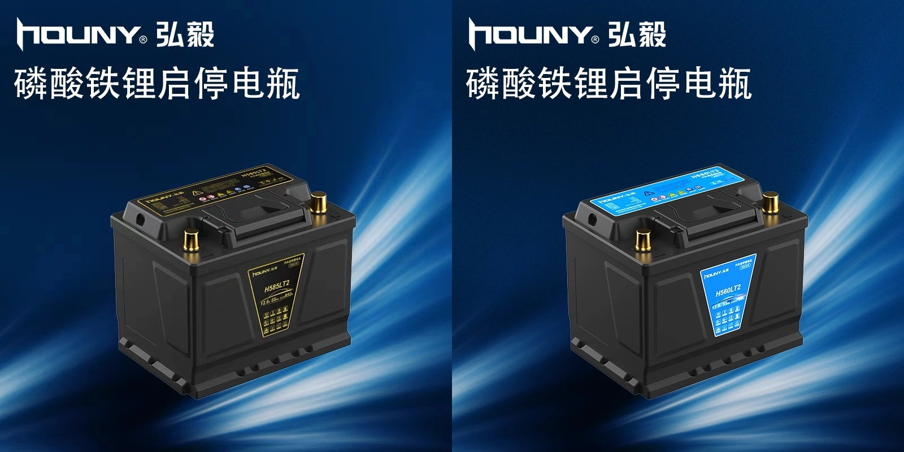](/images/LN2_HY_Type.webp)

Com a reestruturação das linhas da Houny para 2025 (séries Gold, Blue e Green), adquirimos o modelo Gold de 85Ah. Existe uma versão de 100Ah no mesmo invólucro LN2, mas como o carro roda estritamente original e funciona principalmente como veículo de lazer de fim de semana, a entrega real de uma **LiFePO4 de 85Ah equivale a uma bateria de chumbo de 130Ah**, oferecendo ampla tranquilidade.

## Detalhes do Unboxing

[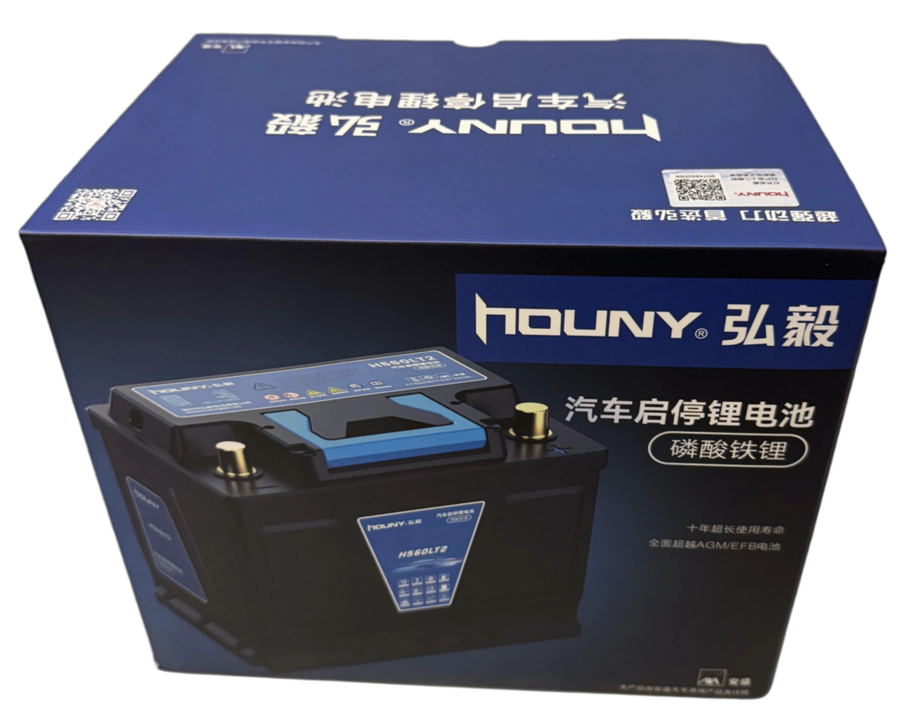](/images/LN2_HY_BOX.webp)  
*Caixa de envio de alta rigidez*

[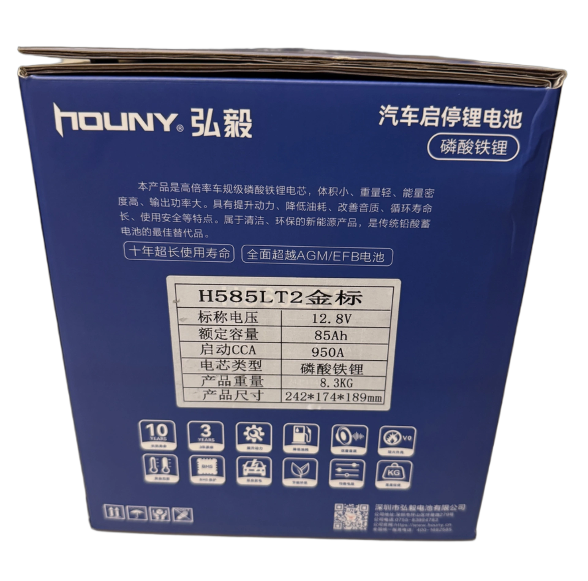](/images/LN2_HY_BOX2.webp)  
*Etiquetas de controle de qualidade e dados técnicos*

[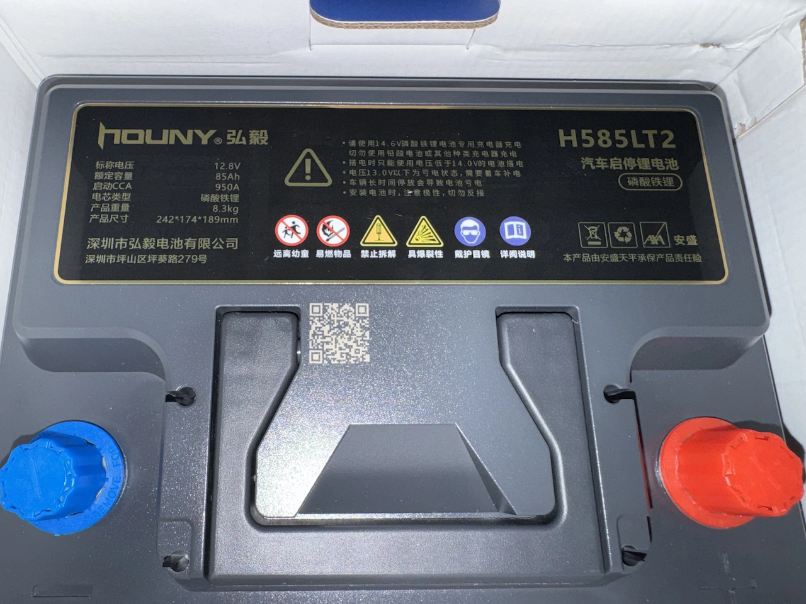](/images/LN2_HY_Top.webp)  
*Apresentação superior com lacre do fabricante*

[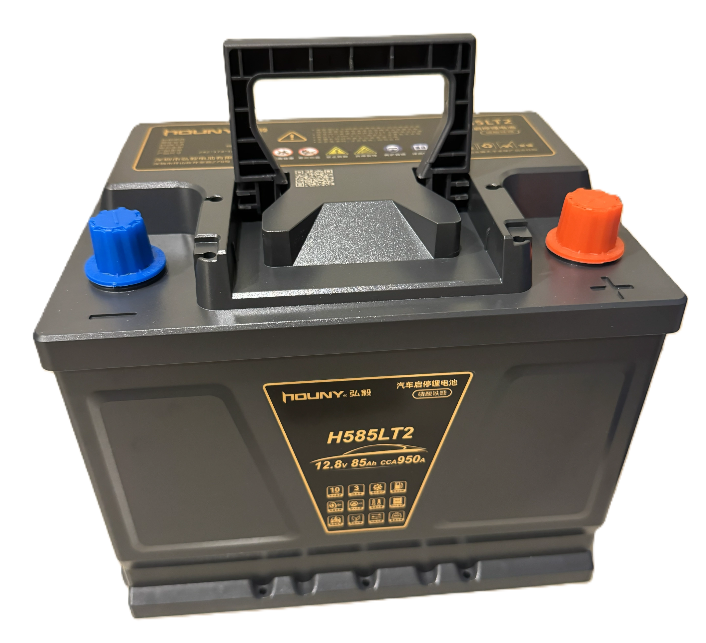](/images/LN2_HY_Front.webp)  
*Parâmetros elétricos nominais gravados na carcaça*

[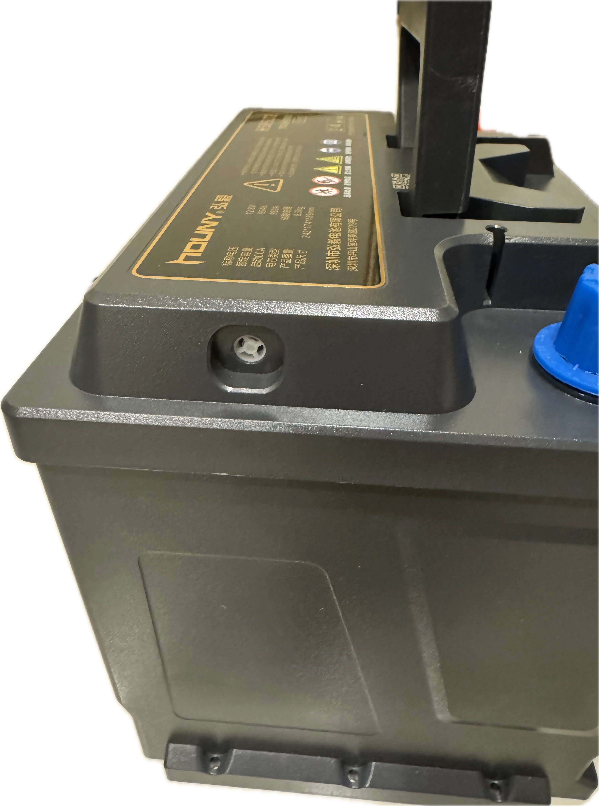](/images/LN2_HY_Side1.webp)  
*Válvula direcional de alívio de segurança*

[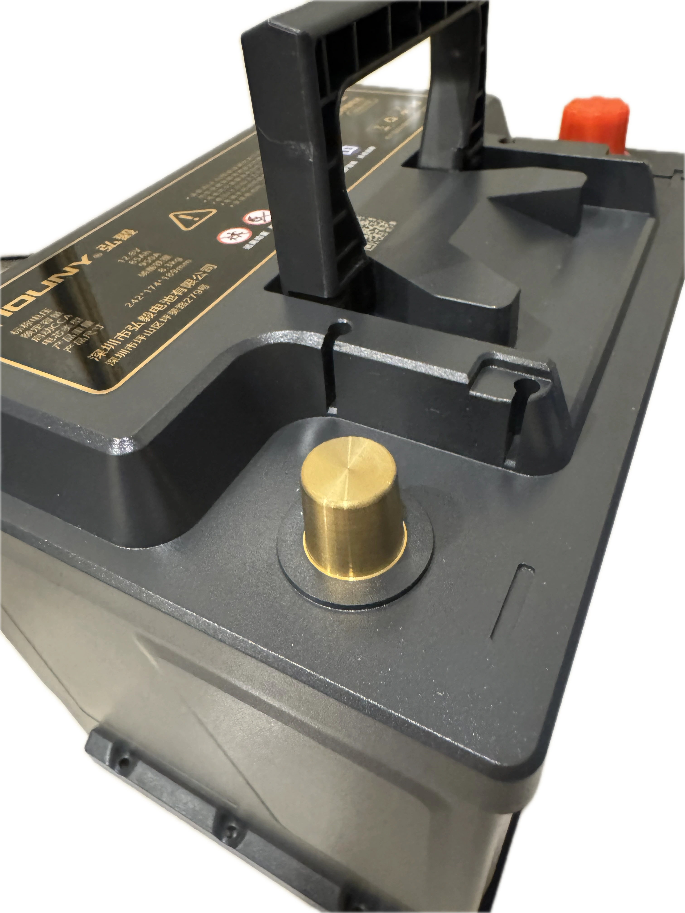](/images/LN2_HY_Side2.webp)  
*Polos coniformes torneados em cobre maciço*

[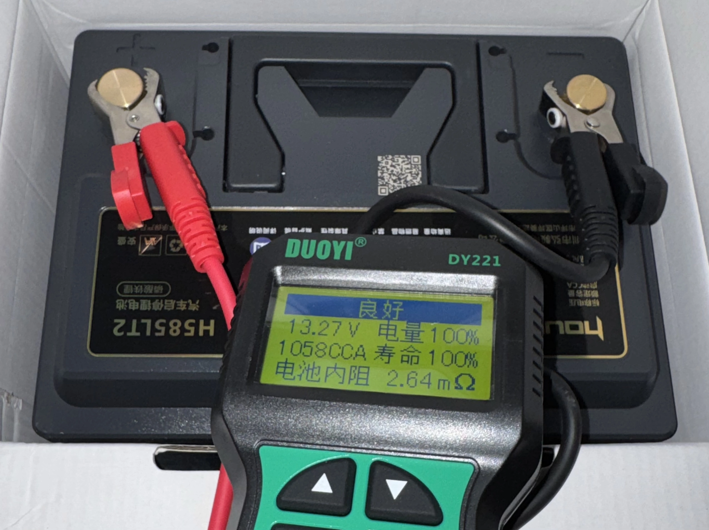](/images/LN2_HY_IR.webp)  
*Conferência na entrega: tensão perfeitamente calibrada e resistência na casa de miliôhms*

Registros fotográficos internos obtidos do [desmonte técnico de um comprador](/images/hongytaobaoreview.webp) revelam o nível de acabamento do produto:

[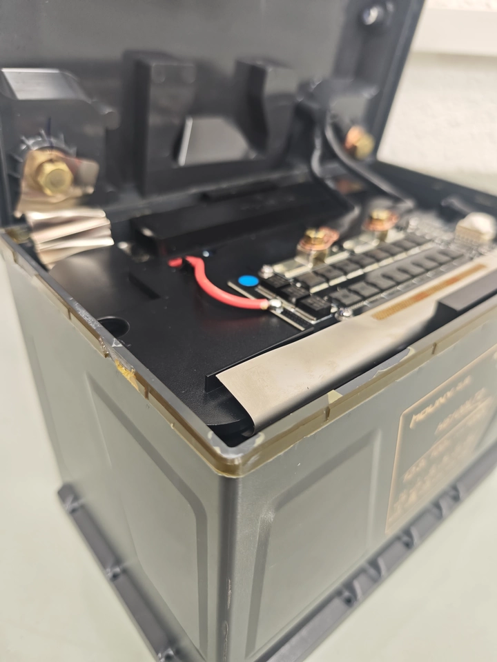](/images/hongyStruct1.webp)  
*Placa controladora BMS com MOSFETs industriais e barramento de cobre puro*

[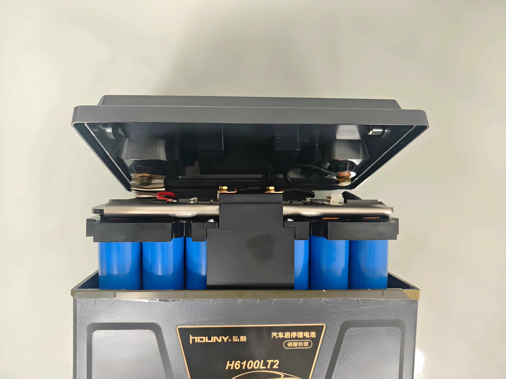](/images/hongyStruct0.webp)  
*Montagem estrutural limpa e carcaça em polímero resistente ao calor*

[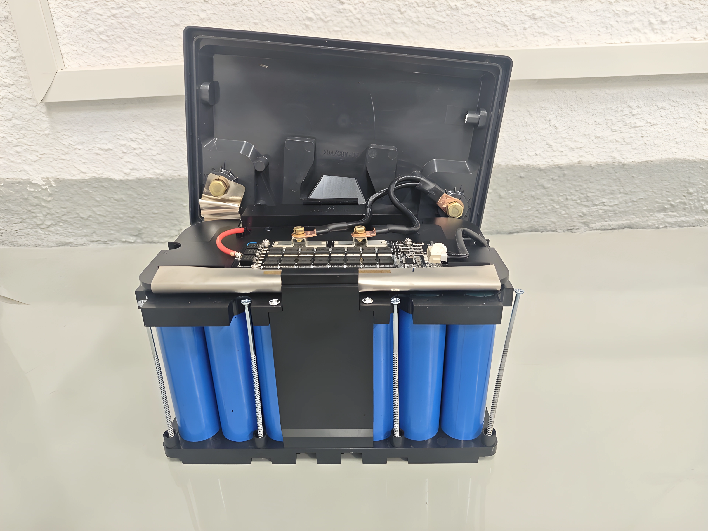](/images/hongyStruct2.webp)  
*Fixação antivibração das células com tirantes de aço pré-tensionados*

## Procedimento de Troca Passo a Passo

### Ferramentas Requeridas

| Ferramenta | Utilidade e Recomendações |
| :--- | :--- |
| **Soquete em L de 10mm [/images/L-socket.webp](/images/L-socket.webp)** | Essencial para desapertar os polos positivo/negativo e a chapa inferior de fixação. |
| **[Salva-Memória OBD](/pt/2025/memory-saving-battery.html)** | Garante alimentação contínua para preservar dados de injeção e relógio. |
| **Bateria Auxiliar 12V** | Fonte de alimentação de 12V para energizar o cabo OBD. |
| **[Alça para Baterias](/images/battery_handle.webp)** | Auxilia no içamento seguro (a bateria de fábrica Sail não traz alça integrada). |

### Roteiro de Montagem
> Registro operacional real. Não houve registro de avarias ou códigos no painel.

[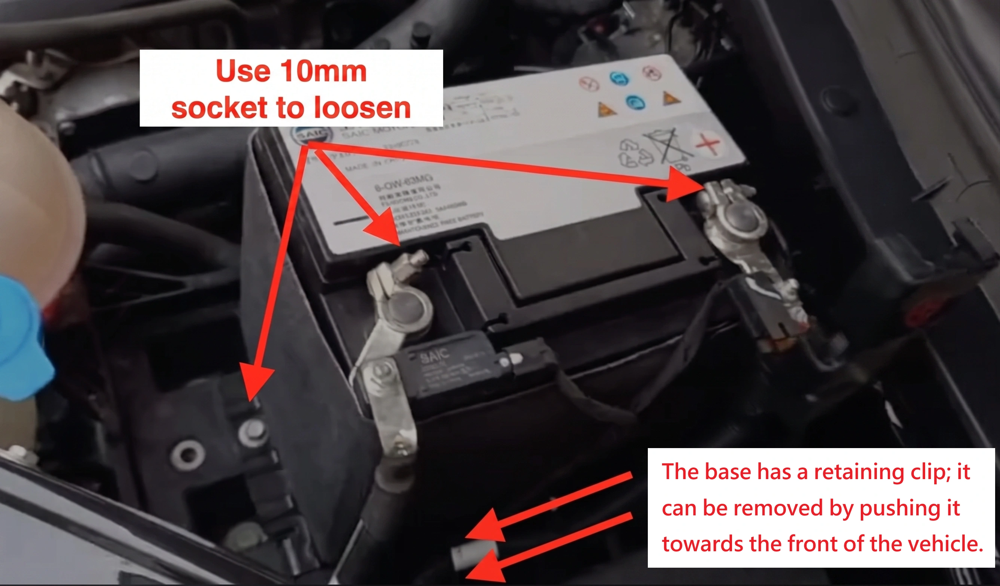](/images/en_LN2-instruction.webp)

| Etapa | Operação | Detalhes e Observações |
| :---: | :--- | :--- |
| **1** | **Conectar o Salva-Memória** | Ligar a fonte auxiliar ao cabo e plugar o terminal na porta OBD do automóvel. |
| **2** | **Aguardar Dormência** | Fechar todas as portas e aguardar 5 minutos até que os módulos da central entrem em repouso. |
| **3** | **Remover a Presilha da Base** | Com o soquete de 10mm, soltar e retirar o parafuso e a trava inferior de fixação. |
| **4** | **Criar Espaço de Trabalho** | Empurrar a bateria velha **em direção à frente do carro** para soltá-la do encaixe traseiro, liberando espaço junto ao polo positivo. |
| **5** | **Desconectar os Polos** | Soltar primeiro o terminal **Negativo (-)** e depois o **Positivo (+)** (isolando-o de imediato). |
| **6** | **Trocar os Acumuladores** | Puxar a bateria antiga com a alça e posicionar a nova bateria LiFePO4 com a capa térmica original. |
| **7** | **Reconectar os Terminais** | Fixar e apertar primeiro o terminal **Positivo (+)** e em seguida o **Negativo (-)**. |
| **8** | **Travar na Base** | Empurrar a nova bateria **em direção ao lado do motorista** para que a aba da base trave com firmeza nos dentes traseiros. |
| **9** | **Reaparafusar a Trava Inferior** | Reposicionar a chapa metálica de fixação e apertar firmemente o parafuso de 10mm. |
| **10** | **Finalização** | Desconectar o aparelho da tomada OBD e dar partida: funcionamento regular e painel 100% limpo. |

## Conclusão e Avaliação dos Benefícios

A troca consumiu apenas 15 minutos de serviço. O amplo espaço no vão do motor do MG HS 1.5T torna essa manutenção extremamente amigável.

[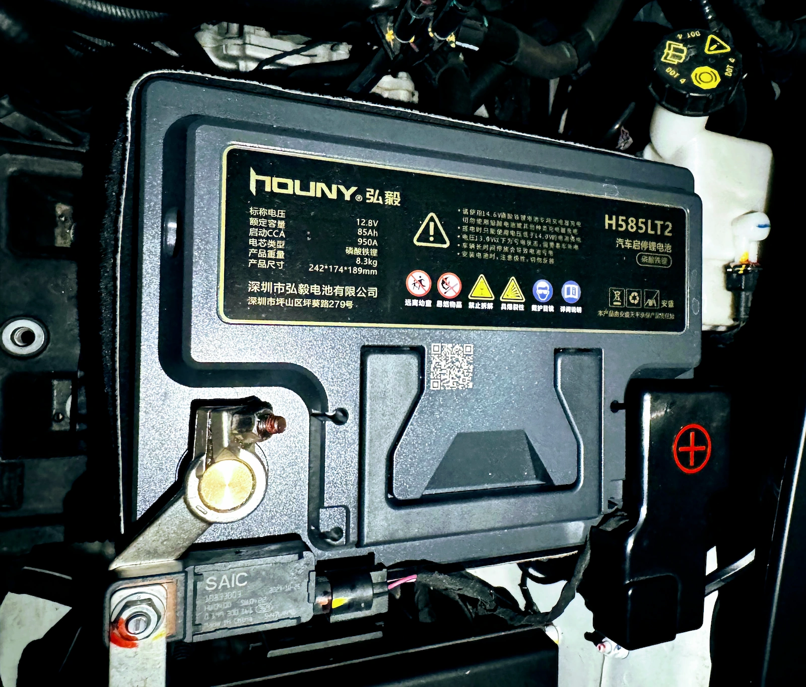](/images/LN2_HY_Install1.webp)

Os ganhos práticos que justificam o investimento na tecnologia LiFePO4:

| Aspecto | Fundamento Técnico | Benefício no Dia a Dia |
| :--- | :--- | :--- |
| **Desempenho de Carga e Descarga** | [Eficiência de recarga expressiva](/images/lifepo4-vs-lead-acid-recharge-speed-thesis-comparison.webp) aliviando o motor; [descarga imediata](/pt/2025/lithium-vs-lead-analysis.html) estabilizando a rede de bordo. | Poupa escovas do alternador e confere maior suavidade na marcha lenta. |
| **Segurança Térmica** | [Estabilidade comprovada sob calor e frio](/images/delta-lifepo4-vs-lead-acid-specs-comparison.webp), estrutura química incombustível sem perigo de explosão. | Máxima segurança sob a temperatura elevada do cofre do motor. |
| **Redução de Peso e Autodescarga** | Redução de mais de 50% no peso (de ~17kg original para apenas 8kg) e perda espontânea mínima de carga. | Alivia o peso sobre o eixo dianteiro; **solução ideal para carros de uso esporádico no fim de semana**. |
| **Economia de Combustível** | [Reabastecimento elétrico rápido](/pt/2025/car-bms.html) reduzindo o tempo de trabalho sob carga do alternador. | [Pesquisas atestam](/images/startup-lifepo4-battery-engine-performance-thesis.webp) ganho palpável no consumo de combustível ao longo do mês. |
