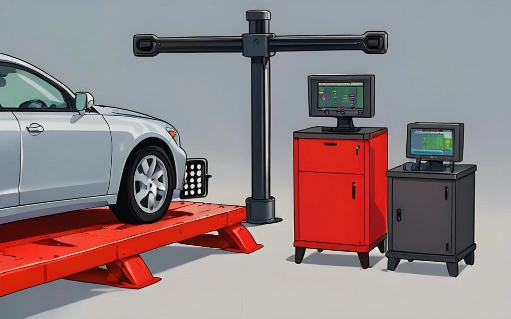

Ao trocar os pneus ou reparar componentes de suspensão e direção, as oficinas recomendam com frequência o chamado «Alinhamento 3D». Comparado aos antigos métodos de alinhamento por réguas laser ou cordéis, a geometria tridimensional moderna é incomparavelmente mais rápida e atinge níveis altíssimos de exatidão. Este artigo explica a fundo os princípios matemáticos e ópticos envolvidos nessa tecnologia.

## 1. Sensores de Alta Precisão: Câmeras Industriais e Alvos Ópticos

A estrutura física de um alinhador 3D é formada por uma barra transversal equipada com duas (ou quatro) câmeras industriais de alta velocidade e sensores CMOS/CCD de alta resolução.

* **Alvos Passivos Refletivos:** As placas afixadas nas quatro rodas não contêm circuitos elétricos, baterias ou cabos. São apenas alvos passivos impressos com uma matriz precisa de círculos refletores.
* **Projeção em Perspectiva:** Quando as câmeras capturam os alvos no espaço tridimensional, a angulação faz com que os círculos apareçam como «elipses» na imagem registrada.
* **Algoritmo de Estimação de Postura:** Comparando a distorção elíptica observada com a geometria real dos pontos gravada no software, o processador calcula com rigor as **coordenadas X, Y, Z** e a **orientação angular no espaço** de cada roda.

## 2. A Etapa Fundamental: Compensação de Excentricidade (Run-out)

Aqui reside a maior inteligência da tecnologia 3D: **o alvo não precisa estar montado perfeitamente no centro geométrico da roda.**

Por quê? Porque as rodas dos veículos costumam apresentar pequenas imperfeições mecânicas na borda ou folgas microscópicas nas garras do adaptador. Medir o alvo de forma puramente estática incorporaria todos esses erros mecânicos.

* **Reconstrução do Eixo Físico de Rotação:** O operador empurra manualmente o carro sobre a plataforma elevatória alguns centímetros para trás e para frente. Conforme as rodas giram, cada ponto do alvo descreve uma trajetória em forma de «arco tridimensional».
* **Ajuste Numérico:** O sistema fotografa esses pontos em sequência e utiliza equações de regressão (como o **Método dos Mínimos Quadrados**) para ajustar esses arcos a um centro comum: o **Eixo da Manga (Spindle Axis)**.
* **Eliminação de Erros:** Esse eixo corresponde à verdadeira linha física de rotação do cubo de roda. A compensação de excentricidade elimina por completo o ruído causado por uma roda levemente amassada ou garra mal encaixada.

## 3. Calibração e Compensações de Hardware

Para atingir repetibilidade com precisão de até 0,01 grau, o sistema neutraliza interferências do ambiente:

* **Física vs. Realidade Mecânica:** Se uma roda estiver gravemente torta ou ovalizada, o software ainda conseguirá calcular seu eixo matemático médio, mas o carro vibrará na pista. Os dados parecerão «perfeitos na tela», mas a roda precisará ser desempenada ou trocada.
* **Compensação Térmica dos Materiais:**
    * **Expansão Estrutural:** As vigas metálicas das câmeras sofrem dilatação com a temperatura da oficina. Sensores térmicos corrigem em tempo real a **distância de base** entre as câmeras.
    * **Desvio dos Sensores:** Câmeras profissionais fazem compensação de temperatura nos chips de imagem, evitando desvio de coordenadas de pixels causados pelo aquecimento da placa.
* **Aferição com Padrão ISO:** Um gabarito de calibração aferido segundo normas ISO mantém a concordância óptica absoluta entre os dois lados da máquina.

## 4. Integração Eletrônica e Conexão com Sistemas ADAS

O alinhador 3D não é apenas um instrumento de medição de ângulos; é o centro integrador da dinâmica veicular.

* **Banco de Dados Original de Montadora (OEM):**
    O software confronta em tempo real os ângulos apurados (Câmber, Caster, Convergência) com os parâmetros oficiais exigidos para aquele ano e modelo do carro.
* **Integração Crucial com ADAS (Sistemas Avançados de Assistência ao Condutor):**
    Esta é a aplicação mais vital em veículos modernos:
    * Radares frontais de piloto automático adaptativo (ACC) e câmeras de faixa precisam estar perfeitamente alinhados com a **Linha de Empuxo (Thrust Line)** gerada pelo eixo traseiro.
    * A máquina de alinhamento 3D calcula o eixo geométrico central e transfere essas coordenadas para os painéis de calibração ADAS, garantindo que os sensores do carro «enxerguem» rigorosamente na mesma direção em que os pneus estão tracionando.

## Conclusão

O alinhamento 3D combina **visão computacional** e **geometria espacial analítica** para conferir precisão extrema a uma rotina de manutenção essencial. Entender esse processo esclarece por que o ato de «empurrar o carro no elevador» (compensação por rolamento) representa o coração de todo o diagnóstico, assegurando que os números na tela correspondam à física real das rodas e não a desvios das ferramentas.
