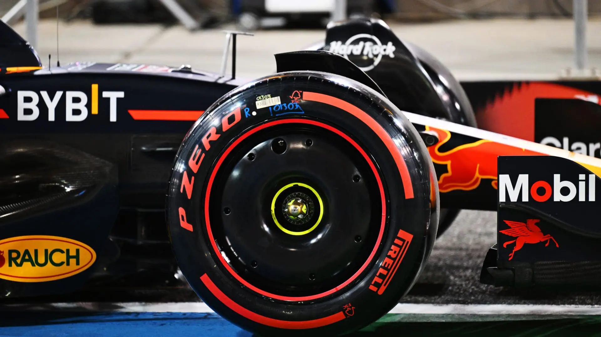
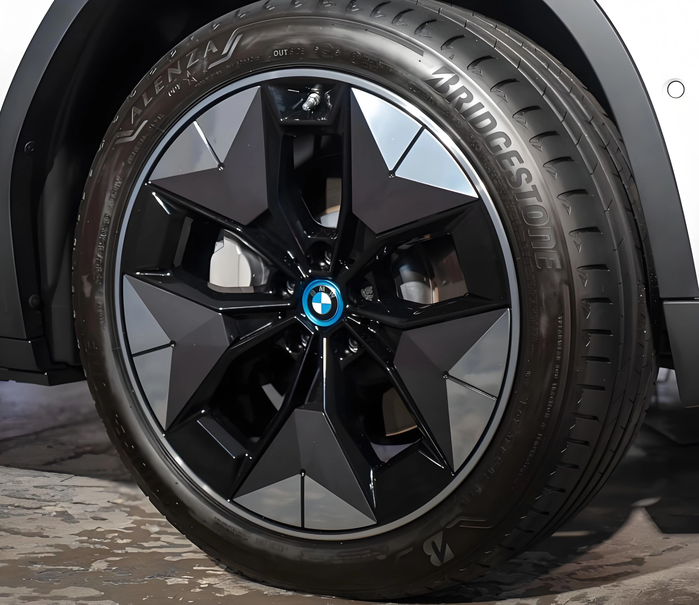

No meio automotivo de preparação, existe uma máxima clássica: «Aliviar 1 kg de peso não suspenso equivale a tirar 10 kg da carroceria». Com o desejo de melhorar o consumo e a dirigibilidade, muitos proprietários investem pesado em rodas forjadas superleves, aproveitando para aumentar o tamanho do aro.

Porém, a realidade física pode contrariar a conversa de loja: **montar rodas com raios finíssimos e muito vazadas, ou exagerar no diâmetro do aro, frequentemente resulta em saídas pesadas, consumo mais alto na rodovia e perda de velocidade final.** Com o crescimento dos carros elétricos (EVs), vemos as próprias montadoras retornando em peso aos desenhos de rodas semi-fechadas e aerodinâmicas.

## 1. Conceito Central: Baixa Velocidade Luta Contra a Inércia, Alta Velocidade Luta Contra o Ar

Para avaliar com rigor a dinâmica de uma roda, é mandatório separar o tráfego em dois cenários:
* **Uso Urbano (Baixa Velocidade):** Nas constantes arrancadas de semáforos, o veículo batalha contra a massa estática e a inércia de rotação. Trocar por rodas mais leves **mantendo as mesmas medidas originais de aro e largura** de fato alivia o esforço do motor e deixa as saídas visivelmente mais ágeis.
* **Uso Rodoviário (Velocidade de Cruzeiro):** Ao cruzar a barreira dos 100 a 120 km/h, o maior obstáculo passa a ser o atrito contra o ar. Nesse patamar, o arrasto aerodinâmico torna-se ordens de grandeza mais determinante do que o peso bruto da roda.

## 2. A Armadilha da Inércia Rotacional: Alívio de Peso Não Supera o Afastamento de Massa

Por que tantos motoristas sentem o carro pesado e amarrado após investir em rodas caras? O erro fatal é avaliar apenas o número da balança, ignorando a física do **aumento de diâmetro e tala**.

* **Deslocamento Periférico do Centro de Gravidade:** Ao subir de aro 17 para 19, ou alargar a tala de 7J para 8.5J, a massa de alumínio é empurrada para a borda externa. Além disso, uma roda mais larga exige a instalação de um **pneu mais largo**.
* **O Pneu é a Parte Mais Pesada do Conjunto:** Um pneu quase sempre pesa mais que a própria roda, e sua banda de rodagem fica posicionada no raio mais extremo possível da rotação.
* **A Regra Matemática do Momento de Inércia ($$I = m r^2$$):** O momento de inércia ($$I$$) é proporcional à massa multiplicada pelo **quadrado do raio ($$r^2$$)**. Quanto mais afastada a massa estiver do centro do cubo, muito mais energia será exigida para fazê-la girar. Assim, uma redução de peso no papel transforma-se em um **aumento severo de inércia rotacional**.
* **Impactos Práticos no Automóvel:**
    * **Respostas Amarradas na Arrancada:** O motor precisa entregar mais torque apenas para romper a inércia das rodas.
    * **Direção Pesada e Preguiçosa:** O efeito giroscópico acentuado endurece as mudanças de direção, tornando o carro menos ágil.
    * **Sobrecarga de Frenagem:** A maior energia cinética rotacional exige mais esforço do sistema de freios, dilatando o espaço de frenagem.

## 3. O Muro Invisível em Velocidades de Cruzeiro: A Lei do Quadrado da Velocidade

Conforme a velocidade cresce, a resistência do ar passa a obedecer à fórmula da força de arrasto aerodinâmico:

$$F_D = \frac{1}{2} \rho v^2 C_D A$$

O termo chave dessa equação é o **quadrado da velocidade ($$v^2$$)**. Se você dobra a velocidade de 70 km/h para 140 km/h, a resistência do ar não dobra: ela **multiplica por quatro (x4)**! A 140 km/h, o arrasto aerodinâmico é responsável por mais de **75%** de toda a força contrária ao movimento do automóvel.

Nessa condição extrema, pequenas diferenças de peso nas rodas tornam-se insignificantes. O coeficiente aerodinâmico ($$C_D$$) passa a ser a única variável capaz de **poupar combustível e manter a aceleração**.

## 4. As Lições da Fórmula 1 e o «Arrasto de Ventilação»

Rodas abertas criam tanta turbulência assim? A resposta é: criam, e em volume gigantesco.

A Fórmula 1 tornou compulsório o uso de **calotas aerodinâmicas (Wheel Covers)** a partir de 2022.

* **Rodas Abertas São Geradores de Turbulência:** Rodas de reposição com desenho muito vazado funcionam como pás de ventilador em alta rotação, sugando o ar e jogando vórtices turbulentos pelas laterais do carro.
* **O Fenômeno do Arrasto de Ventilação:** Testes em túnel de vento revelam que a turbulência nas caixas de roda responde por cerca de **25% a 30%** de todo o arrasto aerodinâmico do veículo. O fato de a F1 preferir adicionar o peso de calotas plásticas para laminar o ar atesta que em alta velocidade a aerodinâmica reina soberana sobre o peso.

## 5. A Era dos Elétricos e as Rodas Aerodinâmicas Fechadas

Em motores a combustão, um arrasto maior resulta em consumo um pouco pior. Em veículos 100% elétricos, o arrasto compromete a sobrevivência do carro: sua autonomia utilizável.

Por isso modelos da Tesla, Porsche (Taycan) ou Hyundai (linha Ioniq) saem de fábrica com **rodas semi-fechadas ou calotas aéro planas**.

* **Canalização Limpa do Fluxo:** O desenho liso faz com que o vento escorregue pela lateral sem ser engolido pelo arco de roda.
* **Diferença Real de Autonomia:** Avaliações com e sem calotas aerodinâmicas demonstram variações de **3% a 5%** na autonomia rodoviária de carros elétricos. As rodas originais de fábrica podem parecer pesadas, mas foram esculpidas em túnel de vento para cortar o ar com eficiência máxima.

## 6. Diretrizes Práticas de Modificação

* **Uso Quotidiano Urbano:** Rodas leves são válidas desde que preservadas as medidas originais de diâmetro e largura. Evite a tentação de aumentar aros desproporcionalmente para não elevar a inércia rotacional.
* **Quem Roda Muito em Rodovia / Donos de Elétricos:** Se o foco é velocidade de cruzeiro, retomadas e autonomia, esqueça o apelo de rodas vazadas ultraleves. Priorize **modelos com face aerodinâmica fechada**, que entregarão maior eficiência energética e estabilidade real.
