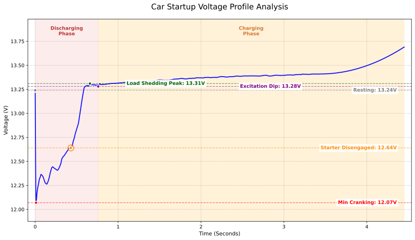

No estudo dos sistemas elétricos veiculares, o momento da partida é a fase de maior solicitação de carga. Por meio de amostragem em alta frequência a 100 Hz na escala de milissegundos, podemos observar a interação física direta entre a bateria e o alternador em uma janela de tempo extremamente curta. Esta análise utiliza um veículo com motor 4 cilindros 2.3L naturalmente aspirado equipado com bateria LiFePO4 GreenRun2 de 50Ah para investigar o comportamento da curva de tensão de partida.

## I. Análise da Tensão Transitória na Partida

O processo de partida divide-se em quatro marcos físicos cruciais, refletindo a transição contínua entre carga mecânica e suprimento elétrico:

### 1. Queda Inicial Provocada pela Corrente de Partida (Inrush)
No instante em que a bobina do solenoide do motor de partida atraca e o rotor começa a girar a partir da inércia, gera-se uma massiva corrente de partida (**inrush current**).
* **Comportamento dos dados:** A tensão cai instantaneamente do patamar de repouso de **13,24 V** para **12,07 V**.
* **Explicação técnica:** A magnitude dessa queda depende diretamente da resistência interna $$R$$ da bateria e da impedância de partida do motor. Conforme a equação:
$$V_{terminal} = V_{ocv} - (I_{start} \times R_{internal})$$
* **Análise:** Devido às suas propriedades químicas, a bateria de fosfato de ferro-lítio (LiFePO4) tem resistência interna extraordinariamente baixa. Assim, sob a mesma corrente de partida $$I$$, a queda de tensão é muito menor do que em uma bateria de chumbo-ácido convencional. O teste registrou uma queda de apenas **1,17 V**, demonstrando excelente taxa de descarga.

### 2. Flutuações de Tensão pelo Curso de Compressão
Com o motor de partida girando continuamente, a tensão apresenta oscilações regulares entre **12,07 V e 12,5 V**.

* **Explicação técnica:** Trata-se da resposta mecânica direta do motor de arranque vencendo os **tempos de compressão** dos cilindros.
    * **Vale:** Quando o pistão sobe comprimindo a mistura, a resistência mecânica atinge o ápice, a demanda de corrente dispara e a tensão cai.
    * **Pico:** Ao ultrapassar o ponto morto superior e entrar nos cursos de combustão ou admissão, a resistência diminui, o consumo cai e a tensão se recupera.
* **Significado físico:** A frequência e a duração dessas flutuações refletem a rotação e a eficiência do sistema de arranque. Neste caso, a ignição ocorreu em apenas **0,55 segundo**, demonstrando um sistema de partida altamente eficiente.

### 3. Alívio de Carga e Salto Indutivo
Quando o motor queima o combustível com sucesso e sua rotação supera o limite de giro do motor de partida, a embreagem unidirecional (bendix) desacopla e o circuito de arranque é interrompido.
* **Comportamento dos dados:** A tensão sobe rapidamente de **12,64 V** para **13,31 V** e estabiliza em torno de **13,30 V**.
* **Princípio:** Trata-se do fenômeno de alívio de carga (**load dump**). Como indutor de grande porte, o motor elétrico libera energia residual no corte do circuito. Simultaneamente, a bateria é liberada de uma carga de centenas de ampères, retornando quase de imediato ao seu patamar estático.

### 4. Estabelecimento da Excitação e Entrada do Alternador
Após a partida, a tensão do sistema não dispara de imediato, mantendo-se brevemente na faixa de **13,28 V a 13,41 V** antes de uma elevação consistente para **13,69 V**.

* **Excitação do rotor**: Ao começar a girar com o motor, o regulador de tensão do alternador precisa de uma fração de tempo para polarizar o rotor e criar o campo magnético. Durante esse intervalo, a tensão gerada ainda é inferior à da bateria, mantendo o sistema suportado por ela.
* **Entrada do alternador**: Uma vez estabelecido o campo magnético, a saída do alternador supera a tensão da bateria. A bateria LiFePO4, com sua baixíssima resistência interna, absorve de pronto uma alta corrente de carga, grampeando temporariamente a tensão do sistema em 13,3–13,4 V. Como o arranque consumiu energia por apenas 0,55 segundo, o déficit é reposto em poucos segundos. A corrente de carga cai, o efeito de grampeamento cessa e a tensão sobe suavemente para a zona estável de recarga acima de 13,69 V.

## II. Observação do Equilíbrio de Tensão em Operação Contínua

O monitoramento contínuo após a partida evidencia a estabilidade elétrica do conjunto:

| Etapa de Monitoramento | Tensão (V) | Descrição do Estado Técnico |
| :--- | :--- | :--- |
| **Pré-partida** | 13,24 | Tensão OCV em patamar elevado; saúde perfeita da bateria. |
| **Início de carga** | 13,69 | Alternador passa a gerar; potencial controlado pela absorção da LiFePO4. |
| **Regime estável** | 13,80 - 13,90 | Entrada na faixa do regulador de tensão; perdas de linha insignificantes. |

### Resumo Técnico
1. **Lógica de Regulação de Tensão:** O sistema estabiliza na faixa de **13,80 V a 13,90 V**. Para uma bateria LiFePO4, essa faixa evita a sobretensão estressante acima de 14,6 V, permitindo repor carga ao mesmo tempo em que preserva a vida útil dos módulos.
2. **Avaliação de Desgaste:** Após 3 anos e 52.000 km de uso, a bateria deste veículo mantém tensão acima de 12 V no ponto mais crítico da partida. O fato de conservar 13,24 V após uma semana parada atesta que a resistência interna não sofreu elevação perceptível, confirmando excelente SOH (State of Health).

## III. Densidade Energética e Taxa de Descarga

Entenda como os atributos do LiFePO4 aperfeiçoam a capacidade de arranque:

1. **Alta Densidade Energética**
   A densidade energética do fosfato de ferro-lítio é cerca de 3 a 5 vezes superior à do chumbo-ácido. Para o mesmo volume físico, entrega menor peso e materiais mais reativos. A tensão de repouso situa-se estavelmente entre **13,2 V e 13,3 V**, assegurando maior potencial disponível no disparo da partida.

2. **Elevada Taxa de Descarga (C-Rate)**
   Baterias LiFePO4 possuem resistência interna mínima e suportam altos fatores de descarga (C-Rate). Somadas à alta densidade, conseguem liberar correntes massivas instantâneas com queda de tensão desprezível, superando amplamente as limitações de difusão química lenta das baterias tradicionais de chumbo.

---

*Dados registrados em veículo real, com precisão de sensor de 0,01 V e frequência de amostragem de 100 Hz.*
