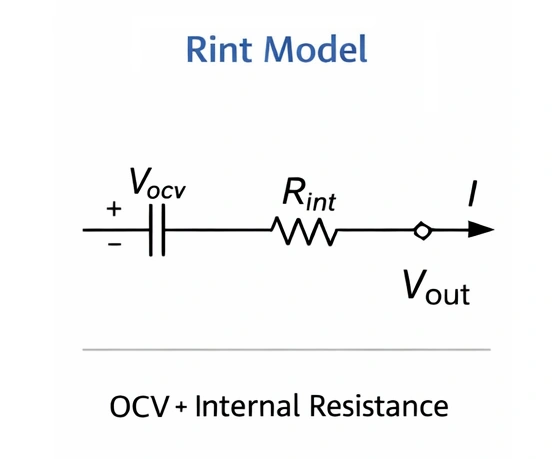

Seja em baterias de íons de lítio ou de chumbo-ácido, a manifestação mais evidente do envelhecimento é o clássico **«carrega rápido, mas descarrega num instante»**, acompanhado de forte aquecimento. Para compreender esses fenômenos, devemos examinar a **resistência interna** da célula e seu modelo de circuito equivalente.

## 1. Modelo de Circuito Equivalente de uma Bateria

Na física, uma bateria não é um componente ideal de armazenamento de energia. Seu circuito equivalente compõe-se de dois elementos fundamentais associados em série:

* **Força Eletromotriz Química ($$V_{ocv}$$)**: A tensão em circuito aberto observada nos terminais na ausência de corrente e carga.
* **Resistência Interna ($$R$$)**: O obstáculo físico imposto à passagem da corrente elétrica através das placas, do eletrólito e do separador.

---

O conceito de **«distribuição de potência»** permite visualizar prontamente por que baterias desgastadas absorvem pouca carga útil: a maior parte da energia da rede elétrica é dissipada como calor indesejado.

## 2. Fenômeno de Recarga com a Bateria Envelhecida: Por Que Aquece Tanto?

Ao conectar um carregador, a potência total fornecida ($$P_{total}$$) divide-se em duas parcelas:
$$P_{total} (V \times I) = P_{\text{térmica}} (\text{perdas por efeito Joule}) + P_{\text{carga}} (\text{potência química armazenada})$$

### 2.1 A Queda Abrupta na Eficiência Energética
Suponha uma fonte de 5V / 2A (potência total de 10W). Compare a conversão entre uma bateria nova e uma gasta:

| Estado da Bateria | Resistência Interna ($$R$$) | Potência Dissipada ($$I^2 R$$) | Potência Efetivamente Armazenada | Eficiência |
| :--- | :--- | :--- | :--- | :--- |
| **Bateria Nova** | $$0.1 \Omega$$ | $$2^2 \times 0.1 = \mathbf{0.4W}$$ | $$10 - 0.4 = \mathbf{9.6W}$$ | **96%** (Altíssima) |
| **Bateria Antiga** | $$1.5 \Omega$$ | $$2^2 \times 1.5 = \mathbf{6.0W}$$ | $$10 - 6.0 = \mathbf{4.0W}$$ | **40%** (Extremamente Baixa) |

**Reflexão técnica:** Na bateria degradada, mais da metade da potência injetada é engolida pela resistência interna $$R$$ e vira calor. Eis a razão pela qual uma bateria desgastada vira um «aquecedor de mão» ao carregar: menos de 40% da energia se converte em armazenamento químico.

### 2.2 Falsa Tensão Plena: O Engano do Voltímetro
O carregador monitora a **tensão nos terminais**:
$$V_{\text{medido}} = V_{ocv} + (I \times R)$$

* **A Ilusão da Bateria Gasta**: Com $$R$$ elevada, ao fluir uma corrente de 2A, a elevação parasitária $$(I \times R)$$ pode alcançar 2V ou mais.
* **O Resultado Prático**: Assim que conectada, o carregador detecta a tensão saltando de imediato para 4,2V (limite de corte). A eletrônica presume carga completa e acende a luz verde, embora o potencial químico interno real $$V_{ocv}$$ ainda esteja em nível criticamente baixo.

Isso explica com perfeição por que uma bateria idosa parece **«encher em minutos»**: trata-se de uma miragem provocada pela queda ôhmica interna.

## 3. Colapso de Tensão na Descarga: A Queda Repentina do Aparelho

Sob consumo do aparelho, a equação se inverte:
$$V_{\text{medido}} = V_{ocv} - (I \times R)$$

**Exemplo prático:**
Um smartphone se desliga por segurança se a tensão cair abaixo de 3,3V. Suponha que a bateria retenha 3,7V estáticos:

* **Bateria Nova ($$R=0.1\Omega$$)**: Ao abrir um jogo que exige 2A, a tensão de trabalho recua para $$3.7 - 0.2 = \mathbf{3.5V}$$ → **Funcionamento contínuo e estável**.
* **Bateria Gasta ($$R=0.5\Omega$$)**: Sob a mesma solicitação de 2A, a tensão despenca para $$3.7 - 1.0 = \mathbf{2.7V}$$ → **Cai abaixo do patamar de segurança e o celular apaga na hora**.

É por essa razão física que aparelhos desgastados com 20% de carga desligam subitamente ao acionar a câmera ou rodar um aplicativo pesado.

## Conclusão: O Envelhecimento é um Entupimento Físico Irreversível

Comparando a bateria a uma **caixa d'água**, a resistência interna funciona como o **entupimento do cano de escoamento**:
* **Ao abastecer**: A tubulação obstruída gera alta contrapressão no bocal, simulando caixa cheia sem que a água consiga entrar de verdade.
* **Ao demandar**: A água sai em filete fraco devido à constrição, sendo incapaz de suprir a vazão necessária.

Sendo essa elevação de impedância decorrente de transformações físicas irreversíveis dos materiais (cristalização das placas e decomposição do eletrólito), a substituição no momento adequado é o único caminho seguro para restabelecer a integridade operacional do sistema.

> **💡 Conceito Avançado: Você sabia que a resistência interna divide-se em «AC» e «DC»?**
>
> Em folhas técnicas, é frequente encontrar duas classificações de impedância:
> 
> * **Resistência Interna AC (ACIR):** Medida por aparelhos injetando corrente alternada de 1 kHz de baixa intensidade. Revela somente a resistência ôhmica pura dos contatos e do eletrólito, sem acionar as reações químicas. O valor medido é bastante baixo e atraente. Quase todos os testadores portáteis comuns medem ACIR.
> 
> * **Resistência Interna DC (DCIR):** Medida aplicando carga contínua e drenando corrente real de alta intensidade. Agrega a resistência ôhmica inicial à resistência de polarização química. Apresenta valores bem superiores e reflete o **comportamento autêntico** enfrentado pelo veículo ou celular.
> 
> *Nota: Os cálculos de queda de potencial e dissipação térmica abordados neste artigo têm como base a Resistência Interna DC (DCIR).*
